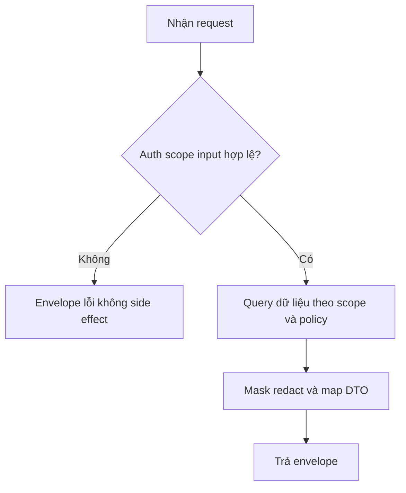
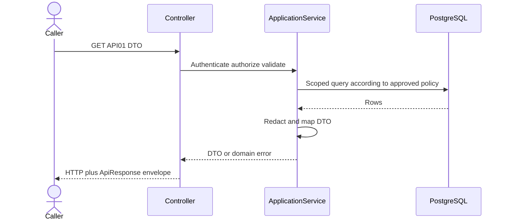
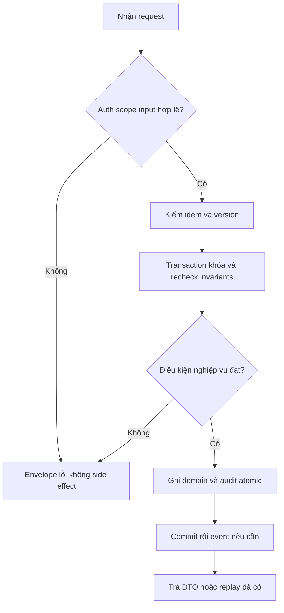
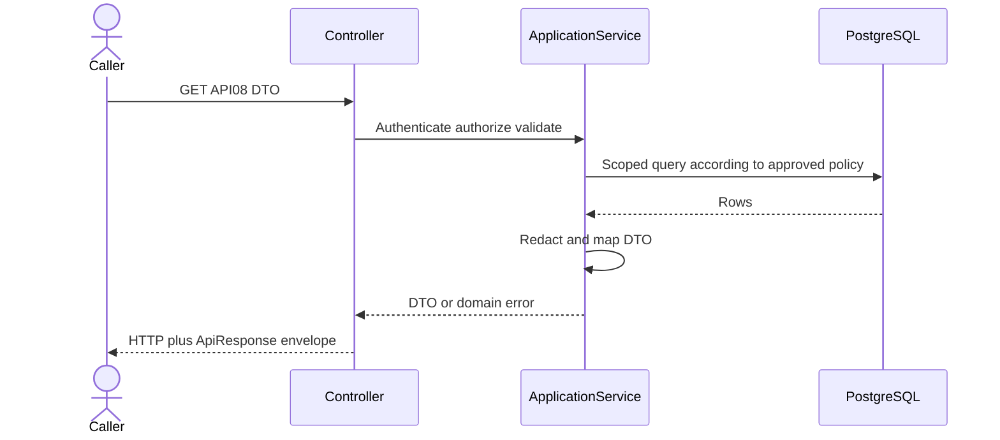

# TV2 Đặc tả vận hành tài chính và kế hoạch kiểm thử

Ngày: 06/10/2026. **Bản đề xuất review**, không phải xác nhận Mentor/Leader duyệt hoặc backend đã chạy. TV2 sở hữu BA/test; TV5–TV8 sở hữu implementation.

## Phạm vi và kết luận

Bộ này hoàn thiện phần có thể chuẩn bị ngay: quyền, flow, data fixture, oracle, test case, API draft, policy log, bug/regression và handoff. Không bịa PASS, không tự chốt policy null. Thực thi API/DB/VNPay/AI phải chờ bản tích hợp và fixture test được duyệt.

## Quy tắc xác định

- Active user + assignment [ActiveFrom,ActiveTo), RevokedAt null; không dùng claim role global cho mọi bãi.
- PendingPayment → Confirmed chỉ sau backend xác minh đủ tiền và recheck reservation trong transaction/locks. QR quyền vào chỉ được dùng khi Confirmed; raw access token tra cứu không phải QR vào bãi.
- QR signature/expiry/revoke/consume atomic; một xe chỉ một Active hoặc ExitPending session toàn hệ thống.
- Checkout tính FinalFee theo snapshot, bù trừ tiền đã nhận và refunds; không sửa snapshot cũ khi đổi giá. ExitPending vẫn chiếm slot, Completed/ExitedAt chỉ sau physical exit đã xác minh.
- Về sớm không hoàn unused time, overtime theo snapshot; cancellation trước đến là policy khác chưa chốt.
- Cash có Staff cùng bãi và audit; client không chỉ định người thu hoặc tự xác nhận tiền từ return URL.
- Append-only audit và realtime sau commit; AI/OCR không tự mở barrier/phạt/ghi session.

## Ma trận quyền

| ID | Chức năng | Guest | Customer | Staff | Manager | Admin | Nguồn | Ghi chú |
| --- | --- | --- | --- | --- | --- | --- | --- | --- |
| R01 | Xem danh mục bãi công khai | Cho phép | Cho phép | Cho phép public | Cho phép public | Cho phép | S04 | Không có PII. |
| R02 | Xem booking/session vận hành | Cấm | Chỉ tài nguyên của mình qua API Customer | Scope bãi | Scope bãi theo policy | Toàn hệ thống theo policy | S01/S04 P01 | Không gán quyền từ knowing ID. |
| R03 | Check-in QR/Staff | Cấm | Cấm gọi API Staff | Scope bãi | Chờ P01 | Chờ P01 | S01/S04 | Nhân viên phải active; policy missing -> deny. |
| R04 | Tính phí/checkout vận hành | Cấm | Xem giá của mình qua API riêng | Scope bãi | Chờ P01 | Chờ P01 | S01/S04 | Không nhận FinalFee từ client. |
| R05 | Cash confirmation | Cấm | Cấm | Scope bãi | Chờ P01 | Chờ P01 | S01/S03 | Actor server-side; FK actor không thay quyền. |
| R06 | Xác nhận xe rời | Cấm | Cấm | Scope bãi | Chờ P01 | Chờ P01 | S04 | Cần physical evidence; không chỉ payment success. |
| R07 | Sửa giá/publish plan | Cấm | Cấm | Cấm | Scope bãi | Toàn hệ thống | S04 | Version/effective period/audit; snapshot cũ bất biến. |
| R08 | Sửa cấu trúc/maintenance | Cấm | Cấm | Chờ policy giới hạn | Scope bãi | Toàn hệ thống | S04 P09 | Không ảnh hưởng silent Confirmed booking. |
| R09 | Quản lý assignments | Cấm | Cấm | Cấm | Scope + delegation; gán Manager chờ P02 | Toàn hệ thống | S01/S02 | Không sửa PlatformRole/Admin qua assignment DTO. |
| R10 | Grant Admin/platform roles | Cấm | Cấm | Cấm | Cấm | Admin theo contract bảo vệ | S01 | Không self-grant từ register/body; policy revoke-last-admin chưa chốt. |
| R11 | Đọc revenue reports | Cấm | Cấm | Chờ P12 | Scope bãi | Toàn hệ thống | S04 P13 | Các lot trong query phải đều được phép. |
| R12 | Đọc/export AuditLog | Cấm | Cấm | Chờ P12 | Chờ P12, nếu duyệt chỉ scope | Admin theo contract bảo vệ | S04 | Không mặc định Manager có toàn bộ audit/PII. |
| R13 | Sửa/xóa AuditLog | Cấm | Cấm | Cấm | Cấm | Cấm | S03/S04 | Append-only ở DB/ORM. |
| R14 | Refund/cancel override | Cấm | Luồng của mình theo policy | Chờ P07 | Chờ P07 | Chờ P07 | S01 P07 | Không tự cấp tiền hoàn chưa duyệt. |
| R15 | OCR ảnh private | Cấm | Ngoài MVP S05 | Scope bãi | Scope bãi | Theo S05 toàn hệ thống | S05 | Không tự check-in/open gate hoặc phạt. |
| R16 | Forecast/assistant public | Public | Public | Public | Public | Public | S05 | Aggregate/FAQ đã duyệt; không trả PII. |
Default deny cho capability chờ duyệt, không coi 403 trước policy approval là feature đã nghiệm thu. API protected xác thực trước; 403 theo scope trước lookup để tránh dò tài nguyên. 404 sau authorize; exact contract còn chờ BE review P14.

## Quy trình vận hành

### Check-in
1. Authenticate, validate principal active và assignment; derive lot từ booking + gate, đối chiếu body cùng bãi.
2. Verify payload signature, expiry/revoke, normalized plate và booking Confirmed, verified prepayment, arrival policy. Không infer ownership từ plate.
3. Begin transaction; advisory lock theo slot/vehicle/booking và lock row QR; re-read state/version/reservation/active sessions.
4. Consume QR, booking CheckedIn, tạo đúng một session vật lý + audit; rollback tất cả nếu lỗi.
5. Commit rồi phát realtime/authorized gate command; failure adapter cần operational retry idempotent, không giả barrier success.

### Checkout và exit
1. Authorize Staff đúng bãi, exit gate; lock/read session Active hoặc ExitPending.
2. Load snapshot committed, server time và ledger verified, tính quote/due; nếu required policy null báo POLICY_NOT_CONFIGURED.
3. Ghi ExitPending và FeeCalculatedThrough; giữ ExitedAt null, không giải phóng slot.
4. Thu remaining qua VNPay verified hoặc Pending Cash+Staff confirm; money effect dedupe/actor server-side.
5. Khi xe thật ở cổng/qua cổng theo event Staff verified, recheck due và P05 grace; nếu phát sinh nợ thì không exit thành công.
6. Transaction hoàn tất session, release current physical assignment và update booking theo transition contract; audit, commit, event. Không xóa reservation/payment history hoặc giải phóng reservation tương lai của khách khác.

### Giá payment và callback
- Giá riêng từng bãi + effective version, rule typed validation; cap/peak order cần khóa vào snapshot. Không sửa snapshot để phản ánh giá mới.
- Verify signature, reference, amount/currency và gateway status; DB unique khóa idempotency/provider event chống double effect. Signed callback có tiền nhưng hold expired phải ghi nhận capture/exception và xử lý P06; không mất tiền khỏi ledger hay tự chiếm slot khác.
- Gateway callback ACK/status/body phụ thuộc contract VNPay, không áp envelope REST vào provider ACK khi chưa có adapter spec. Không chế tạo chữ ký hoặc dùng secret thật trong bộ này.
- Manual override không bypass tài chính một cách ngầm; separate permission/reason/audit và exception path cần duyệt.

## Oracle tính tiền và dữ liệu đề xuất

{
  "label": "ĐỀ XUẤT TEST DEVELOPMENT, không phải seed đã chạy hay policy production",
  "lotA": "11111111-1111-4111-8111-111111111111",
  "lotB": "22222222-2222-4222-8222-222222222222",
  "lotC": "33333333-3333-4333-8333-333333333333",
  "slotA": "aaaaaaaa-aaaa-4aaa-8aaa-aaaaaaaaaaaa",
  "slotB": "bbbbbbbb-bbbb-4bbb-8bbb-bbbbbbbbbbbb",
  "bookingA": "44444444-4444-4444-8444-444444444444",
  "sessionA": "55555555-5555-4555-8555-555555555555",
  "paymentA": "66666666-6666-4666-8666-666666666666",
  "gateA": "77777777-7777-4777-8777-777777777777",
  "exitGateA": "78787878-7878-4878-8878-787878787878",
  "userStaff": "88888888-8888-4888-8888-888888888888",
  "planA": "99999999-9999-4999-8999-999999999999",
  "clock": "2026-10-08T02:00:00Z",
  "timezone": "Asia/Ho_Chi_Minh",
  "pricing": {
    "currency": "VND",
    "blockMinutes": 15,
    "ratePerBlock": 7500,
    "dailyCap": 120000,
    "peakMultiplier": 1,
    "bookingMinutes": 120,
    "quoted": 60000,
    "netPrepaid": 60000
  },
  "identities": [
    "U_ADMIN Active",
    "U_CUSTOMER_A Active own vehicle",
    "U_STAFF_A Active assignment lotA [T0-1d,T0+1d)",
    "U_STAFF_B lotB",
    "U_MANAGER_A lotA delegated false",
    "U_MANAGER_A_DELEGATED lotA delegated true",
    "U_EXPIRED_A ActiveTo=T0",
    "U_REVOKED_A RevokedAt=T0",
    "U_LOCKED_A assignment valid but User not Active",
    "GUEST no user"
  ]
}

Các con số sau **là fixture đề xuất Development**, không là biểu giá thật/policy đã duyệt. Rate7500/block15, cap120000, peak1, cùng một ngày local; blocks=ceil(minutes/15). Estimate=min(blocks*rate,cap). Booking quote120m=60000; FinalFee=max(quote,computed_actual) cho fixture không hoàn unused. NetPaid=successful captures-refunds đã verified, không cộng ledger events trùng; Due=max(0,FinalFee-NetPaid); nếu NetPaid>FinalFee phải báo excess/reconciliation, không tự refund chưa duyệt. Phí0, nhiều ngày/peak/zone cần oracle riêng sau P10.

| ID | Phút | Final hoặc quote expected | NetPaid | Due | Diễn giải |
| --- | --- | --- | --- | --- | --- |
| F01 | 15 | 7500 | 0 | 7500 | Estimate, 1 block |
| F02 | 16 | 15000 | 0 | 15000 | Estimate, ceil block; proposal P10 |
| F03 | 60 | 30000 | 0 | 30000 | Estimate, 4 blocks |
| F04 | 120 | 60000 | 0 | 60000 | Booking quote, 8 blocks |
| F05 | 240 | 120000 | 0 | 120000 | 16 blocks đạt cap |
| F06 | 300 | 120000 | 0 | 120000 | 20 blocks 150000 bị cap 120000; cùng một ngày local |
| F07 | 60 | 60000 | 60000 | 0 | FinalFee floor quote vì về sớm; không hoàn unused |
| F08 | 120 | 60000 | 60000 | 0 | Đúng giờ, không thu lần nữa |
| F09 | 150 | 75000 | 60000 | 15000 | 10 blocks theo snapshot, thu chênh lệch |
| F10 | 150 | 75000 | 75000 | 0 | Đã trả top-up 15000, retry không thu thêm |
## Policy và gap cần duyệt

| ID | Policy | Tình trạng | Quy tắc khi chưa duyệt | Owner | Hạn đề xuất | Test |
| --- | --- | --- | --- | --- | --- | --- |
| P01 | Manager bao hàm Staff và quyền Admin tại gate | Mở | Không tự cho Manager/Admin xác nhận Cash hoặc check-in; default deny khi chưa có policy. | TV8/TV5/TV2 | D2 08/10 | AUTH-02 GATE-01 PAY-06 |
| P02 | Manager gán Manager/ủy quyền delegation | Mở | CanManageStaffAssignments chỉ cho Manager được ủy quyền; phạm vi gán Manager phải duyệt. | TV8/TV5/TV2 | D2 08/10 | AUTH-07 |
| P03 | Early/Late arrival và no-show | Mở | EarlyArrivalMinutes/LateArrivalMinutes null = chưa cấu hình; không dùng ví dụ baseline làm policy đã chốt. | TV8/TV6/TV2 | D2 08/10 | GATE-06 GATE-07 |
| P04 | QR expiry/revoke/rotate | Mở | QrLifetimeMinutes null; một lần, signed token; expiry boundary đề xuất now>=ExpiresAt từ chối. | TV6/TV8/TV2 | Trước QR | GATE-03 GATE-04 |
| P05 | Exit grace và phí phát sinh sau trả tiền | Mở | ExitGraceMinutes null; re-evaluate FeeCalculatedThrough trước exit theo policy, không miễn phí ngầm. | TV6/TV7/TV8 | Trước exit | EXIT-03 EXIT-04 |
| P06 | Callback muộn khi hold expired | Mở | Không Confirmed/mở cổng nếu reservation đã mất. Phải chốt đối soát/refund/manual resolution. | TV6/TV7/TV8 | Trước payment | PAY-05 |
| P07 | Hủy trước đến và hoàn tiền | Mở | Cutoff/Percent null; không suy ra miễn phí hoặc hoàn toàn bộ. | TV7/TV8/TV1/TV2 | Trước cancel/refund | PAY-10 |
| P08 | Walk-in thanh toán trước hay khi ra | Mở | Không áp prepayment của booking cho walk-in khi chưa chốt. | TV6/TV7/TV8 | Trước walk-in | GATE-10 |
| P09 | Overstay gặp booking tiếp theo | Mở | Không giải phóng slot vật lý hay hủy silent; Staff reallocate cùng bãi và audit, thuật toán chờ duyệt. | TV6/TV8/TV2 | Trước overtime | EXIT-07 |
| P10 | Định nghĩa biên block/cap/peak | Mở một phần | 15 phút là default; order peak/cap, timezone ngày và rounding phải ghi trong snapshot; fixture oracle là đề xuất test. | TV7/TV8/TV2 | D2 08/10 | PRICE-02 PRICE-05 |
| P11 | Assignment chồng nhau và revoke ngay | Mở một phần | Model định nghĩa hiệu lực; overlap policy và JWT revocation/caching SLA cần chốt. Không tin assignment cũ trong token. | TV5/TV8/TV2 | D2 08/10 | AUTH-04 AUTH-08 |
| P12 | Audit đọc/export và PII masking | Mở một phần | Không public; Manager report theo bãi, quyền Staff đọc audit/export mặc định deny đến khi duyệt. | TV5/TV8/TV2 | Trước audit/report | AUDIT-03 |
| P13 | Revenue và refunds định nghĩa | Mở | Tách gross receipts, refunds và net; chọn PaidAt/VerifiedAt/report timezone. Không cộng Payment với Transactions trùng. | TV7/TV8/TV2 | Trước reporting | AUDIT-05 |
| P14 | Error contract và existence masking | Đề xuất | 401 unauth; 403 scope trước lookup; 404 sau scope; 409 state/version/policy missing; verify với BE. | TV5–TV8/TV2 | D2 08/10 | AUTH-01 AUTH-03 |
| P15 | Hold và booking duration | Default model | 15m, min30/max1440; policy seed explicit trước test, không dùng prototype 5m. | TV6/TV8 | D2 08/10 | STRUCT-07 |
| P16 | Prepayment early exit overtime | Đã chốt S01 | Booking trả trước đủ; về sớm không hoàn phần chưa dùng; quá giờ tính theo snapshot và bù trừ. | TV6/TV7 | D2 xác nhận contract | PRICE-06 PRICE-07 |
| P17 | AI provider/retention/threshold | Design đề xuất | Theo S05: private ảnh, review bắt buộc, nguồn forecast/FAQ; TTL/provider chưa xác nhận triển khai. | TV8/TV6/TV7/TV2 | Trước AI | AI-01 AI-05 |
| P18 | Schema và nhánh đích | Mở | V4 47 bảng snake_case khác EF 28 bảng; main/duc/dev khác tree. TV8 chốt trước test integration. | TV8/TV5–TV7 | D1 07/10 | STRUCT-01 |
| Gap | Hiện trạng | Rule đối chiếu | Khuyến nghị | Owner | Status |
| --- | --- | --- | --- | --- | --- |
| G01 | API mẫu tạo booking trả QR ngay PendingPayment | Model S01 yêu cầu trả trước đầy đủ trước Confirmed và quyền check-in. | Đề xuất chỉ cấp QR dùng được sau Confirmed; phân biệt access token tra cứu và QR entry. | TV6/TV7/TV8 | Chờ duyệt |
| G02 | Check-in mẫu dùng gateCode/qrSignature, sessionId không UUID | Model dùng Guid + QR nonce/signature; sample không là runtime contract. | Chuẩn hóa gateId/qrPayload DTO, exact route/version/error với BE trước FE/test. | TV6/TV8 | Chờ duyệt |
| G03 | Prototype hold5m/90%/fixed floors/unique active | Baseline/model hold15m, multi-lot, windows và physical state. | Không dùng prototype làm oracle V4; migrate schema/logic có tests. | TV6/TV8 | Open |
| G04 | V4 47-table snake_case vs EF 28-table PascalCase | Không cùng schema/migration đã chạy. | Mapping matrix + chosen schema test; không chạy SQL lẫn. | TV5–TV8 | Open |
| G05 | Main/duc/dev có tree khác nhau | Dev mới có dist/node_modules, chưa source/BE như main. | Chốt buildable integration tree; không coi branch có asset build là API readiness. | TV8 | Open |
| G06 | Manager/Admin quyền Cash/gate chưa contract | Staff được assigned là rule chắc chắn; Manager bao hàm Staff mới đề xuất. | Default deny từng capability mở; chốt P01 trước thực thi. | TV5/TV8/TV2 | Open |
## Thiết kế API dự kiến

Các route/DTO dưới đây là proposal TV2 để BE review, **không phải API đang tồn tại**. Chỉ check-in/out có mẫu trong docs/05-API.md; các field được chuẩn hóa đề xuất ở đây chưa được phê duyệt. Không ghi đè API mẫu/đổi backend trong lần bàn giao này. Read GET không mutate; write requires `Idempotency-Key` header <=128, server scoped theo actor/resource/action và hash request; same key+same payload replay same logical result, different payload409. Key uniqueness schema Payment hiện global, adapter cần prefix/derive internal key để không collision cross-action. Version checks server; audit safe; HTTP và statusCode phải khớp.

### API01 Danh sách assignment của bãi

**Overview:** Authorize read assignments then query scoped active/history rows.

**Specification:** GET `/api/v1/parking-lots/{lotId}/staff-assignments`. Permission: Admin hoặc Manager của bãi có delegation. Quyền đọc danh sách riêng còn cần TV5/TV8 duyệt; Staff không tự có quyền xem danh sách nhân sự.

**Request sample:**

```json
{
  "query": "page=1&pageSize=20"
}
```

| Field | Kiểu và validation | Required |
| --- | --- | --- |
| lotId | UUID bãi | Có |
| page | int >=1 | Có |
| pageSize | int 1..100 | Có |

**Response sample (200):**

```json
{
  "result": {
    "items": [],
    "page": 1,
    "pageSize": 20,
    "total": 0
  },
  "isSuccess": true,
  "statusCode": 200,
  "message": "Sample theo contract đề xuất"
}
```

**Validation & errors:** 400 query sai; 401 token thiếu/sai; 403 permission/scope; 404 sau authorize. Không trả token/password/phone không cần thiết. Chung: 429 rate limit, 503 dependency, envelope ProblemDetails; error example bên dưới.





### API02 Tạo assignment Staff

**Overview:** Validate delegation role and period then insert assignment plus audit.

**Specification:** POST `/api/v1/parking-lots/{lotId}/staff-assignments`. Permission: Admin hoặc Manager delegated của chính bãi. MVP DTO đề xuất chỉ role Staff; gán Manager/ủy quyền giữ P02 chưa duyệt.

**Request sample:**

```json
{
  "userId": "88888888-8888-4888-8888-888888888888",
  "role": "Staff",
  "activeFrom": "2026-10-08T00:00:00Z",
  "activeTo": "2026-11-08T00:00:00Z",
  "reason": "Phân công ca vận hành thử nghiệm"
}
```

| Field | Kiểu và validation | Required |
| --- | --- | --- |
| userId | UUID user Active | Có |
| role | Staff duy nhất trong draft này | Có |
| activeFrom | ISO8601 UTC | Có |
| activeTo | UTC > from hoặc null | Không |
| reason | nonblank <=1000 | Có |

**Response sample (201):**

```json
{
  "result": {
    "assignmentId": "10101010-1010-4010-8010-101010101010",
    "parkingLotId": "11111111-1111-4111-8111-111111111111",
    "role": "Staff"
  },
  "isSuccess": true,
  "statusCode": 201,
  "message": "Sample theo contract đề xuất"
}
```

**Validation & errors:** 400 invalid role/period/reason; 403 scope/delegation; 409 overlapping assignment theo P11 khi duyệt. AssignedBy lấy từ principal, không nhận Admin/CanManageStaffAssignments trong body. Chung: 429 rate limit, 503 dependency, envelope ProblemDetails; error example bên dưới.



```mermaid
sequenceDiagram
    actor Caller
    participant API as Controller
    participant S as ApplicationService
    participant DB as PostgreSQL
    Caller->>API: POST API02 DTO
    API->>S: Authenticate authorize validate
    S->>DB: Begin Tx and acquire locks appropriate to action
    S->>DB: Recheck state version scope and idempotency
    S->>DB: Persist operation and AuditLog atomically
    S->>DB: Commit; rollback on failed invariant
    S->>S: Publish committed result if needed
    S-->>API: DTO or domain error
    API-->>Caller: HTTP plus ApiResponse envelope
```

### API03 Check-in booking

**Overview:** Verify signature expiry amount arrival then lock slot vehicle booking consume QR insert session and audit atomically.

**Specification:** POST `/api/v1/check-in`. Permission: Staff assigned active; Manager/Admin chờ P01. Không cho Guest gọi Staff action.

**Request sample:**

```json
{
  "parkingLotId": "11111111-1111-4111-8111-111111111111",
  "gateId": "77777777-7777-4777-8777-777777777777",
  "bookingId": "44444444-4444-4444-8444-444444444444",
  "normalizedPlate": "30ATEST01",
  "qrPayload": "REPLACE_WITH_SIGNED_TEST_QR",
  "expectedBookingVersion": 1
}
```

| Field | Kiểu và validation | Required |
| --- | --- | --- |
| parkingLotId/gateId/bookingId | UUID cùng bãi, entry gate | Có |
| normalizedPlate | normalized string match booking/vehicle | Có |
| qrPayload | signed opaque payload, không nonce hash | Có |
| expectedBookingVersion | positive integer | Có |

**Response sample (200):**

```json
{
  "result": {
    "sessionId": "55555555-5555-4555-8555-555555555555",
    "status": "Active",
    "bookingStatus": "CheckedIn",
    "slotId": "aaaaaaaa-aaaa-4aaa-8aaa-aaaaaaaaaaaa",
    "enteredAt": "2026-10-08T02:00:00Z"
  },
  "isSuccess": true,
  "statusCode": 200,
  "message": "Sample theo contract đề xuất"
}
```

**Validation & errors:** 400 payload; 401/403 quyền; 404 authorized ID absent; 409 wrong state/vehicle/QR replay/stale/unpaid/policy missing. Không giữ DB lock khi gọi AI. Barrier command chỉ sau commit qua adapter. Chung: 429 rate limit, 503 dependency, envelope ProblemDetails; error example bên dưới.


```mermaid
sequenceDiagram
    actor Caller
    participant API as Controller
    participant S as ApplicationService
    participant DB as PostgreSQL
    Caller->>API: POST API03 DTO
    API->>S: Authenticate authorize validate
    S->>DB: Begin Tx and acquire locks appropriate to action
    S->>DB: Recheck state version scope and idempotency
    S->>DB: Persist operation and AuditLog atomically
    S->>DB: Commit; rollback on failed invariant
    S->>S: Publish committed result if needed
    S-->>API: DTO or domain error
    API-->>Caller: HTTP plus ApiResponse envelope
```

### API04 Yêu cầu checkout và tính phí

**Overview:** Lock session read immutable snapshot and verified receipts calculate quote set ExitPending and audit without physical release.

**Specification:** POST `/api/v1/check-out`. Permission: Staff assigned; Manager/Admin chờ P01.

**Request sample:**

```json
{
  "parkingLotId": "11111111-1111-4111-8111-111111111111",
  "sessionId": "55555555-5555-4555-8555-555555555555",
  "exitGateId": "78787878-7878-4878-8878-787878787878",
  "expectedSessionVersion": 1
}
```

| Field | Kiểu và validation | Required |
| --- | --- | --- |
| parkingLotId/sessionId/exitGateId | UUID cùng bãi, gate exit | Có |
| expectedSessionVersion | positive integer | Có |

**Response sample (200):**

```json
{
  "result": {
    "sessionId": "55555555-5555-4555-8555-555555555555",
    "status": "ExitPending",
    "finalFee": 75000,
    "netPaid": 60000,
    "remainingDue": 15000,
    "currency": "VND",
    "feeCalculatedThrough": "2026-10-08T04:30:00Z",
    "exitedAt": null
  },
  "isSuccess": true,
  "statusCode": 200,
  "message": "Sample theo contract đề xuất"
}
```

**Validation & errors:** 400 invalid; 403 scope; 409 state/version/missing P05/P10; 503 dependencies. FinalFee/paid/clock tính server; không tin client price/time. Dữ liệu mẫu minh họa, phải thay fixture đã seed thật. Chung: 429 rate limit, 503 dependency, envelope ProblemDetails; error example bên dưới.


```mermaid
sequenceDiagram
    actor Caller
    participant API as Controller
    participant S as ApplicationService
    participant DB as PostgreSQL
    Caller->>API: POST API04 DTO
    API->>S: Authenticate authorize validate
    S->>DB: Begin Tx and acquire locks appropriate to action
    S->>DB: Recheck state version scope and idempotency
    S->>DB: Persist operation and AuditLog atomically
    S->>DB: Commit; rollback on failed invariant
    S->>S: Publish committed result if needed
    S-->>API: DTO or domain error
    API-->>Caller: HTTP plus ApiResponse envelope
```

### API05 Xác nhận Cash payment

**Overview:** Resolve payment owner lot authorize staff lock payment verify due and currency save Success server actor ledger audit.

**Specification:** POST `/api/v1/payments/{paymentId}/cash-confirmation`. Permission: Staff active assignment của bãi suy ra từ payment owner. Manager/Admin chờ P01.

**Request sample:**

```json
{
  "expectedVersion": 1,
  "reason": "Đã nhận tiền mặt tại quầy"
}
```

| Field | Kiểu và validation | Required |
| --- | --- | --- |
| paymentId | UUID Pending Cash có đúng một owner | Có |
| expectedVersion | positive integer | Có |
| reason | nonblank <=1000 | Có |

**Response sample (200):**

```json
{
  "result": {
    "paymentId": "66666666-6666-4666-8666-666666666666",
    "status": "Success",
    "amount": 15000,
    "currency": "VND",
    "cashConfirmedByUserId": "88888888-8888-4888-8888-888888888888"
  },
  "isSuccess": true,
  "statusCode": 200,
  "message": "Sample theo contract đề xuất"
}
```

**Validation & errors:** 409 replay payload mismatch/stale/not Cash/already settled; 403 cross-lot; 400 reason. Amount từ Payment đã tạo hợp lệ, không gửi amount/actorId. Cần API tạo Pending Cash từ TV7, ngoài 8 contract này. Chung: 429 rate limit, 503 dependency, envelope ProblemDetails; error example bên dưới.


```mermaid
sequenceDiagram
    actor Caller
    participant API as Controller
    participant S as ApplicationService
    participant DB as PostgreSQL
    Caller->>API: POST API05 DTO
    API->>S: Authenticate authorize validate
    S->>DB: Begin Tx and acquire locks appropriate to action
    S->>DB: Recheck state version scope and idempotency
    S->>DB: Persist operation and AuditLog atomically
    S->>DB: Commit; rollback on failed invariant
    S->>S: Publish committed result if needed
    S-->>API: DTO or domain error
    API-->>Caller: HTTP plus ApiResponse envelope
```

### API06 Xác nhận xe thực tế rời

**Overview:** Lock resources verify physical confirmation and recheck due grace then complete release current slot audit after commit notify.

**Specification:** POST `/api/v1/sessions/{sessionId}/confirm-exit`. Permission: Staff active đúng bãi, evidence đã xác minh. Adapter camera/barrier có machine auth contract riêng chưa thiết kế ở đây.

**Request sample:**

```json
{
  "parkingLotId": "11111111-1111-4111-8111-111111111111",
  "exitGateId": "78787878-7878-4878-8878-787878787878",
  "expectedVersion": 2,
  "evidenceType": "StaffConfirmed",
  "reason": "Nhân viên xác nhận xe đã qua cổng ra"
}
```

| Field | Kiểu và validation | Required |
| --- | --- | --- |
| sessionId/parkingLotId/exitGateId | UUID cùng bãi, gate exit | Có |
| expectedVersion | positive integer | Có |
| evidenceType | StaffConfirmed trong draft | Có |
| reason | nonblank <=1000 | Có |

**Response sample (200):**

```json
{
  "result": {
    "sessionId": "55555555-5555-4555-8555-555555555555",
    "status": "Completed",
    "exitedAt": "2026-10-08T04:31:00Z",
    "remainingDue": 0
  },
  "isSuccess": true,
  "statusCode": 200,
  "message": "Sample theo contract đề xuất"
}
```

**Validation & errors:** 409 unpaid/grace stale/state/evidence invalid; 403 scope; không cho body ExitedAt do client quyết định. Replay same idem trả logical result; no silent override debt. Chung: 429 rate limit, 503 dependency, envelope ProblemDetails; error example bên dưới.


```mermaid
sequenceDiagram
    actor Caller
    participant API as Controller
    participant S as ApplicationService
    participant DB as PostgreSQL
    Caller->>API: POST API06 DTO
    API->>S: Authenticate authorize validate
    S->>DB: Begin Tx and acquire locks appropriate to action
    S->>DB: Recheck state version scope and idempotency
    S->>DB: Persist operation and AuditLog atomically
    S->>DB: Commit; rollback on failed invariant
    S->>S: Publish committed result if needed
    S-->>API: DTO or domain error
    API-->>Caller: HTTP plus ApiResponse envelope
```

### API07 Báo cáo thu tiền theo bãi

**Overview:** Authorize lot and range aggregate verified receipts once minus refunds with agreed timezone timestamp policy.

**Specification:** GET `/api/v1/parking-lots/{lotId}/reports/payments`. Permission: Manager assigned đúng bãi hoặc Admin; Staff đọc báo cáo chờ P12.

**Request sample:**

```json
{
  "query": "from=2026-10-08T00:00:00Z&to=2026-10-09T00:00:00Z&currency=VND"
}
```

| Field | Kiểu và validation | Required |
| --- | --- | --- |
| lotId | UUID scope | Có |
| from/to | UTC [from,to), from<to; tối đa range chờ contract | Có |
| currency | VND | Có |

**Response sample (200):**

```json
{
  "result": {
    "parkingLotId": "11111111-1111-4111-8111-111111111111",
    "currency": "VND",
    "grossReceipts": 100000,
    "refunds": 10000,
    "netReceipts": 90000
  },
  "isSuccess": true,
  "statusCode": 200,
  "message": "Sample theo contract đề xuất"
}
```

**Validation & errors:** 400 invalid range/currency; 403 any unauthorized filter/export; 409 POLICY_NOT_CONFIGURED P13. Sample amounts là fixture, không dữ liệu thật. Chung: 429 rate limit, 503 dependency, envelope ProblemDetails; error example bên dưới.


### API08 Đọc audit có phân trang

**Overview:** Authorize audit capability scope lot paginate redact before DTO no mutation.

**Specification:** GET `/api/v1/parking-lots/{lotId}/audit-logs`. Permission: Admin theo protected contract; Manager/Staff chờ P12, nếu được duyệt phải scope bãi.

**Request sample:**

```json
{
  "query": "page=1&pageSize=20"
}
```

| Field | Kiểu và validation | Required |
| --- | --- | --- |
| lotId | UUID scope | Có |
| page/pageSize | 1.. / 1..100 | Có |

**Response sample (200):**

```json
{
  "result": {
    "items": [],
    "page": 1,
    "pageSize": 20,
    "total": 0
  },
  "isSuccess": true,
  "statusCode": 200,
  "message": "Sample theo contract đề xuất"
}
```

**Validation & errors:** 400 paging; 403 denied; không endpoint UPDATE/DELETE. Old/NewValue chỉ whitelist, không raw secrets/PII. Empty sample không chứng minh audit đã có. Chung: 429 rate limit, 503 dependency, envelope ProblemDetails; error example bên dưới.




Error sample proposal409:
```json
{"result":{"type":"about:blank","title":"POLICY_NOT_CONFIGURED","status":409,"detail":"Policy cho luồng này chưa được cấu hình hoặc duyệt."},"isSuccess":false,"statusCode":409,"message":"Chưa đủ điều kiện nghiệp vụ."}
```

## Test plan và bằng chứng

Workbook có 64 cases chia AUTH/STRUCT/GATE/PRICE/PAY/EXIT/AUDIT/AI. Test procedure: xác nhận build/schema/clock/identity/fixture và policy readiness; reset per case; một ca nhiều biến thể phải lưu evidence từng biến thể và chỉ PASS khi tất cả đạt; collection Runner tuần tự không chứng minh concurrency. Concurrent QR/callback/booking cần barrier start/parallel harness do BE cung cấp, đọc DB asserts sau commit. Not run/Blocked không tính Pass. Case đụng P policy chưa duyệt -> Blocked policy; API chưa có -> Blocked API lúc chạy, không chỉ dùng404 kết luận bug. Cột status hiện Not run vì chưa thực thi.

### Evidence checklist
- Ghi environment, branch/commit, schema migration, endpoint contract revision, server timestamp/clock, role/scope và policy revision.
- Request/response sanitized, request/correlationId, screenshot UI, DB rows before/after bằng read-only query dev, ledger/audit/event counts; không copy JWT, QR nonce, API secret, full personal data.
- Chuẩn bị sandbox ký từ TV7; server/VNPay timeout, failure và retry có fixture/harness, không gọi callback bằng chữ ký bịa.
- Reset dữ liệu riêng database test; không xóa shared/prod database hay AuditLog. Lỗi DB test dùng transaction rollback/isolated DB do owner chuẩn bị.

### Bug template
ID BUG-TV2-001; summary; severity theo ảnh hưởng; priority riêng; requirement/test ID; build/env; role/lot; preconditions; steps; expected; actual; sanitized evidence/correlationId; owner; status Open→Assigned→Fixed→Retest→Closed hoặc Reopened; fix commit và retest run. Reproduce tối thiểu, không tự ghi nguyên nhân chưa điều tra.

### Regression và UAT
Chạy smoke auth/scope/lot/quote trước; P0 cross-lot/concurrency/payment/physical exit/audit không có lỗi chặn; P1 rules; AI checks nếu runtime sẵn. UAT01 tạo bãi/giá đúng scope; UAT02 Customer trả trước→QR→Staff check-in; UAT03 overtime topup→physical exit; UAT04 wrong-lot/replay/retry; UAT05 AI hỗ trợ không vượt quyền. Case chưa có API/policy ghi blocked và người xử lý; không ký nghiệm thu toàn luồng khi còn blocker.

### Handoff
TV2 review với TV5 quyền/assignment, TV6 QR/gate, TV7 money/callback/report, TV4 UI và TV8 integration/policy. D1/D2 chốt policy/contract; D4/D5 chạy phần thật có; D9/D10 regression/retest. Chưa gửi/push lên GitLab trong tác vụ này. GitHub/GitLab workflow và Design/Implementation vẫn theo AGENTS.md.

## Nguồn và mức xác minh

| ID | Nguồn | Path | Revision | Ý nghĩa |
| --- | --- | --- | --- | --- |
| S01 | Models README | backend_parking_system/database-work/ParkingSystem/Models/README.md | main 2ac3f62 | Trả trước đủ; early exit không hoàn phần chưa dùng; OTP/assignment và policy nullable. |
| S02 | Policy và Assignment | Models/Parking/ParkingPolicy.cs; Models/Identity/FacilityStaffAssignment.cs | main 2ac3f62 | Hold 15; min30/max1440 mặc định; scope [from,to), RevokedAt; delegation riêng. |
| S03 | Booking Session QR và Finance | Models/Bookings; Models/Payments; Data/ParkingDbContext.Bookings.cs; Data/ParkingDbContext.Finance.cs | main 2ac3f62 | Enums, active session, Version, XOR payment owner, unique provider/idempotency, Cash actor. |
| S04 | Baseline và API mẫu | docs/02-BUSINESS-RULES.md; docs/05-API.md; docs/APIDesignTemplate.md | main 2ac3f62 | Multi-lot, envelope, advisory locks, physical exit. API mẫu có chỗ cần sửa theo S01. |
| S05 | AI Design | update103/11-AI-EXTENSION.md; Parking_Database_V4.dbml | features/Design_AIExtension fa872f0 | OCR review, không phạt tự động; forecast aggregate; assistant chỉ public. |
| S06 | Frontend | frontend_parking_system/README.md và src | duc df0a5a5 | UI có; README ghi auth backend chưa có. |
| S07 | Nhánh tích hợp | git tree dev | dev 30c402f, 06/10/2026 | Commit mới chủ yếu dist/node_modules; không thấy src/services/api.ts hay frontend README. |
| S08 | Phân công nhóm | PHAN_CONG_TASK_NHOM_8_NGUOI.md người dùng cung cấp | 02/10/2026 | TV2 sở hữu BA/test vận hành và tài chính; BE owner code/contracts. |
Fetch 06/10/2026; source main/duc/AI/dev khác nhau. Chưa chạy backend, DB, sandbox, CI hay test suite mới. Policy default/đã chốt có nguồn, proposal và open được phân biệt. Bộ này chuẩn bị đầy đủ BA/test trong scope; phần thiếu evidence cần execution phía nhóm.
