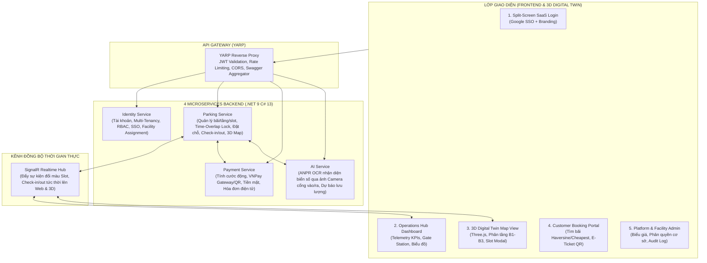
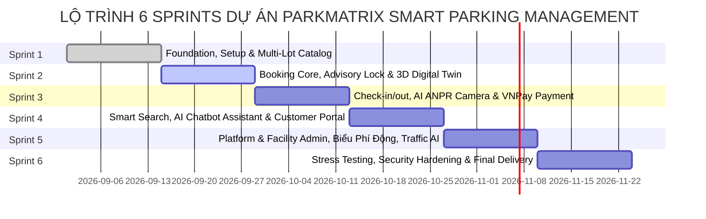

# HỆ THỐNG QUẢN LÝ BÃI ĐỖ XE THÔNG MINH PARKMATRIX
# BẢNG TỔNG HỢP TOÀN DIỆN TÍNH NĂNG VÀ PHÂN CHIA NHIỆM VỤ DỰ ÁN
> **Phiên bản:** Baseline V4 — Multi-Parking Platform (Enterprise Architecture - Pure Software & AI Vision, No IoT Hardware)  
> **Tài liệu tham chiếu:** [Baseline V4](file:///d:/FSOFT_FALL26_NET/Project.CleanArchitecture/ParkingSystemAI/docs/Parking_OJT_FA26_Baseline_V4_Multi_Parking.md), [APIDesignTemplate](file:///d:/FSOFT_FALL26_NET/Project.CleanArchitecture/ParkingSystemAI/docs/APIDesignTemplate.md), [GitlabGuide](file:///d:/FSOFT_FALL26_NET/Project.CleanArchitecture/ParkingSystemAI/docs/GitlabGuide.md) & [Google Stitch Prototype](https://stitch.withgoogle.com/projects/17901168502255720053).

---

## I. TỔNG QUAN KIẾN TRÚC & PHÂN TÁCH TRÁCH NHIỆM (SYSTEM LANDSCAPE)

Hệ thống được thiết kế theo kiến trúc **Microservices chuẩn Clean Architecture & Domain-Driven Design (DDD)**, phục vụ mô hình vận hành đa bãi đỗ (`Multi-Parking Lot First`), hoạt động hoàn toàn dựa trên **phần mềm, Web UI, Camera ANPR và sự kiện thời gian thực (Không phụ thuộc vào phần cứng IoT/cảm biến vật lý)**.



---

## II. DANH MỤC TÍNH NĂNG CHI TIẾT THEO 4 MICROSERVICES

### 1. IDENTITY SERVICE (Xác thực, Phân quyền & Quản lý Tổ chức)
*Đảm bảo an toàn thông tin theo tiêu chuẩn ISO 27001 và phân quyền phạm vi cơ sở (Facility-Scoped RBAC).*

- **ID-01: Xác thực Đa phương thức (Multi-Method Auth):**
  - Đăng nhập cục bộ (Email/Mật khẩu) sử dụng Argon2id / BCrypt hash.
  - Tích hợp Đăng nhập một lần **Google SSO OAuth2**.
  - Cấp phát cặp JWT Token: `AccessToken` (hạn 15 phút) và `RefreshToken` (xoay vòng an toàn - Sliding Window).
  - Quên mật khẩu, đổi mật khẩu và xác thực 2 bước (2FA OTP qua Email).
- **ID-02: Phân quyền theo Phạm vi Cơ sở (Facility-Scoped RBAC):**
  - `PLATFORM_ADMIN`: Toàn quyền hệ thống, khởi tạo bãi đỗ mới, xem báo cáo tổng hợp liên cơ sở.
  - `PARKING_MANAGER`: Quản lý vận hành bãi đỗ được phân công (`FacilityStaffAssignment`), cấu hình biểu giá, quản lý tài sản bãi, duyệt nhân sự.
  - `PARKING_STAFF`: Nhân viên trực cổng/trực bãi tại cơ sở chỉ định, vận hành trạm kiểm soát vào/ra, xác nhận tiền mặt, xử lý sự cố.
  - `CUSTOMER / VIP_MEMBER`: Tài xế tìm kiếm bãi, đặt chỗ trước, quản lý danh sách biển số xe, xem lịch sử giao dịch.
- **ID-03: Quản lý Hồ sơ & Phương tiện Người dùng:**
  - Quản lý danh mục phương tiện cá nhân (Biển số xe, Loại xe: Ô tô 4-7 chỗ, Xe điện EV, Xe máy).
  - Phân hạng thành viên: Tiêu chuẩn, Bạc, Vàng (`Gold Star Member` - hưởng ưu đãi chiết khấu biểu giá).
- **ID-04: Phân công & Lịch trực Nhân viên (`FacilityStaffAssignment`):**
  - CRUD phân công Staff/Manager vào từng cơ sở (`ParkingLotId`).
  - Giao ca, chốt ca trực và quản lý doanh thu theo ca (`Shift Management`).

---

### 2. PARKING SERVICE (Lõi Vận hành Bãi xe, Đặt chỗ & Digital Twin)
*Quản lý toàn bộ vòng đời không gian bãi đỗ, chống overbooking và điều phối luồng xe hoàn toàn bằng phần mềm.*

- **PK-01: Quản trị Danh mục Không gian Đa Bãi Đỗ (Multi-Lot Spatial Catalog):**
  - Quản lý Bãi đỗ (`ParkingLot`): Tọa độ GPS (Lat/Long), địa chỉ, giờ hoạt động, chính sách.
  - Quản lý Tầng (`ParkingLevel`): Tầng hầm (B1, B2, B3), Tầng nổi (G, L1, L2), bản đồ số hóa.
  - Quản lý Phân khu (`Zone`): Zone A (VIP), Zone B (EV Charging có trụ sạc), Zone C (Tiêu chuẩn), Zone D (Xe máy).
  - Quản lý Ô đỗ (`ParkingSlot`): Mã ô (B2-A01, B2-A02,...), loại slot (`Standard`, `EV_Charging`, `Accessible`, `VIP`), tọa độ không gian 3D `(x, y, z, rotation)`.
- **PK-02: Công cụ Tìm kiếm Bãi Đỗ Thông minh (Smart Search Engine):**
  - Thuật toán **Haversine** (`NEAREST`): Tính khoảng cách chim bay từ tọa độ GPS khách hàng đến từng bãi đỗ.
  - Thuật toán **Dự toán Chi phí** (`CHEAPEST`): Gọi động cơ tính giá (`EstimatedPriceService`) dự toán toàn bộ chi phí theo thời lượng dự kiến gửi của khách.
  - Bộ lọc thông minh: Lọc bãi có trạm sạc EV, có slot ô tô khả dụng, có mái che, mở cửa 24/7.
- **PK-03: Cơ chế Đặt Chỗ & Khóa Giao dịch Chống Chồng Lấn (Overlap Concurrency Guard):**
  - Hỗ trợ 2 chế độ:
    - `ExactSlot`: Khách hàng tự chọn ô cụ thể trên sơ đồ 3D.
    - `AutoSlot`: Hệ thống tự động gợi ý ô tối ưu nhất gần cửa thang máy/lối ra vào.
  - **Chống Overbooking tuyệt đối:** Khóa giao dịch cấp cơ sở dữ liệu bằng **PostgreSQL Advisory Lock** (`pg_advisory_xact_lock(slot_id)`).
  - Kiểm tra dải thời gian đặt chỗ (`tstzrange` overlap) đảm bảo không có 2 xe đặt trùng dải thời gian trên cùng 1 slot.
  - Cơ chế **Giữ chỗ tạm thời (Hold 15 phút)**: Chuyển slot sang trạng thái `Reserved` trong 15 phút chờ thanh toán tiền cọc.
  - **Background Sweeper Worker**: Quét định kỳ mỗi 10 giây, tự động hoàn trả slot về `Available` nếu quá hạn 15 phút chưa thanh toán.
- **PK-04: Điều phối Cổng Vào/Ra & Phiên Đỗ Xe Phần Mềm (`ParkingSession`):**
  - **Sinh vé điện tử (E-Ticket QR):** Sinh mã QR động có Nonce và chữ ký HMAC SHA-256 chống chụp màn hình chia sẻ.
  - **Check-in Cổng vào:**
    - Nhân viên quét vé QR hoặc gửi ảnh chụp xe vào lên AI Service để nhận diện biển số ANPR.
    - Kiểm tra biển số khớp với vé đặt trước (nếu là khách đặt trước) hoặc cấp phiên đỗ mới (nếu là khách vãng lai).
    - Tạo `ParkingSession`, chuyển trạng thái slot sang `Occupied`, phát lệnh trạng thái cổng mở.
  - **Check-out Cổng ra:**
    - Nhận diện biển số xe tại cổng ra qua ảnh chụp AI ANPR hoặc quét vé QR.
    - Đối soát biển số xe vào và xe ra nhằm chống gian lận/tráo biển.
    - Chốt thời gian đỗ thực tế, gọi Payment Service để tính tiền.
    - Sau khi thanh toán hoàn tất (VNPay/Tiền mặt), đóng `ParkingSession` và chuyển slot về `Available`.
- **PK-05: Cung cấp Dữ liệu Sơ đồ Không gian 3D (3D Digital Twin Backend):**
  - API trả về cấu trúc phân tầng (`levels`), phân khu (`zones`), và ma trận vị trí slot kèm tọa độ không gian 3 chiều.
  - Phiên bản hóa bản đồ (`MapVersion`) để Client cache tối ưu băng thông.
  - Kết nối **SignalR Hub**: Phát sự kiện thời gian thực khi có thay đổi trạng thái slot (Available, Occupied, Reserved, Maintenance) để mô hình 3D cập nhật màu sắc ngay lập tức mà không cần F5.
- **PK-06: Xử lý Ngoại lệ & Can thiệp Thủ công của Nhân viên (Staff Override):**
  - Xác nhận vào chỗ thủ công (`Manual Check-in`) khi ảnh chụp biển số bị mờ/bẩn không đọc được.
  - Chức năng **Đổi ô đỗ (`Reassign Slot`)** khi xe gặp sự cố hoặc khách muốn chuyển sang ô có sạc điện.
  - Chức năng **Đưa ô vào bảo trì (`Maintenance Toggle`)** khi mặt sàn cần sửa chữa/vệ sinh.
  - Hủy giữ chỗ khẩn cấp (`Force Cancel Hold`) có ghi vết tài khoản thực hiện vào Audit Logs.

---

### 3. PAYMENT SERVICE (Biểu phí Động, Thanh toán & Quyết toán)
*Quản lý doanh thu minh bạch, biểu giá block linh hoạt và tích hợp đa cổng thanh toán.*

- **PM-01: Động cơ Biểu phí Đa Dạng (Flexible Pricing Engine):**
  - Cấu hình biểu giá riêng biệt theo từng bãi đỗ xe (`PricingPlan`).
  - Hỗ trợ tính theo Block thời gian (mặc định block đầu 60 phút, mỗi block tiếp theo 15 phút).
  - Giới hạn cước tối đa trong ngày (`Daily Cap`).
  - Hệ số nhân giờ cao điểm (`Peak Multiplier`) và phụ phí cuối tuần/lễ tết.
  - Biểu giá riêng cho xe điện sử dụng trụ sạc (tính theo kWh hoặc thời gian cắm sạc).
  - Hỗ trợ vé lượt vãng lai và thẻ tháng (`Monthly Pass`).
- **PM-02: Tích hợp Cổng Thanh toán VNPay (VNPay Gateway & VNPay-QR):**
  - Tích hợp luồng thanh toán trực tuyến qua Cổng VNPay Sandbox (hỗ trợ tạo URL thanh toán, quét mã VNPay-QR trên ứng dụng ngân hàng, thẻ ATM/Nội địa và Quốc tế).
  - Tiếp nhận và xử lý an toàn Webhook IPN từ VNPay (`vnp_ResponseCode`, xác thực chữ ký số HMAC SHA-512), đảm bảo tính Idempotency và cập nhật trạng thái đơn hàng tự động.
- **PM-03: Thanh toán Tiền mặt & Quyết toán Ca Trực (Cash Handling):**
  - Nhân viên thu tiền mặt tại bốt kiểm soát, bấm xác nhận giao dịch trên hệ thống.
  - Đối soát tiền mặt cuối ca trực của từng nhân viên (báo cáo doanh thu ca).
- **PM-04: Quản lý Hóa đơn & Hoàn tiền (Invoicing & Refund):**
  - Tự động xuất biên lai điện tử (E-Receipt) kèm mã tra cứu hóa đơn.
  - Xử lý hoàn tiền tự động (`Refund`) khi khách hủy đặt chỗ đúng thời hạn cho phép theo chính sách hoàn tiền của bãi.

---

### 4. AI SERVICE (Nhận diện Biển số & Dự báo Lưu lượng)
*Tập trung chuyên biệt vào xử lý ảnh ANPR và phân tích dữ liệu thông minh, không cần thiết bị IoT.*

- **AI-01: Nhận diện Biển số Xe Qua Ảnh Chụp (ANPR - Automatic Number Plate Recognition):**
  - API nhận ảnh tải lên từ camera cổng hoặc thiết bị chụp của nhân viên tại trạm kiểm soát.
  - Nhận diện biển số xe cơ giới Việt Nam (biển trắng, biển vàng, biển xanh, biển xe máy 2 dòng) với độ chính xác đạt trên 98%.
  - Trả về: Chuỗi biển số đã chuẩn hóa, độ tin cậy (`Confidence Score: 0.0 - 1.0`), tọa độ khung nhận diện (Bounding Box) và ảnh cắt biển số.
- **AI-02: So khớp Biển số & Cảnh báo Sai lệch (Plate Matching & Incident Detection):**
  - So khớp tự động giữa biển số xe nhận diện tại cổng vào/ra với biển số đã lưu trong đơn đặt chỗ.
  - Tự động kích hoạt cảnh báo sự cố **#0482 Lệch biển số ANPR** khi độ tin cậy thấp hoặc biển số vào/ra không trùng khớp để nhân viên can thiệp xử lý.
- **AI-03: Phân tích Dự báo Lưu lượng & Giờ Cao điểm (Predictive Traffic Analytics):**
  - Thống kê lịch sử vào/ra từ cơ sở dữ liệu để dự báo lưu lượng xe theo từng khung giờ trong ngày (đỉnh trưa 11:30 - 13:00, đỉnh chiều 17:30 - 19:00).
  - Cung cấp dữ liệu để Parking Manager chủ động điều tiết nhân sự trực bãi và áp dụng phụ phí giờ cao điểm.

---

## III. HỆ THỐNG GIAO DIỆN FRONTEND (100% THEO THIẾT KẾ STITCH & MỞ RỘNG)

Dựa trên nguyên mẫu **Google Stitch Prototype** (`ParkMatrix Smart Parking Management System`), hệ thống giao diện Frontend gồm 5 module hoàn chỉnh:

### Module 1: Màn hình Đăng nhập Doanh nghiệp (SaaS Split-Screen Login)
*Theo đúng thiết kế màn hình 1 trong Stitch Prototype.*
- **Giao diện Split-Screen:**
  - **Cột trái (Branding Visual):** Tone nền Dark Navy (`#0b1c30`), hiệu ứng Gradient Cyan (`#087f8c`), hình ảnh bãi xe công nghệ cao kết hợp khẩu hiệu:  
    *"Tối ưu vị trí, nâng tầm giá trị - Hệ thống bãi đỗ thông minh & viễn trắc đô thị ParkMatrix"*.
  - Huy hiệu bảo mật chuẩn doanh nghiệp: **ISO 27001 • PCI-DSS Certified**.
  - **Cột phải (Auth Box):** Form đăng nhập tài khoản/mật khẩu, nút Đăng nhập nhanh Google SSO, ghi nhớ đăng nhập, chuyển đổi ngôn ngữ Việt / Anh.
- **Footer Doanh nghiệp (4 Cột):**
  - Cột 1: Độ phủ hạ tầng (Hệ thống kết nối tại TP.HCM, Hà Nội, Đà Nẵng).
  - Cột 2: Trung tâm hỗ trợ 24/7 (Tài liệu API, Hướng dẫn tài xế, Quy chuẩn tích hợp).
  - Cột 3: Dành cho doanh nghiệp (Giải pháp tòa nhà văn phòng, Trung tâm thương mại, Sân bay).
  - Cột 4: Liên hệ & An ninh (Hotline khẩn cấp 1900 8866, Chứng nhận an toàn thông tin).

### Module 2: Dashboard Vận hành Thời gian thực (ParkMatrix Operations Hub)
*Theo đúng thiết kế màn hình 2 trong Stitch Prototype.*
- **Thanh Điều hướng & Phạm vi Cơ sở (Facility Selector):**
  - Dropdown chọn bãi đỗ đang quản lý (ví dụ: `Metropolis Central Hub`).
  - Hiển thị tình trạng đường truyền: Gateway latency `18ms` (Chỉ số kết nối xanh).
- **Thẻ Chỉ số Vận hành (Real-time Telemetry KPIs):**
  - **Lượt xe trong ngày:** `1,245` lượt (Vào: 642 | Ra: 603).
  - **Tỷ lệ lấp đầy:** `78.5%` (296/420 ô chiếm dụng, 78 ô trống, 34 ô đặt trước, 12 ô bảo trì).
  - **Doanh thu Ca 1:** `4,850,000 VNĐ` (Tỷ trọng: VNPay 72%, Tiền mặt 28%).
  - **Hàng đợi Sự cố Cần Xử lý:** `03` sự cố (Cảnh báo đỏ/vàng: Lệch biển số ANPR, mất thẻ từ, vé hỏng).
- **Biểu đồ Lưu lượng Xe In/Out theo Giờ:**
  - Biểu đồ đường kép (Double Area/Line Chart) hiển thị lưu lượng xe vào (xanh cyan) và xe ra (xanh navy).
  - Đánh dấu rõ các dải cao điểm: Đỉnh trưa (11:30 - 13:00) và Đỉnh chiều (17:30 - 19:00).
- **Bảng Giám sát Trực tiếp Trạm Kiểm soát Cổng (Gate Station Monitor):**
  - Theo dõi trạng thái từng cổng: **Gate 01 (Cổng Bắc)**, **Gate 02 (Cổng Nam)**, **Gate 03 (Hầm B2)**.
  - Hiển thị thông số kiểm soát: Độ chính xác ANPR (`99.8%`), tốc độ xử lý xác thực trung bình (`1.1s`), trạng thái trạm cổng đang online/sẵn sàng.

### Module 3: Sơ đồ Bãi Đỗ 3D Digital Twin (Phân Khu Tầng Hầm)
*Theo đúng thiết kế màn hình 3 trong Stitch Prototype.*
- **Bộ điều khiển Góc nhìn 3D (Three.js Engine):**
  - Chuyển đổi linh hoạt: `2D Mặt Bằng`, `3D Isometric`, và `Xoay tự do 45°`.
  - Bộ chọn tầng: Tầng **B1** (Khu VIP & Vãng lai), Tầng **B2** (Ô tô & Khu sạc EV), Tầng **B3** (Xe máy & Cư dân).
- **Hệ thống Mã màu Trạng thái Ô đỗ (Slot Status Visual):**
  - 🟢 **Available (Xanh ngọc):** Ô trống sẵn sàng nhận xe.
  - 🔴 **Occupied (Đỏ san hô):** Ô đang có xe đỗ (dựa trên phiên `ParkingSession` đang mở).
  - 🟡 **Reserved (Vàng hổ phách):** Ô đã được giữ chỗ trong khung giờ.
  - ⚪ **Maintenance (Xám/Trắng):** Ô tạm dừng phục vụ để bảo trì/vệ sinh.
- **Thẻ Popup / Modal Chi tiết Ô Đỗ (Slot Detail Drawer - Ô B2-A03):**
  - Thông tin phương tiện: Biển số `51A-123.45`, Dòng xe: *Toyota Camry 2.5Q - Trắng*, Huy hiệu xác thực *ANPR Verified ✓*.
  - Thông tin khách hàng: Tên *Nguyễn Thành Nam*, Hạng *Hội viên Gold Star*.
  - Khung giờ đặt: *14:00 - 17:00* (Đồng hồ đếm ngược: Còn 14 phút tới giờ đến).
  - Trạng thái phiên: Đang giữ chỗ / Khởi tạo từ đơn đặt trước trực tuyến.
  - Các nút hành động nghiệp vụ (Action Buttons):
    1. *Xác nhận vào chỗ thủ công* (Manual Check-in)
    2. *Đổi ô đỗ* (Reassign Slot)
    3. *Đưa vào bảo trì* (Set Maintenance)
    4. *Hủy giữ chỗ* (Cancel Reservation)

### Module 4: Cổng Đặt Chỗ & Tìm Bãi cho Khách Hàng (Customer Web Portal)
*Tính năng mở rộng phục vụ người dùng cuối (Tài xế).*
- **Giao diện Bản đồ Vị trí (GIS Map):**
  - Tự động định vị vị trí hiện tại của tài xế.
  - Tìm kiếm bãi đỗ theo tiêu chí `NEAREST` (gần nhất) hoặc `CHEAPEST` (tiết kiệm nhất).
  - Hiển thị danh thiếp bãi đỗ: Khoảng cách (km), giá tạm tính (VNĐ), số ô trống theo thời gian thực.
- **Trình Đặt Chỗ Trực Quan:**
  - Chọn thời gian dự kiến gửi (Từ giờ ... đến giờ ...).
  - Chọn ô đỗ trên bản đồ tương tác hoặc bấm "Tự động chọn ô thuận tiện nhất".
  - Thanh toán giữ chỗ online qua VNPay (Cổng thanh toán / VNPay-QR).
- **Vé Điện tử Thông minh (Active E-Ticket):**
  - Hiển thị mã QR động dẫn đường vào bãi.
  - Hướng dẫn vị trí ô đỗ trong bãi (Indoor Slot Guide).

### Module 5: Cổng Quản trị Nền tảng (Platform & Facility Admin)
*Dành cho Platform Admin và Quản lý Bãi đỗ.*
- **Quản lý Cấu hình Bãi xe:** Khởi tạo bãi xe mới, vẽ sơ đồ mặt bằng, tạo slot, gắn tọa độ 3D.
- **Quản lý Biểu giá:** Thiết lập block giờ, phụ phí cao điểm, tạo voucher khuyến mãi.
- **Nhật ký Kiểm toán (Audit Logs):** Bảng ghi nhật ký Append-Only lưu vết toàn bộ thao tác can thiệp thủ công của nhân viên, mở cổng khẩn cấp, thay đổi biểu giá.

---

## IV. MA TRẬN PHÂN CHIA NHIỆM VỤ NHÓM CHO 6 SPRINTS (FULL 6-SPRINT TASK ALLOCATION MATRIX)

Dựa trên cấu trúc 4 Microservices (thuần phần mềm & AI) và 5 Module Frontend, công việc toàn bộ dự án qua 6 Sprint được phân chia chi tiết theo từng vai trò:

### 🔹 SPRINT 1: Nền tảng Xác thực, Hạ tầng & Không gian Đa Bãi Đỗ (Setup & Foundation)
| Mã Nhiệm Vụ | Tên Công Việc Chi Tiết | Module / Service | Epic | Thành viên Đảm nhiệm |
| :--- | :--- | :--- | :--- | :--- |
| **S1-01** | Khởi tạo Solution .NET 9 Clean Architecture, 4 Microservices và thư viện Shared Kernel | DevOps / Backend | `QA Testing & DevOps CI/CD` | **TV8 Nhật** |
| **S1-02** | Thiết kế CSDL PostgreSQL, DDL Script, Migrations và Triggers kiểm tra ràng buộc | Database | `Parking Core & 3D Spatial` | **TV6 Hàn & TV8 Nhật** |
| **S1-03** | Xây dựng Identity Service: JWT Token (AccessToken + Sliding RefreshToken) & BCrypt Hash | Identity Service | `Identity & API Gateway` | **TV5 N.Đức** |
| **S1-04** | Tích hợp Google SSO OAuth2 xác thực người dùng | Identity Service | `Identity & API Gateway` | **TV5 N.Đức** |
| **S1-05** | CRUD Danh mục Bãi đỗ xe (`ParkingLot`), cấu hình giờ mở cửa và tọa độ GPS | Parking Service | `Parking Core & 3D Spatial` | **TV6 Hàn** |
| **S1-06** | CRUD Tầng (`ParkingLevel`), Phân khu (`Zone`) và Ô đỗ (`ParkingSlot`) | Parking Service | `Parking Core & 3D Spatial` | **TV6 Hàn** |
| **S1-07** | Dựng YARP API Gateway cơ bản định tuyến request tới các service | API Gateway | `Identity & API Gateway` | **TV8 Nhật** |
| **S1-08** | Cắt giao diện Split-Screen SaaS Login (Google SSO, Dark Navy Theme theo Stitch) | Frontend Module 1 | `Frontend ParkMatrix Web & 3D` | **TV4 Tiến** |
| **S1-09** | Xây dựng khung Frontend Layout: Sidebar, Header, Bộ chọn cơ sở (`FacilitySelector`) | Frontend Web | `Frontend ParkMatrix Web & 3D` | **TV4 Tiến** |
| **S1-10** | Dựng Three.js Canvas ban đầu tải mặt sàn 2D bãi xe | Frontend Module 3 | `Frontend ParkMatrix Web & 3D` | **TV3 A.Đức** |
| **S1-11** | Nghiên cứu và chuẩn bị Dataset ảnh biển số xe ô tô & xe máy Việt Nam | AI Vision | `AI & Computer Vision` | **TV1 Phát** |
| **S1-12** | Viết Unit Tests cơ bản cho Identity & CRUD Parking Slot | QA & Testing | `QA Testing & DevOps CI/CD` | **TV2 Quang** |

---

### 🔹 SPRINT 2: Lõi Đặt Chỗ, Khóa Giao Dịch & 3D Digital Twin Viewer
| Mã Nhiệm Vụ | Tên Công Việc Chi Tiết | Module / Service | Epic | Thành viên Đảm nhiệm |
| :--- | :--- | :--- | :--- | :--- |
| **S2-01** | DevOps: Review microservices architecture, Docker compose & CI pipeline | DevOps / Infra | `QA Testing & DevOps CI/CD` | **TV8 Nhật** |
| **S2-02** | Identity: Quyền theo bãi (Facility RBAC), xe Customer và cấu trúc bãi | Identity Service | `Identity & API Gateway` | **TV5 N.Đức** |
| **S2-03** | Parking: Search NEAREST, CHEAPEST và quote toàn thời lượng | Parking & Payment | `Parking Core & 3D Spatial` | **TV7 Sơn** |
| **S2-04** | Parking: Availability booking lookup và hold expiry worker (Advisory Lock, Sweeper 15p) | Parking Service | `Parking Core & 3D Spatial` | **TV6 Hàn** |
| **S2-05** | Parking: QR một lần và Staff check-in tạo parking session | Parking Service | `Parking Core & 3D Spatial` | **TV6 Hàn** |
| **S2-06** | Payment: Cước phí, VNPay Sandbox (Tạo URL & Webhook IPN) và CASH payment | Payment Service | `Payment & Pricing (VNPay)` | **TV7 Sơn** |
| **S2-07** | Frontend: Staff UI chọn bãi, CASH, QR check-in & Operations Hub Dashboard | Frontend Module 2 | `Frontend ParkMatrix Web & 3D` | **TV4 Tiến** |
| **S2-08** | AI: ANPR OCR nhận diện biển số xe qua ảnh chụp cổng vào/ra & Test dataset | AI Service | `AI & Computer Vision` | **TV1 Phát** |
| **S2-09** | Frontend: Giao diện Split-Screen SaaS Login (Google SSO, Branding Stitch) | Frontend Module 1 | `Frontend ParkMatrix Web & 3D` | **TV4 Tiến** |
| **S2-10** | Frontend: Customer UI booking flow, xem giá ước tính & thanh toán VNPay | Frontend Module 4 | `Frontend ParkMatrix Web & 3D` | **TV4 Tiến** |
| **S2-11** | Frontend: Sơ đồ 3D Digital Twin Viewer tầng B1-B3 (Three.js) | Frontend Module 3 | `Frontend ParkMatrix Web & 3D` | **TV3 A.Đức** |
| **S2-12** | Frontend: Modal Chi tiết Ô Đỗ (Ô B2-A03) & Thao tác Staff | Frontend Module 3 | `Frontend ParkMatrix Web & 3D` | **TV3 A.Đức** |
| **S2-13** | QA: Acceptance Test Concurrency Đặt chỗ (409 Conflict) & VNPay IPN Callback | QA & Testing | `QA Testing & DevOps CI/CD` | **TV1 Phát & TV2 Quang** |
| **S2-14** | QA: FAQ có nguồn duyệt, kiểm thử fallback & tài liệu nghiệm thu | QA & Requirements | `QA Testing & DevOps CI/CD` | **TV1 Phát** |

---

### 🔹 SPRINT 3: Vận hành Check-in/out Thực tế, AI ANPR Camera Cổng & Thanh toán Tại Chỗ
| Mã Nhiệm Vụ | Tên Công Việc Chi Tiết | Module / Service | Epic | Thành viên Đảm nhiệm |
| :--- | :--- | :--- | :--- | :--- |
| **S3-01** | YARP Gateway: Hoàn thiện định tuyến 4 microservices, Rate Limiting & Swagger UI tập trung | API Gateway | `Identity & API Gateway` | **TV8 Nhật** |
| **S3-02** | Identity: Quản lý danh mục phương tiện cá nhân (biển số, loại xe) & phân hạng thành viên Gold Star | Identity Service | `Identity & API Gateway` | **TV5 N.Đức** |
| **S3-03** | Parking: Luồng Check-in tự động (vé QR/biển số) & vãng lai, tạo `ParkingSession`, slot -> `Occupied` | Parking Service | `Parking Core & 3D Spatial` | **TV6 Hàn** |
| **S3-04** | Parking: Luồng Check-out đối soát biển số, chốt thời gian đỗ, tính cước và giải phóng slot về `Available` | Parking Service | `Parking Core & 3D Spatial` | **TV6 Hàn** |
| **S3-05** | Payment: Động cơ tính cước theo Block 15 phút, phụ phí giờ cao điểm (`Peak Multiplier`) và Daily Cap | Payment Service | `Payment & Pricing (VNPay)` | **TV7 Sơn** |
| **S3-06** | Payment: Tích hợp VNPay-QR cho khách quét trả tại cổng & luồng thu tiền mặt bốt trực kèm biên lai | Payment Service | `Payment & Pricing (VNPay)` | **TV7 Sơn** |
| **S3-07** | AI: Xử lý nhận diện biển số xe ANPR từ ảnh chụp camera cổng (tối ưu độ trễ < 1.5s, độ chính xác > 98%) | AI Service | `AI & Computer Vision` | **TV1 Phát** |
| **S3-08** | AI & Parking: Thuật toán so khớp biển số xe vào/ra và kích hoạt cảnh báo sự cố #0482 khi lệch biển | AI & Parking | `AI & Computer Vision` | **TV1 Phát & TV2 Quang** |
| **S3-09** | Frontend: Màn hình Giám sát Trạm Cổng (Gate Station Monitor) hiển thị ảnh camera, kết quả ANPR, nút mở barrier | Frontend Module 2 | `Frontend ParkMatrix Web & 3D` | **TV4 Tiến** |
| **S3-10** | Frontend 3D: Đồng bộ SignalR real-time đổi màu slot (Available 🟢, Occupied 🔴, Reserved 🟡, Maintenance ⚪) | Frontend Module 3 | `Frontend ParkMatrix Web & 3D` | **TV3 A.Đức** |
| **S3-11** | QA: Kịch bản kiểm thử E2E: Xe vào cổng -> Check-in -> Chiếm slot 3D -> Check-out -> Thanh toán -> Nhả slot | QA & Testing | `QA Testing & DevOps CI/CD` | **TV2 Quang** |
| **S3-12** | QA & AI: Bộ test dataset 100 ảnh biển số xe máy và ô tô Việt Nam kiểm định độ chính xác ANPR | AI & QA | `QA Testing & DevOps CI/CD` | **TV1 Phát** |

---

### 🔹 SPRINT 4: Tìm kiếm Thông minh (Haversine/Cheapest), Trợ lý Ảo AI & Cổng Khách Hàng (Customer Portal)
| Mã Nhiệm Vụ | Tên Công Việc Chi Tiết | Module / Service | Epic | Thành viên Đảm nhiệm |
| :--- | :--- | :--- | :--- | :--- |
| **S4-01** | Parking: Tối ưu hóa thuật toán tìm bãi Haversine (`NEAREST`) và dự toán chi phí toàn thời lượng (`CHEAPEST`) | Parking Service | `Parking Core & 3D Spatial` | **TV6 Hàn** |
| **S4-02** | AI: Tích hợp Trợ lý ảo AI Chatbot (Gemini / Local Fallback) tư vấn quy định bãi, giá vé, mất thẻ | AI Service | `AI & Computer Vision` | **TV1 Phát** |
| **S4-03** | AI: Triển khai 2-tier Zero-Cost Guardrail từ chối câu hỏi ngoài lề (0 token tiêu tốn) bảo toàn quota | AI Service | `AI & Computer Vision` | **TV1 Phát** |
| **S4-04** | Identity: Phân quyền theo ca trực (`Shift Management`) và cơ chế đổi mật khẩu / 2FA OTP qua Email | Identity Service | `Identity & API Gateway` | **TV5 N.Đức** |
| **S4-05** | Payment: Xử lý hoàn tiền tự động (`Refund`) khi khách hủy đặt chỗ trước giờ & bảng kê doanh thu theo ca | Payment Service | `Payment & Pricing (VNPay)` | **TV7 Sơn** |
| **S4-06** | Frontend: Cổng khách hàng (Customer Portal) tìm bãi đỗ trên bản đồ, lọc tiện ích (trạm sạc EV, mái che) | Frontend Module 4 | `Frontend ParkMatrix Web & 3D` | **TV4 Tiến** |
| **S4-07** | Frontend: Khung đặt chỗ trực tuyến, hiển thị vé điện tử động (Active E-Ticket QR) kèm đồng hồ đếm ngược | Frontend Module 4 | `Frontend ParkMatrix Web & 3D` | **TV4 Tiến** |
| **S4-08** | Frontend 3D: Tính năng tự động gợi ý vị trí đỗ thuận tiện nhất (`AutoSlot Recommendation`) gần thang máy | Frontend Module 3 | `Frontend ParkMatrix Web & 3D` | **TV3 A.Đức** |
| **S4-09** | DevOps: Cấu hình Distributed Cache (Redis) cho dữ liệu bản đồ 3D và phiên chat AI | DevOps / Infra | `QA Testing & DevOps CI/CD` | **TV8 Nhật** |
| **S4-10** | QA: Kiểm thử tính đúng đắn của thuật toán Haversine, dự toán cước theo block và kịch bản hoàn tiền Refund | QA & Testing | `QA Testing & DevOps CI/CD` | **TV2 Quang** |
| **S4-11** | QA: Kiểm thử các prompt tấn công Prompt Injection và câu hỏi ngoài lề trên AI Chatbot | QA & AI | `QA Testing & DevOps CI/CD` | **TV2 Quang & TV1 Phát** |

---

### 🔹 SPRINT 5: Quản trị Nền tảng (Platform & Facility Admin), Biểu Phí Động & AI Dự Báo Lưu Lượng
| Mã Nhiệm Vụ | Tên Công Việc Chi Tiết | Module / Service | Epic | Thành viên Đảm nhiệm |
| :--- | :--- | :--- | :--- | :--- |
| **S5-01** | Identity: Quản lý phân công nhân sự cơ sở (`FacilityStaffAssignment`) và báo cáo chấm công ca trực | Identity Service | `Identity & API Gateway` | **TV5 N.Đức** |
| **S5-02** | Parking: Nghiệp vụ can thiệp nhân viên (Staff Override): Đổi ô đỗ (`Reassign`), bảo trì (`Maintenance`), hủy khẩn | Parking Service | `Parking Core & 3D Spatial` | **TV6 Hàn** |
| **S5-03** | Parking: Hệ thống Audit Logs Append-Only lưu vết 100% thao tác thay đổi trạng thái slot và can thiệp của Staff | Parking Service | `Parking Core & 3D Spatial` | **TV6 Hàn** |
| **S5-04** | Payment: Quản trị biểu giá bãi đỗ (`PricingPlan`), gói vé tháng (`Monthly Pass`) và voucher chiết khấu | Payment Service | `Payment & Pricing (VNPay)` | **TV7 Sơn** |
| **S5-05** | AI: Dịch vụ phân tích dữ liệu dự báo lưu lượng xe cao điểm (`Predictive Traffic Analytics`) | AI Service | `AI & Computer Vision` | **TV1 Phát** |
| **S5-06** | Frontend: Cổng Quản trị Admin (Facility Admin Portal) cấu hình thông tin bãi đỗ, phân khu Zone và bảng giá | Frontend Module 5 | `Frontend ParkMatrix Web & 3D` | **TV4 Tiến** |
| **S5-07** | Frontend: Màn hình Quản lý Sự cố (Incident Queue) và Xem nhật ký kiểm toán (Audit Logs Viewer) | Frontend Module 5 | `Frontend ParkMatrix Web & 3D` | **TV4 Tiến** |
| **S5-08** | Frontend 3D: Công cụ quản trị mặt bằng bãi xe (Floorplan Slot Editor) trực quan trên web | Frontend Module 3 | `Frontend ParkMatrix Web & 3D` | **TV3 A.Đức** |
| **S5-09** | DevOps: Cấu hình hệ thống Logging & Metrics tập trung (Serilog, OpenTelemetry, Prometheus / Grafana) | DevOps / Infra | `QA Testing & DevOps CI/CD` | **TV8 Nhật** |
| **S5-10** | QA: Kiểm thử phân quyền chặt chẽ RBAC (Manager cơ sở A không thể can thiệp cơ sở B) và toàn vẹn Audit Log | QA & Testing | `QA Testing & DevOps CI/CD` | **TV2 Quang** |
| **S5-11** | QA: Kiểm thử mô hình dự báo lưu lượng so với dữ liệu lịch sử vào/ra | QA & AI | `QA Testing & DevOps CI/CD` | **TV1 Phát & TV2 Quang** |

---

### 🔹 SPRINT 6: Kiểm thử Tải (Stress Testing), Hardening Bảo Mật, Tối Ưu & Nghiệm Thu Tổng Thể
| Mã Nhiệm Vụ | Tên Công Việc Chi Tiết | Module / Service | Epic | Thành viên Đảm nhiệm |
| :--- | :--- | :--- | :--- | :--- |
| **S6-01** | DevOps: Kịch bản Stress Testing (k6 / JMeter) 500-1000 concurrent booking, xác nhận tính toàn vẹn Advisory Lock | DevOps / QA | `QA Testing & DevOps CI/CD` | **TV8 Nhật** |
| **S6-02** | DevOps: Hoàn thiện trọn bộ Docker Compose đa nền tảng (4 microservices, Gateway, PostgreSQL, Redis, Frontend) | DevOps / Infra | `QA Testing & DevOps CI/CD` | **TV8 Nhật** |
| **S6-03** | Identity: Security Hardening: Chống Brute-force, xoay vòng Refresh Token an toàn, khóa tài khoản nghi vấn | Identity Service | `Identity & API Gateway` | **TV5 N.Đức** |
| **S6-04** | Parking & Payment: Tối ưu hóa Database Indexing, query latency < 50ms, Idempotency key 100% giao dịch | Parking & Payment | `Parking Core & 3D Spatial` | **TV6 Hàn & TV7 Sơn** |
| **S6-05** | Frontend 3D: Tối ưu hiệu năng Three.js (LOD, Texture Compression, FPS > 55fps trên thiết bị phổ thông) | Frontend Module 3 | `Frontend ParkMatrix Web & 3D` | **TV3 A.Đức** |
| **S6-06** | Frontend: Tối ưu hóa UI/UX toàn hệ thống, responsive layout, dark navy theme đồng bộ với Stitch Prototype | Frontend All | `Frontend ParkMatrix Web & 3D` | **TV4 Tiến** |
| **S6-07** | AI: Đóng gói và tối ưu hóa thời gian xử lý ANPR OCR & tích hợp hoàn chỉnh quy trình cổng | AI Service | `AI & Computer Vision` | **TV1 Phát** |
| **S6-08** | QA: Security Audit toàn diện theo chuẩn OWASP Top 10 và kiểm tra xác thực JWT trên tất cả Endpoint | QA & Testing | `QA Testing & DevOps CI/CD` | **TV2 Quang** |
| **S6-09** | QA: Tổng duyệt kịch bản nghiệm thu UAT E2E 100% nghiệp vụ và hoàn thiện Test Report | QA & Requirements | `QA Testing & DevOps CI/CD` | **TV2 Quang & TV1 Phát** |
| **S6-10** | Toàn nhóm: Tổng hợp bộ tài liệu nghiệm thu kỹ thuật: APIDesignTemplate, Kiến trúc ADR, DoD Checklist & Demo Video | Toàn bộ Team | `QA Testing & DevOps CI/CD` | **Toàn thể Team** |

---

## V. LỘ TRÌNH TRIỂN KHAI THEO 6 SPRINTS (SPRINT ROADMAP & MILESTONES)



### 📌 Sprint 1: Nền tảng Xác thực & Không gian Đa Bãi Đỗ (Setup & Foundation)
- **Mục tiêu:** Dựng xong khung giải pháp Clean Architecture, kết nối CSDL PostgreSQL, hoàn thiện Identity Service (JWT + Google SSO), dựng YARP Gateway và sơ đồ khung bãi đỗ.
- **DoD:** Đăng nhập thành công, phân quyền cơ bản, Seed dữ liệu 3 bãi đỗ mẫu hiển thị được trên API và khung Frontend.

### 📌 Sprint 2: Lõi Đặt Chỗ, Khóa Giao Dịch Chống Trùng Lịch & 3D Map View
- **Mục tiêu:** Chống overbooking tuyệt đối bằng PostgreSQL Advisory Lock, Sweeper Worker hoàn trả slot sau 15 phút, hiển thị bản đồ 3D Digital Twin tầng B1-B3 (Three.js) và Drawer chi tiết ô đỗ.
- **DoD:** 2 user cùng đặt 1 slot cùng dải giờ $\rightarrow$ 1 người thành công, 1 người nhận lỗi `409 Conflict`. Bản đồ 3D đổi màu slot thời gian thực.

### 📌 Sprint 3: Vận hành Cổng Check-in/out, AI ANPR Camera & Thanh toán Thực tế
- **Mục tiêu:** Vận hành trạm kiểm soát vào/ra — Check-in tự động (vé QR/biển số) và vãng lai, camera gửi ảnh sang AI Service nhận diện ANPR, đối soát biển số, chốt cước ra bãi thanh toán VNPay-QR hoặc Tiền mặt, SignalR đồng bộ tức thời.
- **DoD:** Chu trình hoàn chỉnh: Xe vào gửi ảnh ANPR $\rightarrow$ khớp vé $\rightarrow$ slot chuyển sang Occupied $\rightarrow$ Xe ra quét biển/vé $\rightarrow$ tính tiền block 15p $\rightarrow$ thanh toán VNPay $\rightarrow$ slot giải phóng về Available.

### 📌 Sprint 4: Tìm kiếm Thông minh (Haversine/Cheapest), Trợ lý Ảo AI & Cổng Khách Hàng
- **Mục tiêu:** Tối ưu hóa trải nghiệm khách hàng — Tìm kiếm bãi đỗ gần nhất (Haversine) và rẻ nhất (Dự toán toàn thời lượng), Trợ lý ảo AI Chatbot tư vấn bãi xe với Zero-Cost Guardrail bảo vệ quota, Cổng Web cho khách đặt chỗ và quản lý vé QR.
- **DoD:** Khách hỏi trợ lý AI các câu về bãi xe trả lời tự nhiên; hỏi câu ngoài lề bị từ chối với 0-token tiêu tốn. Khách tìm bãi và đặt chỗ online mượt mà.

### 📌 Sprint 5: Quản trị Nền tảng, Biểu Phí Động, Can thiệp Thủ công & AI Dự Báo Lưu Lượng
- **Mục tiêu:** Hoàn thiện bộ tính năng quản trị toàn diện — CRUD bãi/tầng/slot trên web, cấu hình biểu giá linh hoạt (block, peak multiplier, vé tháng), can thiệp của nhân viên (đổi ô, bảo trì, hủy khẩn) có lưu vết Audit Log Append-Only, AI phân tích dự báo lưu lượng giờ cao điểm.
- **DoD:** Manager phân quyền chặt chẽ theo cơ sở, chỉnh sửa biểu giá áp dụng ngay lập tức, 100% can thiệp thủ công có log truy vết.

### 📌 Sprint 6: Kiểm thử Tải (Stress Testing), Hardening Bảo Mật, Tối Ưu & Nghiệm Thu Tổng Thể
- **Mục tiêu:** Đưa toàn bộ hệ thống vào trạng thái hoàn thiện tuyệt đối — Chạy Stress Test 500-1000 concurrent booking requests, audit bảo mật OWASP Top 10, tối ưu hóa Three.js 3D (FPS > 55fps), đóng gói Docker Compose và chuẩn bị trọn bộ hồ sơ nghiệm thu dự án.
- **DoD:** Hệ thống vượt qua stress test không có race condition hay deadlock; test coverage đạt tiêu chuẩn; toàn bộ API tuân thủ APIDesignTemplate; bảo vệ đồ án thành công.

---

## VI. QUY CHUẨN ĐẶC TẢ API & RESPONSE DÀNH CHO CẢ NHÓM (ENVELOPE STANDARD)

Tất cả các API được xây dựng trong 4 microservices bắt buộc phải trả về theo cấu trúc phong bì chuẩn:

```json
{
  "result": { ... },
  "isSuccess": true,
  "statusCode": 200,
  "message": "Thao tác thành công."
}
```

Trường hợp xảy ra lỗi nghiệp vụ (ví dụ trùng lịch đặt chỗ):

```json
{
  "result": null,
  "isSuccess": false,
  "statusCode": 409,
  "message": "Slot B2-A03 đã được đặt trong dải thời gian yêu cầu.",
  "errors": [
    "Thời gian yêu cầu (14:00 - 17:00) chồng lấn với đơn đặt chỗ #BK-9821."
  ]
}
```
