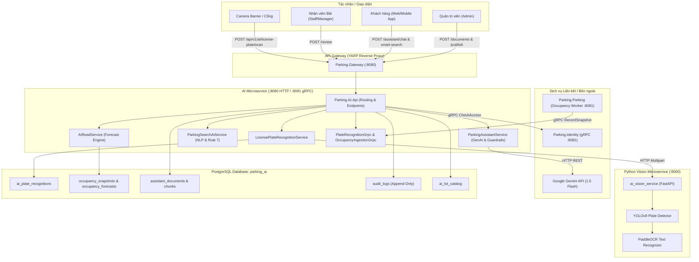
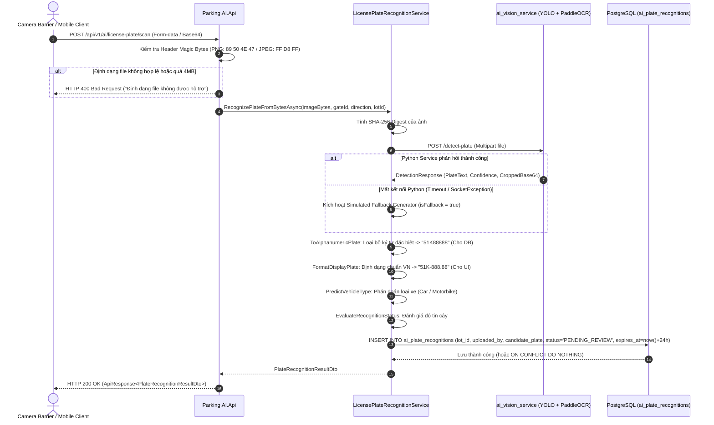
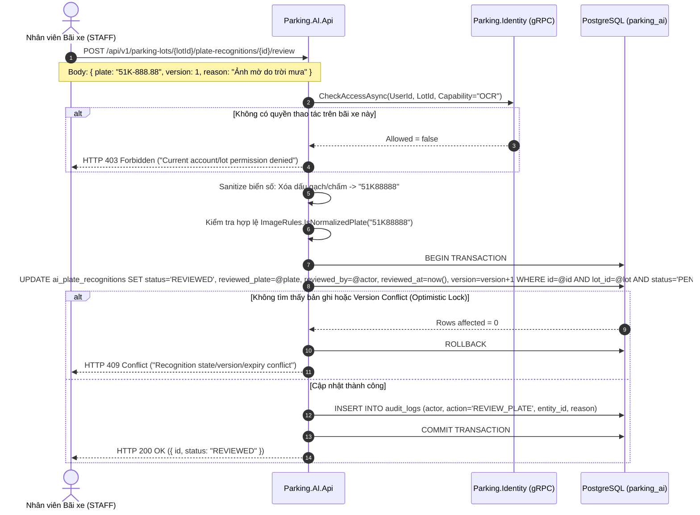
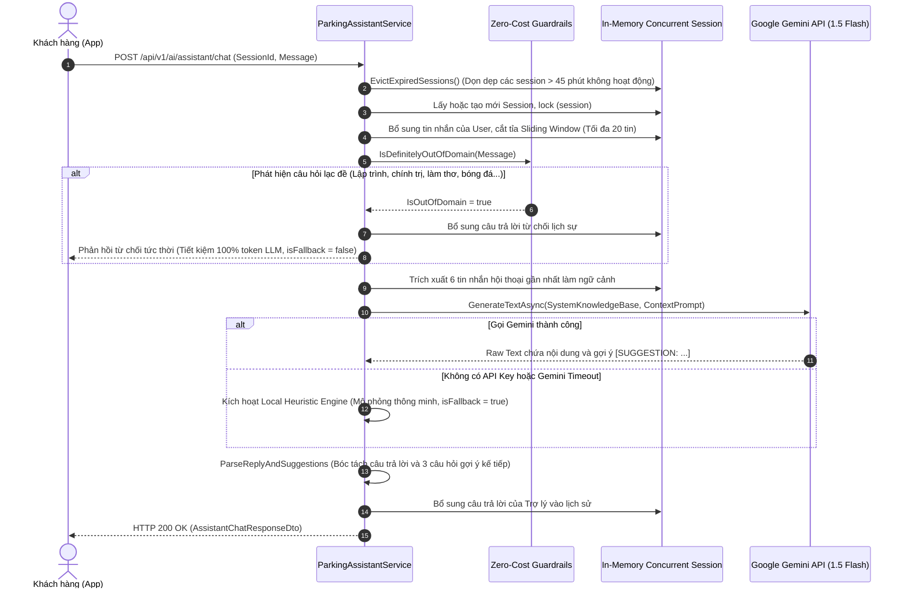
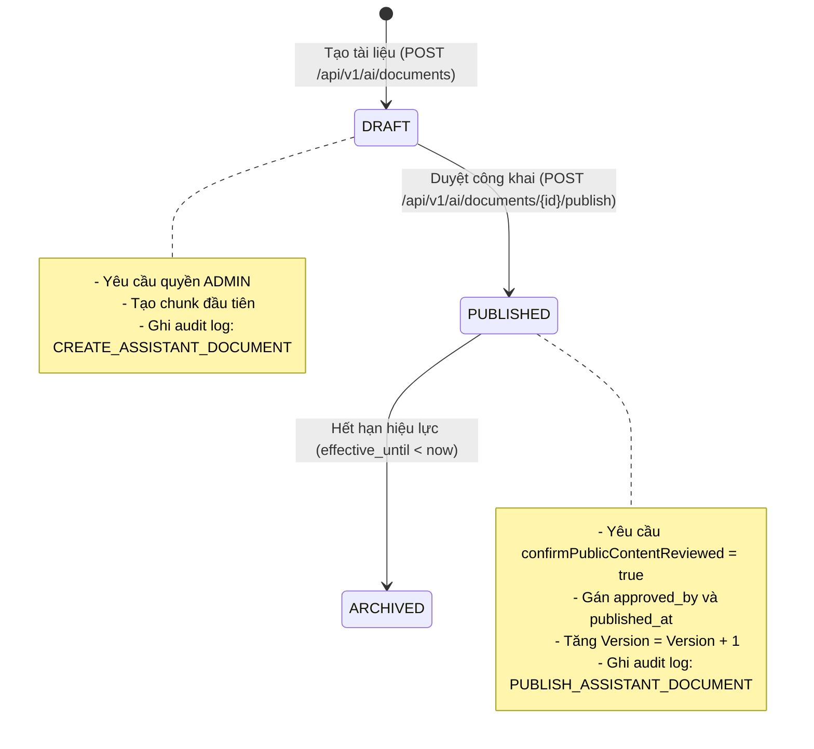
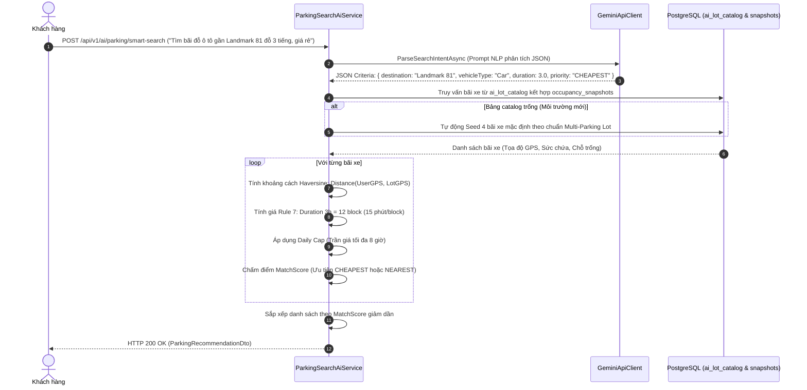
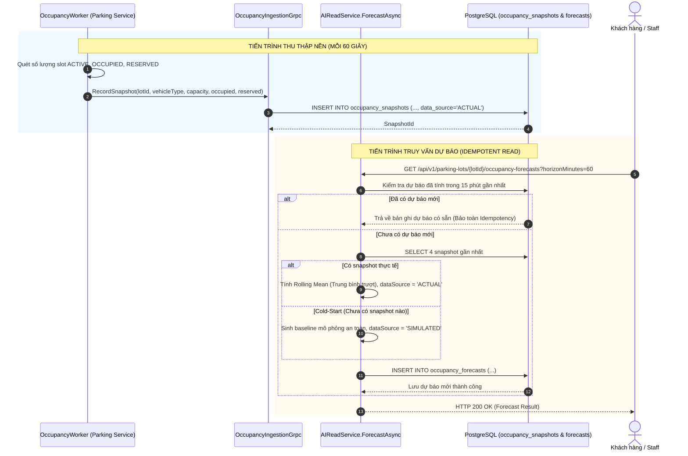
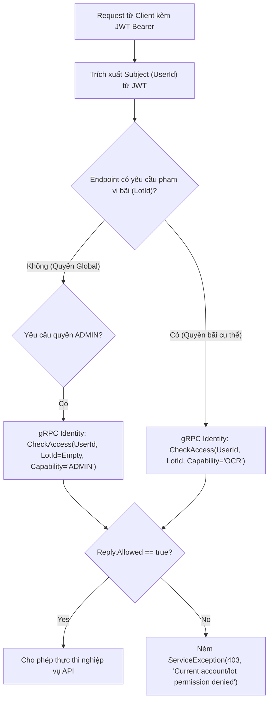

# ĐẶC TẢ CÁC LUỒNG NGHIỆP VỤ PHÂN HỆ AI (AI SERVICE BUSINESS FLOWS)
## DỰ ÁN: SMART 3D PARKING MANAGEMENT SYSTEM (BASELINE V4)

> **Tài liệu tham chiếu:** [AGENTS.md](file:///d:/FSOFT_FALL26_NET/Project.CleanArchitecture/ParkingSystemAI/AGENTS.md), [02-BUSINESS-RULES.md](file:///d:/FSOFT_FALL26_NET/Project.CleanArchitecture/ParkingSystemAI/docs/02-BUSINESS-RULES.md), [04-DATABASE.md](file:///d:/FSOFT_FALL26_NET/Project.CleanArchitecture/ParkingSystemAI/docs/04-DATABASE.md)  
> **Ngôn ngữ & Nền tảng:** C# 13, .NET 9 Clean Architecture, Python FastAPI (YOLOv8 + PaddleOCR), PostgreSQL 17  
> **Kiến trúc:** Microservice độc lập (`Parking.AI`), giao tiếp Dual-Channel (RESTful API Envelope + gRPC Inter-service)

---

## MỤC LỤC
1. [Tổng quan Kiến trúc & Phạm vi Phân hệ AI](#1-tổng-quan-kiến-trúc--phạm-vi-phân-hệ-ai)
2. [Ma trận Tổng hợp Các Luồng Nghiệp vụ](#2-ma-trận-tổng-hợp-các-luồng-nghiệp-vụ)
3. [Chi tiết Luồng 1: Nhận diện Biển số xe Tự động (ANPR OCR)](#3-chi-tiết-luồng-1-nhận-diện-biển-số-xe-tự-động-anpr-ocr)
4. [Chi tiết Luồng 2: Soát xét Biển số Thủ công từ Nhân viên (Staff Review)](#4-chi-tiết-luồng-2-soát-xét-biển-số-thủ-công-từ-nhân-viên-staff-review)
5. [Chi tiết Luồng 3: Trợ lý ảo AI Đàm thoại Đa lượt (Contextual Chatbot)](#5-chi-tiết-luồng-3-trợ-lý-ảo-ai-đàm-thoại-đa-lượt-contextual-chatbot)
6. [Chi tiết Luồng 4: Tra cứu Quy chế / FAQ Nội bộ (Document Retrieval - No LLM)](#6-chi-tiết-luồng-4-tra-cứu-quy-chế--faq-nội-bộ-document-retrieval---no-llm)
7. [Chi tiết Luồng 5: Quản lý & Phê duyệt Tài liệu Tri thức (Knowledge Base)](#7-chi-tiết-luồng-5-quản-lý--phê-duyệt-tài-liệu-tri-thức-knowledge-base)
8. [Chi tiết Luồng 6: Tìm kiếm Bãi đỗ Thông minh (Smart Search & Rule 7)](#8-chi-tiết-luồng-6-tìm-kiếm-bãi-đỗ-thông-minh-smart-search--rule-7)
9. [Chi tiết Luồng 7: Thu thập Snapshot & Dự báo Công suất (Occupancy Forecast)](#9-chi-tiết-luồng-7-thu-thập-snapshot--dự-báo-công-suất-occupancy-forecast)
10. [Chi tiết Luồng 8: Phân quyền Phục vụ Cơ sở (Facility-Scoped RBAC Guard)](#10-chi-tiết-luồng-8-phân-quyền-phục-vụ-cơ-sở-facility-scoped-rbac-guard)

---

## 1. TỔNG QUAN KIẾN TRÚC & PHẠM VI PHÂN HỆ AI

Phân hệ **Parking.AI** chịu trách nhiệm cung cấp toàn bộ năng lực trí tuệ nhân tạo, thị giác máy tính và phân tích dự báo cho hệ thống quản lý bãi đỗ xe thông minh đa cơ sở (**Multi-Parking Lot Platform**).



---

## 2. MA TRẬN TỔNG HỢP CÁC LUỒNG NGHIỆP VỤ

| Luồng | Tên Nghiệp vụ | Giao thức / Endpoint | Bảng CSDL Tác động | Tác nhân Chính |
|:---:|:---|:---|:---|:---|
| **WF-01** | Nhận diện Biển số xe ANPR | `POST /api/v1/ai/license-plate/scan`<br>gRPC `PlateRecognition.Recognize` | `ai_plate_recognitions` | Camera Barrier, Cổng vào/ra |
| **WF-02** | Soát xét Biển số Thủ công | `POST /api/v1/parking-lots/{lotId}/plate-recognitions/{id}/review` | `ai_plate_recognitions`<br>`audit_logs` | Staff bãi xe |
| **WF-03** | Trợ lý ảo AI Đàm thoại Đa lượt | `POST /api/v1/ai/assistant/chat`<br>`DELETE /session/{sessionId}` | In-Memory Session (TTL 45m) | Khách hàng |
| **WF-04** | Tra cứu Quy chế / FAQ (No-LLM) | `POST /api/v1/parking-lots/{lotId}/assistant` | `assistant_documents`<br>`assistant_document_chunks` | Khách hàng, Staff |
| **WF-05** | Quản lý Tài liệu Tri thức | `POST /api/v1/ai/documents`<br>`POST /api/v1/ai/documents/{id}/publish` | `assistant_documents`<br>`assistant_document_chunks`<br>`audit_logs` | Admin |
| **WF-06** | Tìm kiếm Bãi đỗ Thông minh | `POST /api/v1/ai/parking/smart-search`<br>`POST /api/v1/ai/parking/recommend` | `ai_lot_catalog`<br>`occupancy_snapshots` | Khách hàng |
| **WF-07** | Dự báo Công suất Bãi đỗ | gRPC `OccupancyIngestion.RecordSnapshot`<br>`GET /occupancy-forecasts` | `occupancy_snapshots`<br>`occupancy_forecasts` | Parking Worker, Khách hàng |
| **WF-08** | Phân quyền Phạm vi Bãi (RBAC) | Inter-service gRPC check | `audit_logs` | Toàn bộ Actor có định danh |

---

## 3. CHI TIẾT LUỒNG 1: NHẬN DIỆN BIỂN SỐ XE TỰ ĐỘNG (ANPR OCR)

### Mục tiêu nghiệp vụ
Tự động nhận diện biển số xe khi phương tiện tiến vào cổng check-in hoặc check-out tại barrier; phân loại phương tiện (Ô tô / Xe máy); tách biệt chuỗi chuẩn hóa CSDL và chuỗi hiển thị giao diện; lưu vết kiểm toán và hỗ trợ cơ chế phòng vệ khi dịch vụ AI ngoại tuyến.



### Các quy tắc cốt lõi (Invariants):
1. **Tách biệt định dạng (DEF-01):**
   - `PlateNumber`: Chuỗi chữ và số liền mạch, chuẩn regex `^[A-Z0-9]{1,20}$` (thỏa mãn DB Check Constraint của bảng `ai_plate_recognitions`).
   - `DisplayPlate`: Chuỗi thân thiện người dùng (VD: `51K-888.88` hoặc `59-P1 678.90`).
2. **Kiểm tra nhị phân (DEF-08):** Bắt buộc kiểm tra Magic Bytes nhị phân, loại trừ các file mã độc giả mạo đuôi ảnh.
3. **Idempotency & Expiration:** Khóa duy nhất `(lot_id, uploaded_by, idempotency_key)` chống chụp lặp barrier; bản ghi hết hạn sau 24 giờ.

---

## 4. CHI TIẾT LUỒNG 2: SOÁT XÉT BIỂN SỐ THỦ CÔNG TỪ NHÂN VIÊN (STAFF REVIEW)

### Mục tiêu nghiệp vụ
Cho phép nhân viên chốt trực (`PARKING_STAFF`) tại cổng bãi xe chỉnh sửa lại biển số khi camera nhận diện sai hoặc mờ, ghi vết kiểm toán minh bạch phục vụ đối soát tài chính lúc xe ra.



---

## 5. CHI TIẾT LUỒNG 3: TRỢ LÝ ẢO AI ĐÀM THOẠI ĐA LƯỢT (CONTEXTUAL CHATBOT)

### Mục tiêu nghiệp vụ
Cung cấp kênh tư vấn 24/7 cho khách hàng về giá vé, cách đặt chỗ, thủ tục khi mất thẻ xe, quy định PCCC và an toàn bãi xe; tích hợp bộ lọc Guardrails loại bỏ các câu hỏi lạc đề; kiểm soát bộ nhớ RAM nghiêm ngặt.



### Bộ lọc Zero-Cost Guardrails (DEF-04):
- **Cơ chế:** Kiểm tra trực tiếp trên chuỗi văn bản không tốn tài nguyên GPU/Token.
- **Quy tắc chặn:** Tự động chặn các chủ đề không liên quan (viết code, thơ ca, thời tiết, chính trị, công thức nấu ăn, đạo hàm toán học, phim ảnh) nếu câu hỏi dài trên 20 ký tự mà hoàn toàn không chứa từ khóa bãi xe (`xe`, `đỗ`, `gửi`, `giá`, `slot`, `barrier`, `camera`, `vào`, `ra`, `thẻ`, `vé`, v.v.).

---

## 6. CHI TIẾT LUỒNG 4: TRA CỨU QUY CHẾ / FAQ NỘI BỘ (DOCUMENT RETRIEVAL - NO LLM)

### Mục tiêu nghiệp vụ
Cung cấp cơ chế tra cứu cứu trích đoạn văn bản pháp lý chính xác 100% (RAG không dùng LLM) từ các tài liệu đã được Ban Quản lý bãi xe phê duyệt, loại bỏ hoàn toàn hiện tượng "ảo giác" (hallucination).

```mermaid
sequenceDiagram
    autonumber
    actor Client as Khách hàng / Nhân viên
    participant Service as AIReadService.AssistantAsync
    participant DB as PostgreSQL (assistant_documents)

    Client->>Service: POST /api/v1/parking-lots/{lotId}/assistant (Question)
    Service->>Service: Bóc tách tối đa 10 từ khóa chính trong câu hỏi
    
    Service->>DB: SELECT d.title, c.section_title, c.content, d.source_reference FROM assistant_documents d JOIN assistant_document_chunks c ON c.document_id = d.id WHERE d.status='PUBLISHED' AND d.visibility='PUBLIC' AND d.language='vi' AND d.approved_by IS NOT NULL AND d.effective_from <= now() AND (d.effective_until IS NULL OR now() < d.effective_until) AND (d.lot_id = @lot OR d.lot_id IS NULL) AND (content LIKE %term1% OR ...) ORDER BY (d.lot_id IS NOT NULL) DESC LIMIT 3

    DB-->>Service: Trả về danh sách trích đoạn tài liệu phù hợp
    Service-->>Client: HTTP 200 OK ({ mode: "RETRIEVAL_NO_LLM", answers: [...], message: "..." })
```



---

## 7. CHI TIẾT LUỒNG 5: QUẢN LÝ & PHÊ DUYỆT TÀI LIỆU TRI THỨC (KNOWLEDGE BASE)

### Mục tiêu nghiệp vụ
Cho phép Ban Quản trị (`ADMIN`) cập nhật và phê duyệt các quy định, biểu phí, hướng dẫn xử lý sự cố của từng bãi xe theo phiên bản (Versioning) có ghi vết kiểm toán.



---

## 8. CHI TIẾT LUỒNG 6: TÌM KIẾM BÃI ĐỖ THÔNG MINH (SMART SEARCH & RULE 7)

### Mục tiêu nghiệp vụ
Cho phép người dùng nhập yêu cầu bằng ngôn ngữ tự nhiên (hoặc giọng nói); AI tự động phân tích ý định, áp dụng công thức tính khoảng cách GPS đường chim bay (**Haversine**) và tính toán biểu phí chính xác theo **Baseline Rule 7** (Block 15 phút, Daily Cap, Giờ cao điểm).



---

## 9. CHI TIẾT LUỒNG 7: THU THẬP SNAPSHOT & DỰ BÁO CÔNG SUẤT (OCCUPANCY FORECAST)

### Mục tiêu nghiệp vụ
Theo dõi tải thực tế của bãi xe theo thời gian thực và đưa ra cảnh báo/dự báo trước 30/60/120 phút giúp người dùng chọn thời điểm đỗ xe tối ưu.



---

## 10. CHI TIẾT LUỒNG 8: PHÂN QUYỀN PHỤC VỤ CƠ SỞ (FACILITY-SCORED RBAC GUARD)

### Mục tiêu nghiệp vụ
Bảo đảm tính toàn vẹn của mô hình **Multi-Parking Lot**: Nhân viên của Bãi A tuyệt đối không được duyệt biển số hoặc can thiệp dữ liệu của Bãi B.



---

## 11. BẢNG MÃ LỖI CHUẨN HÓA (PROBLEM DETAILS & STATUS CODES)

Mọi phản hồi lỗi từ Phân hệ AI đều tuân thủ chặt chẽ định dạng Envelope theo [APIDesignTemplate.md](file:///d:/FSOFT_FALL26_NET/Project.CleanArchitecture/ParkingSystemAI/docs/APIDesignTemplate.md):

```json
{
  "result": null,
  "isSuccess": false,
  "statusCode": 400,
  "message": "Định dạng file không được hỗ trợ. Chỉ chấp nhận ảnh PNG hoặc JPEG hợp lệ."
}
```

| Mã HTTP | Tình huống kích hoạt trong AI Service |
|:---:|:---|
| `400 Bad Request` | Base64 sai format, file upload không phải PNG/JPEG, câu hỏi quá 1000 ký tự, horizon không thuộc (30, 60, 120). |
| `401 Unauthorized` | Thiếu hoặc hết hạn token JWT Bearer trên các endpoint bảo mật. |
| `403 Forbidden` | Nhân viên cố tình duyệt biển số hoặc sửa tài liệu của bãi xe không được phân công quản lý. |
| `404 Not Found` | Bản ghi nhận diện biển số hoặc tài liệu tri thức không tồn tại. |
| `409 Conflict` | Xung đột phiên bản (Optimistic Lock Version Conflict) khi 2 nhân viên cùng duyệt 1 biển số hoặc tài liệu cùng lúc. |
| `503 Service Unavailable` | Không thể kết nối dịch vụ thiết yếu và không có cơ chế fallback khả dụng. |

---

*Tài liệu được biên soạn và chuẩn hóa theo kiến trúc Baseline V4.*
