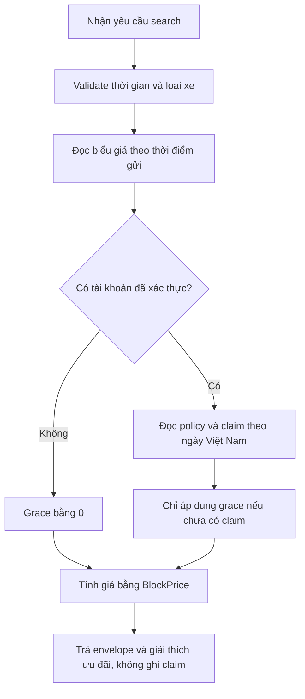
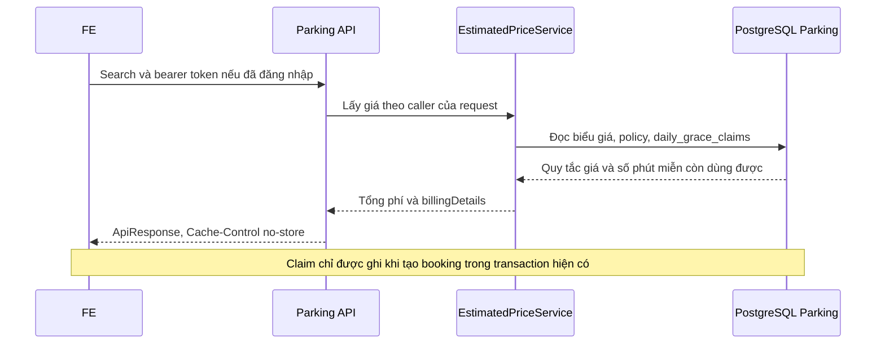

# Giá trước khi đặt, miễn phí trong ngày và hạn mức NCB sandbox

**Cập nhật tiếp theo:** đã có yêu cầu minimum 10.000đ/lượt cho biểu giá mới/được nâng cấp; xem [MINIMUM_PARKING_CHARGE.md](MINIMUM_PARKING_CHARGE.md). Ví dụ 8.000đ → 7.000đ bên dưới giải thích nguyên nhân cũ và vẫn đúng cho snapshot legacy. Booking mới theo biểu giá có minimum sẽ có phí cuối ít nhất 10.000đ.

## Nguyên nhân và hành vi sau sửa

Booking áp dụng `lot_vehicle_policies.grace_free_minutes` một lần/người/ngày Việt Nam, xuyên bãi. Trước đây search tính đủ thời lượng, còn booking trừ grace khi tạo, nên 120 phút ở mức 1.000đ/15 phút hiển thị 8.000đ trước khi đặt nhưng còn 7.000đ sau khi nhận miễn 15 phút.

Search hiện đọc quyền lợi của tài khoản đã xác thực và dùng cùng `BlockPrice.Estimate(start + grace, end, timezone)` như booking. Khách chưa đăng nhập hoặc tài khoản đã có claim trong ngày nhận giá gốc. `billingDetails` giải thích số phút miễn được tính. Xem giá không tạo claim; booking vẫn quyết định quyền lợi trong transaction. Nếu quyền lợi hoặc biểu giá đổi sau khi xem giá, số tiền được xác định lại khi đặt.

## Contract: GET /api/v1/parking-lots/search

Không thêm endpoint, query parameter hay trường JSON. Giữ nguyên envelope, validation và trường `estimatedPricing`. Các tham số nhận diện người dùng từ query/header không được dùng để tính ưu đãi; chỉ lấy `sub`/`NameIdentifier` từ principal đã xác thực. Response có `Cache-Control: no-store` để tránh tái sử dụng giá giữa tài khoản.

Ví dụ request:

```http
GET /api/v1/parking-lots/search?vehicleType=MOTORBIKE&startTime=2026-11-21T08:12:00Z&expectedDuration=120&sortBy=CHEAPEST
Authorization: Bearer <access-token>
```

Ví dụ phần dữ liệu giá trong response:

```json
{
  "result": {
    "totalCount": 1,
    "items": [{
      "parkingLotId": "22222222-2222-4222-8222-222222222222",
      "code": "DEMO-BT",
      "name": "Bãi đỗ xe Landmark 81 - Central Park",
      "address": "720A Điện Biên Phủ, Bình Thạnh, TP.HCM",
      "latitude": 10.7952,
      "longitude": 106.7219,
      "distanceKm": 0,
      "availableSlots": 1,
      "operatingStatus": "ACTIVE",
      "estimatedPricing": {
        "expectedDurationMinutes": 120,
        "estimatedTotalFee": 7000,
        "currency": "VND",
        "billingDetails": "Block 15p, Đơn giá 1.000 đ, Trần ngày 20.000 đ. Đã tính miễn 15 phút đầu theo quyền lợi trong ngày; quyền lợi được kiểm tra lại khi đặt chỗ."
      }
    }]
  },
  "isSuccess": true,
  "statusCode": 200,
  "message": "Search completed successfully."
}
```

Thiếu/không có quyền miễn phí trả cùng schema với `estimatedTotalFee=8000` cho ví dụ trên. Validation không hợp lệ vẫn trả 400 theo envelope hiện có. Nếu có gửi Authorization nhưng token hết hạn/không hợp lệ, trả 401 theo envelope để frontend refresh token thay vì nhận nhầm giá Guest. Kiểm thử unit bảo vệ việc không lấy danh tính từ `customerId` hoặc `X-User-Id`.

### Activity Diagram



### Sequence Diagram



## NCB sandbox và khoản thu nhỏ

FAQ VNPay công bố mức tối thiểu chung 5.000đ: <https://sandbox.vnpayment.vn/apis/docs/faqs/>. Ngân hàng có hạn mức riêng; mức chung không bảo đảm mọi thẻ ngân hàng chấp nhận 7.000đ.

Kiểm tra thực tế ngày 21/11/2026 bằng thẻ NCB test công khai từ <https://sandbox.vnpayment.vn/apis/vnpay-demo/>, dừng tại bước xác thực thẻ, chưa gửi OTP hoặc xác nhận thanh toán:

| Số tiền | Kết quả xác thực thẻ sandbox |
|---|---|
| 7.000đ | Code 10: ngoài hạn mức ngân hàng |
| 8.000đ | Code 10: ngoài hạn mức ngân hàng |
| 9.999đ | Code 10: ngoài hạn mức ngân hàng |
| 10.000đ | Code 00: chuyển sang bước OTP |

Đây là kết quả của NCB **sandbox** tại thời điểm kiểm tra, không phải quy định chung cho mọi ngân hàng hoặc cấu hình Production.

Màn hình thanh toán vẫn thông báo giới hạn NCB sandbox với booking legacy dưới 10.000đ. Với chính sách mới đã được yêu cầu, biểu giá mới/được nâng cấp có minimum 10.000đ áp dụng cho cả CASH/VNPAY, xem tài liệu ở đầu trang. Không thay số tiền của booking đã chốt, không làm tròn riêng trong URL VNPay và không bỏ kiểm tra số tiền/chữ ký IPN. Khi test, tạo booking mới để sử dụng phiên bản giá mới.

## Kiểm chứng

- Unit test: giá 7.000đ khi còn grace, 8.000đ khi hết grace/chưa đăng nhập; không cache quyền lợi giữa lần tính; không lấy danh tính từ query/header.
- PostgreSQL integration test: xem giá hai lần không tiêu claim; giá booking khớp giá search; sau booking ưu đãi không còn trong ngày, xuyên bãi; ngày tiếp theo được kiểm tra riêng.
- Frontend: cập nhật lại search khi đổi tài khoản/đăng nhập và hiển thị hướng dẫn NCB cho khoản thu nhỏ.
