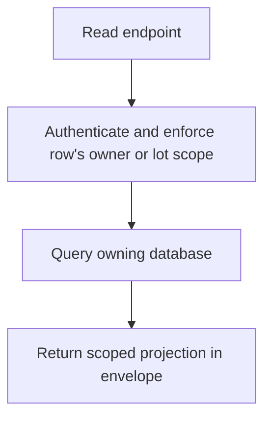
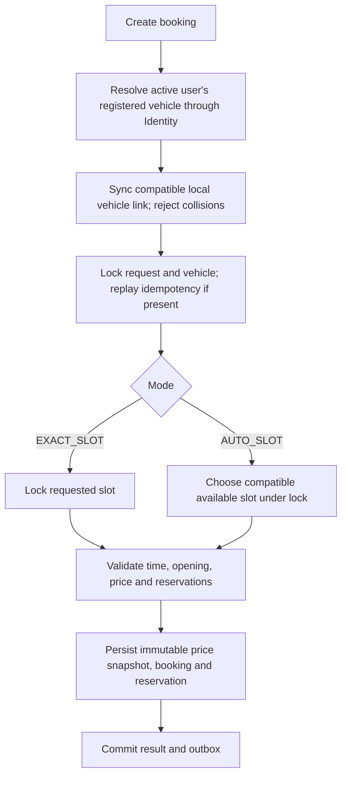
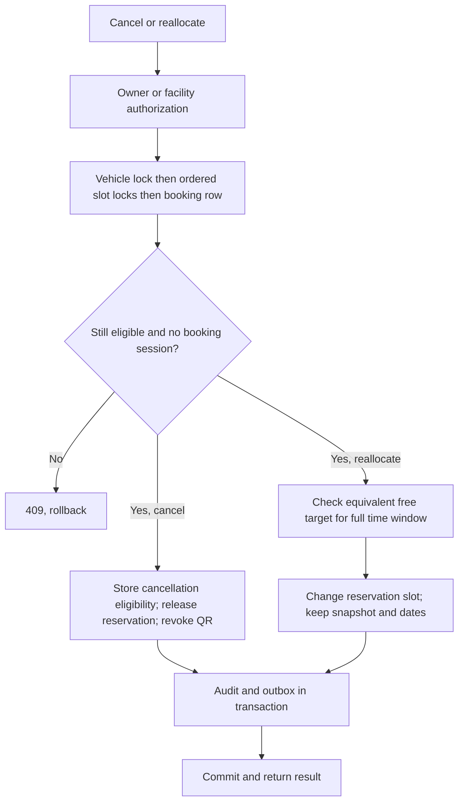
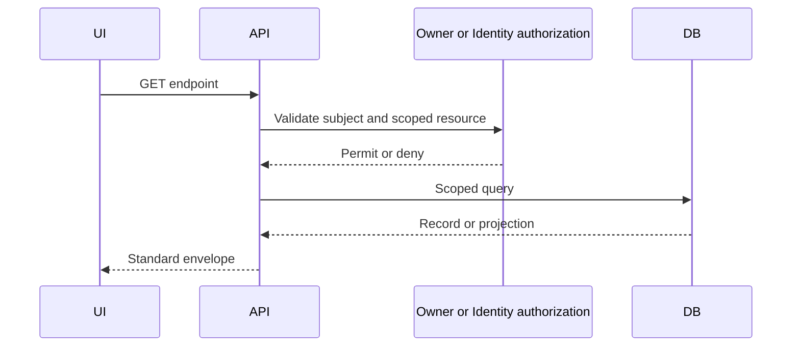
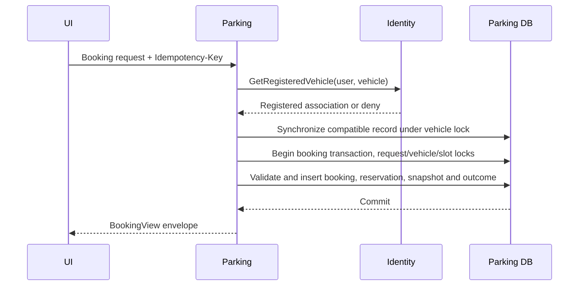

# Booking lifecycle API extensions

Source-only changes following the SRS/Baseline review. No build/runtime validation performed. All HTTP results use the standard `{result,isSuccess,statusCode,message}` envelope. IDs in examples are placeholders for UUIDs.

## Endpoints and example payloads

| Endpoint | Access | Request | Result |
|---|---|---|---|
| POST /api/v1/bookings | Active owner, registered vehicle via Identity | `{"lotId":"<uuid>","slotId":"00000000-0000-0000-0000-000000000000","vehicleId":"<uuid>","startsAt":"2026-12-01T01:00:00Z","endsAt":"2026-12-01T02:00:00Z","mode":"AUTO_SLOT"}` + Idempotency-Key | Existing BookingView: id, code, status, estimatedAmount, holdExpiresAt, version |
| POST /api/v1/bookings/{id}/cancel | Booking owner only | `{"reason":"Plans changed"}` | `{"booking_id":"<uuid>","lot_id":"<uuid>","requested_by":"<uuid>","reason":"Plans changed","requested_at":"2026-11-12T10:00:00Z","refund_eligible":true,"refund_status":"REVIEW_REQUIRED"}` |
| GET /api/v1/bookings/{id}/cancellation | Booking owner only | none | Same cancellation record; 404 if none or not owner |
| GET /api/v1/parking-lots/{lotId}/booking-cancellations | MANAGER at lot | none | `[{"bookingId":"<uuid>","bookingCode":"B...","requestedAt":"2026-11-12T10:00:00Z","reason":"Plans changed","refundEligible":true,"refundStatus":"REVIEW_REQUIRED","recordedPaidAmount":20000}]` |
| GET /api/v1/parking-lots/{lotId}/active-reservations | GATE at lot | none | `[{"bookingId":"<uuid>","code":"B...","version":2,"vehicleType":"CAR","slotId":"<uuid>","slotCode":"A01","startsAt":"2026-12-01T01:00:00Z","endsAt":"2026-12-01T02:00:00Z","status":"CONFIRMED"}]` |
| POST /api/v1/parking-lots/{lotId}/bookings/{bookingId}/reallocate | GATE at lot | `{"targetSlotId":"<uuid>","expectedVersion":2,"reason":"Original slot requires repair"}` | `{"bookingId":"<uuid>","slotId":"<target uuid>"}` |
| FacilityAuthorization.GetRegisteredVehicle (gRPC) | Internal authenticated service | user_id + vehicle_id | vehicle_id, normalized plate, CAR/MOTORBIKE, is_primary, fuel_type; requires active account and matching registration |

Fields: mode defaults EXACT_SLOT for existing callers; EXACT_SLOT requires a nonempty slotId; AUTO_SLOT selects one transactionally. Cancellation reason and reallocation reason required, max 2000 characters. expectedVersion is the current booking version. Time range and vehicle policies use the existing booking validation. Reallocation preserves pricing snapshot and dates; it does not move a physical session. QR references the booking and resolves the current reservation at check-in.

Validation: 400 invalid fields/type/mode, 401 missing auth, 403 denied account/vehicle/lot, 404 missing scoped booking or cancellation, 409 changed/expired/checked-in booking, plate collision, incompatible or busy target, or no auto slot. Unique/exclusion constraints remain the final concurrency guard. Refund eligibility is not refund completion. A late payment still needs reconciliation; this API never claims provider transfer success.

## Activity diagrams

Each GET endpoint above uses the read path; its row determines owner or lot scope and projection. The RPC follows the same path against Identity's account and registered vehicle data.







No-show worker applies vehicle/slot locks, rereads CONFIRMED and arrival deadline, protects occupied resources, releases reservation, revokes QR and writes audit. It does not cancel checked-in sessions or refund payments.

## Sequence diagrams

Applies individually to GET cancellation, GET cancellation queue and GET active reservations, with each row's authorization:



Create booking and its vehicle RPC:



Cancel and reallocate use this sequence individually with their activity-diagram mutation:

```mermaid
sequenceDiagram
  participant UI
  participant API
  participant Repo
  participant DB
  participant Worker
  participant Hub
  UI->>API: Cancel(reason) or reallocate(target,version,reason)
  API->>Repo: Authorized actor and scoped request
  Repo->>DB: Begin; vehicle and ordered slot locks; read booking
  alt Stale, busy or forbidden transition
    Repo-->>API: Rollback and business error
    API-->>UI: 409 envelope
  else Eligible
    Repo->>DB: Persist transition, audit, reservation outbox
    Repo->>DB: Commit
    API-->>UI: Persisted result envelope
    Worker->>DB: Read queued event and current canonical slot state
    Worker->>Hub: Broadcast public status, no identity data
  end
```

## Rollout

Apply Parking migrations 005 and 006 after 004 before using the new UI; Start-DockerTest contains the ordered list. Rebuild Identity and Parking together for the new protobuf RPC. Rebuild frontend to include the UI changes. Docker frontend uses http://localhost:3000 with same-origin API/websocket proxy. The local stack remains Development; it is not automatically public-hosted or production-certified.
