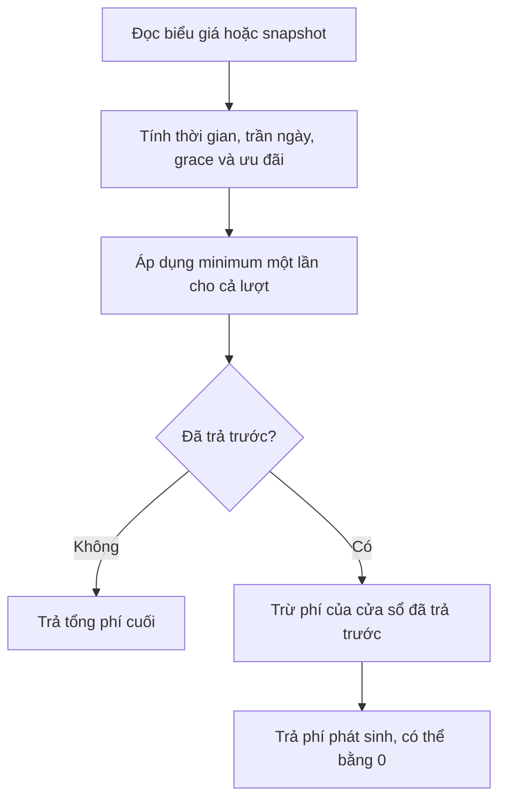
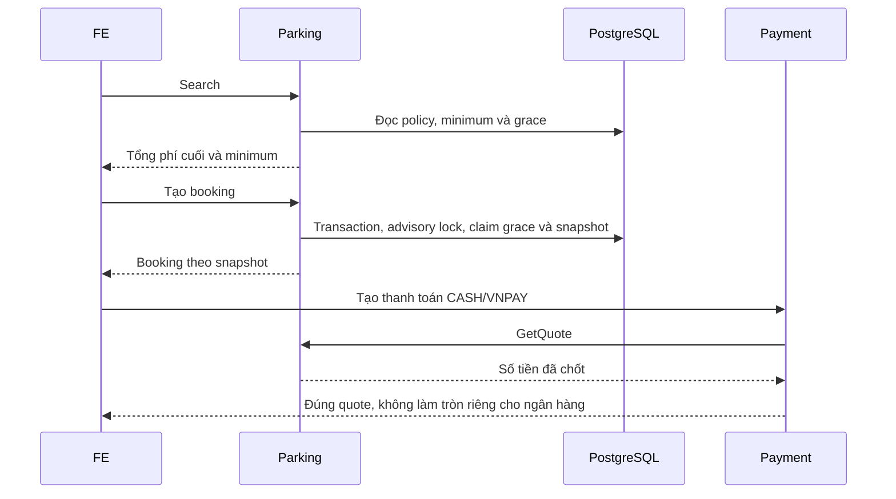

# Phí tối thiểu 10.000đ mỗi lượt đỗ

## Chính sách và bảo toàn dữ liệu

Biểu giá mới/được nâng cấp dùng `minimumChargeVnd >= 10000`, cấu hình theo bãi và loại xe, áp dụng cho cả CASH và VNPAY:

```text
phí cuối = max(minimumChargeVnd, phí theo thời gian sau grace và ưu đãi áp dụng)
```

Ví dụ: 2.000đ, 7.000đ, 8.000đ trở thành 10.000đ; 15.000đ giữ nguyên. Minimum không vượt trần giá ngày. Lượt thực tế nằm trọn trong grace vẫn chịu minimum nếu snapshot có quy định; thời lượng bằng 0 không phát sinh phí.

Minimum áp dụng một lần cho **cả lượt**, không phải mỗi block/ngày/lần thu tiền. Booking trả trước ra đúng giờ không trả thêm. Quá giờ tính phí cả lượt rồi trừ phần đã tính cho cửa sổ trả trước. Phí phát sinh có thể dưới 10.000đ, không làm tròn riêng khoản phát sinh lên minimum; cần chọn phương thức phù hợp nếu NCB sandbox không nhận khoản nhỏ.

Trường mới nằm trong `pricing_rules.parameters`, không thêm cột tiền vào booking/Payment. Snapshot thiếu trường này mặc định minimum bằng 0 để giữ giá đã hứa. Booking cũ 7.000đ vẫn là 7.000đ; muốn thử mức mới cần tạo booking mới.

Migration `database/services/parking/migrations/012_minimum_charge_10000.sql` khóa theo nhóm giá, tạo phiên bản mới, archive bản trước và lưu audit. Không sửa `bookings.estimated_amount`, `pricing_snapshots.resolved_rules` hoặc Payment đã có. Chạy lại không nhân đôi phiên bản đã có minimum phù hợp. Trần ngày dưới 10.000đ hoặc plan PUBLISHED được lên lịch tương lai trong cùng nhóm sẽ làm migration dừng/rollback để review.

Local: `Sync-LocalDatabases.ps1 -StartBackend` sao lưu trước khi áp dụng migration và nạp backend mới. Docker launcher và script seed đã nối migration vào luồng chạy; seed áp dụng minimum sau khi tạo dữ liệu demo. Backup trước khi nâng cấp môi trường có dữ liệu; không dùng `down -v`. Rebuild Parking và Payment cùng bản contract gRPC mới.

## API và tương thích

Không thêm endpoint; giữ envelope `ApiResponse<T>` và các trường cũ:

| Contract | Thay đổi |
|---|---|
| GET `/api/v1/parking-lots/search` | Thêm `estimatedPricing.minimumChargeVnd`; tổng phí có minimum |
| GET `/api/v1/bookings/{id}` | Thêm `minimumChargeVnd` từ snapshot; legacy trả 0 |
| GET/POST biểu giá theo bãi `/pricing-plans` | `rules.minimumChargeVnd`; POST phải từ 10.000đ và không vượt daily cap |
| POST `/api/v1/payments/calculate-fee` | Thêm `minimumChargeVnd`, `minimumChargeAdjustmentVnd`; `finalNetAmountVnd` là tiền cuối |
| `ParkingCatalog.GetPricingPolicy` | Thêm field 14 `minimum_charge_vnd` (`int64`), giữ số field cũ |

Response fields mới là bổ sung; FE chấp nhận response legacy thiếu minimum. **Write contract công bố giá chặt hơn**: client cũ không gửi minimum hợp lệ sẽ nhận 400, cần nâng cấp trước khi công bố giá. Provider gRPC cũ không gửi field 14 sẽ có giá trị 0; triển khai Parking mới trước/cùng Payment mới.

Ví dụ request công bố giá của Manager được gán bãi:

```json
{
  "vehicleType": "MOTORBIKE", "name": "Biểu giá xe máy", "expectedVersion": 2,
  "rules": {
    "blockMinutes": 15, "rateVnd": 1000, "dailyCapVnd": 20000,
    "multiplier": 1, "peakStart": null, "peakEnd": null, "minimumChargeVnd": 10000
  },
  "reason": "Áp dụng minimum mỗi lượt sau ưu đãi"
}
```

Ví dụ phần response search nằm trong `result.items[].estimatedPricing`:

```json
{
  "expectedDurationMinutes": 120, "estimatedTotalFee": 10000,
  "minimumChargeVnd": 10000, "currency": "VND",
  "billingDetails": "Đã tính grace nếu còn quyền lợi; phí cuối tối thiểu 10.000đ/lượt sau ưu đãi."
}
```

Ví dụ lỗi giá:

```json
{
  "result": null, "isSuccess": false, "statusCode": 400,
  "message": "Minimum charge for a new pricing version must be at least 10,000 VND per visit."
}
```

401/403 cho xác thực/phạm vi bãi, 409 cho expectedVersion cũ giữ nguyên. Payment lấy đúng quote từ Parking; không tăng riêng số tiền URL hoặc bỏ kiểm tra IPN. 10.000đ được gửi thành `vnp_Amount=1000000`.

### Activity Diagram



### Sequence Diagram



## Kiểm chứng

Unit tests: dưới/bằng/trên minimum, sau chiết khấu, qua nửa đêm, overtime, grace, snapshot legacy và số tiền VNPay. PostgreSQL tests: phiên bản mới, migration chạy lại, không sửa booking/snapshot cũ và search khớp booking mới. FE contract tests bảo toàn minimum và không bịa phí cho legacy. Calculator đọc lại policy qua gRPC mỗi yêu cầu để không giữ giá cũ 30 phút sau công bố.
