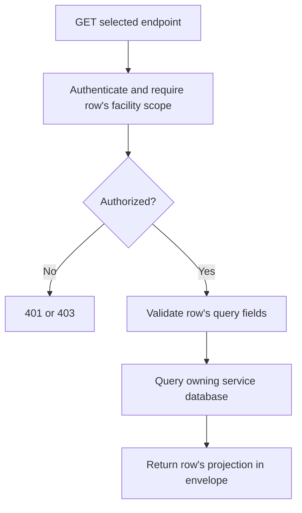
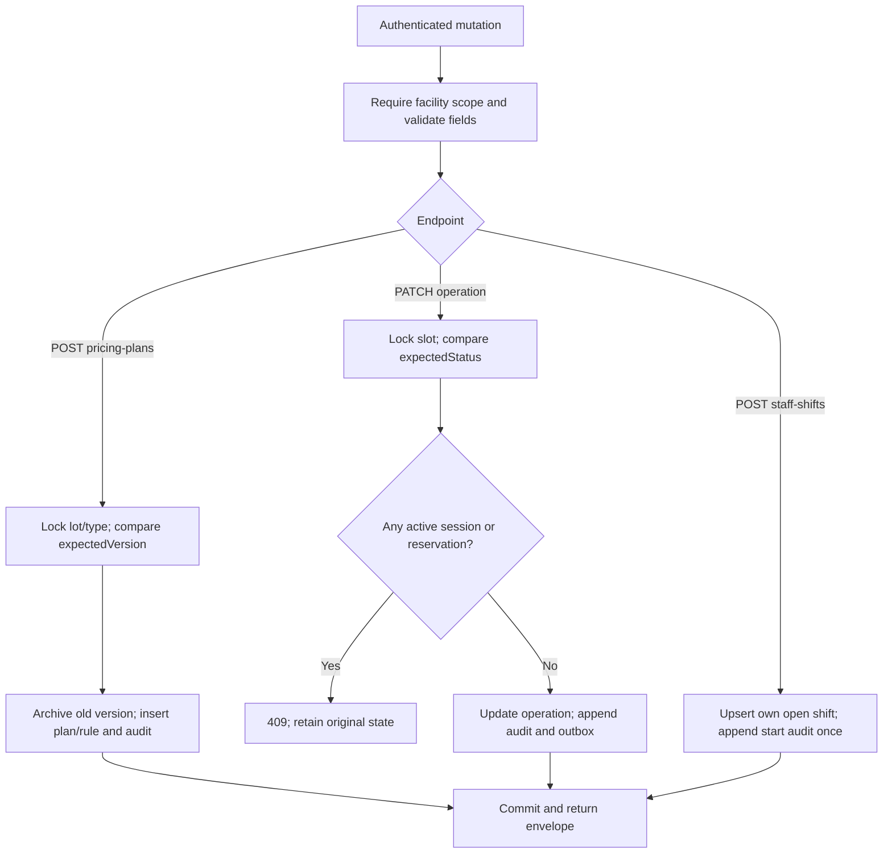
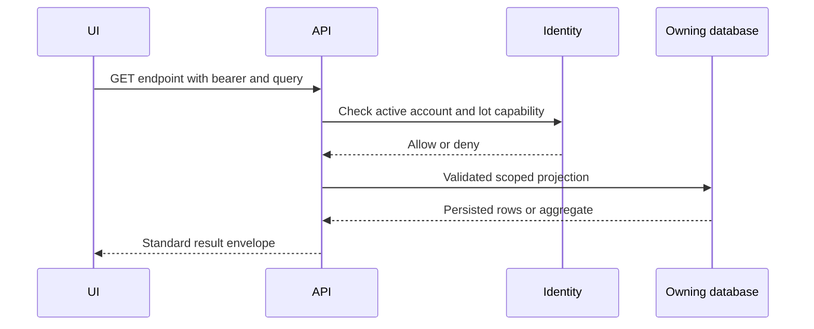

# Lot operations API — design, 2026-11-12

## Overview

Persist the Manager/Staff operations previously represented by browser fixtures. Source-only implementation; not runtime-verified. Related business review: [BUSINESS_ALIGNMENT_2026-11-12.md](BUSINESS_ALIGNMENT_2026-11-12.md).

All endpoints require bearer authentication. `L` below means `/api/v1/parking-lots/{lotId}`. IDs are UUIDs. Read requests have no body. Date ranges are ISO-8601 instants, end-exclusive and at most 366 days. All successful results use `{ "result": ..., "isSuccess": true, "statusCode": 200, "message": "..." }`. The table gives a request sample and the `result` sample for each endpoint; samples illustrate shapes, not seeded records.

## Specification and samples

| Method / URL and sample query | Scope | Body sample | Result sample |
|---|---|---|---|
| GET `L/pricing-plans?vehicleType=CAR` | MANAGER | none | `[{"id":"<uuid>","lotId":"<uuid>","vehicleType":"CAR","version":1,"name":"Standard","status":"PUBLISHED","effectiveFrom":"2026-11-12T00:00:00Z","effectiveUntil":null,"createdBy":"<uuid>","createdAt":"2026-11-12T00:00:00Z","rules":{"blockMinutes":15,"rateVnd":5000,"dailyCapVnd":150000,"multiplier":1,"peakStart":null,"peakEnd":null}}]` |
| POST `L/pricing-plans` | MANAGER | see publish below | same array shape, newest first |
| GET `L/operational-slots` | GATE | none | `[{"id":"<uuid>","lotId":"<uuid>","slotCode":"A01","levelId":"<uuid>","levelName":"L1","zoneId":"<uuid>","zoneName":"A","operationalStatus":"ACTIVE","status":"AVAILABLE","vehicleTypes":["CAR"]}]` |
| PATCH `L/slots/{slotId}/operation` | GATE | `{"status":"MAINTENANCE","expectedStatus":"ACTIVE","reason":"Repair surface"}` | `{"slotId":"<uuid>","lotId":"<uuid>","operationalStatus":"MAINTENANCE"}` |
| GET `L/audit-logs?from=2026-11-01T00:00:00Z&until=2026-11-02T00:00:00Z` | REPORT | none | `[{"id":"<uuid>","timestampUtc":"2026-11-01T08:00:00Z","operatorId":"<uuid>","operatorRole":"USER","actionType":"SLOT_OVERRIDE","targetEntity":"PARKING_SLOT:<uuid>","justificationNote":"Repair surface"}]` |
| GET `L/usage-report?from=2026-11-01T00:00:00Z&until=2026-11-02T00:00:00Z` | REPORT | none | `{"lotId":"<uuid>","from":"2026-11-01T00:00:00Z","until":"2026-11-02T00:00:00Z","capacity":20,"occupied":3,"entries":4,"exits":1,"averageDurationMinutes":45,"carEntries":3,"motorbikeEntries":1}` |
| GET `L/operations-summary?from=2026-11-01T00:00:00Z&until=2026-11-02T00:00:00Z` | GATE | none | same usage shape; no payment data |
| GET `L/staff-shifts` | HANDOVER | none | `[{"id":"<uuid>","lotId":"<uuid>","staffUserId":"<uuid>","startedAt":"2026-11-01T08:00:00Z"}]` |
| POST `L/staff-shifts` | HANDOVER | none | `{"id":"<uuid>"}` (existing open shift returned on retry) |
| GET `/api/v1/payments/reports/{lotId}?from=2026-11-01T00:00:00Z&until=2026-11-02T00:00:00Z` | REPORT via Identity | none | `{"lotId":"<uuid>","from":"2026-11-01T00:00:00Z","until":"2026-11-02T00:00:00Z","currency":"VND","gross":20000,"cash":5000,"digital":15000,"transactions":2,"refunds":0,"net":20000}` |
| GET `/api/v1/staff-assignments?lotId=<uuid>` | MANAGER for lot or ADMIN | none | `[{"assignmentId":"<uuid>","staffUserId":"<uuid>","name":"Staff name","roleCode":"PARKING_STAFF","validFrom":"2026-11-01T00:00:00Z","validUntil":null,"canManageStaffAssignments":false}]` |

Publish example:

```json
{
  "vehicleType": "CAR",
  "name": "Weekday",
  "expectedVersion": 1,
  "rules": {
    "blockMinutes": 15,
    "rateVnd": 5000,
    "dailyCapVnd": 150000,
    "multiplier": 1.2,
    "peakStart": "17:00",
    "peakEnd": "20:00"
  },
  "reason": "Approved tariff revision"
}
```

| Field | Meaning / validation |
|---|---|
| lotId / slotId | Assigned lot; slot must belong to lot |
| vehicleType | CAR or MOTORBIKE (MOTORCYCLE normalized by operations API); lot must support type |
| name | Nonempty, <=200 characters |
| expectedVersion | Latest version shown to user, 0 for first publication |
| blockMinutes | Integer 1..1440 |
| rateVnd / dailyCapVnd | Positive integer VND for published booking rates |
| multiplier | 1..1.5; applies all day when both peak times null |
| peakStart / peakEnd | Both absent or both parseable, unequal; overnight window supported |
| reason | Required 1..2000 characters for mutation audit |
| status / expectedStatus | ACTIVE, MAINTENANCE or DISABLED; physical occupancy is not writable here |
| from / until | Explicit timestamp offset; normalized to UTC for PostgreSQL |

A peak overlap charges the whole billing block at the peak factor; blocks round up, then the local-day cap applies. Pricing publication is immediate, not scheduled. Published versions are archived on replacement; booking/session price snapshots remain unchanged. Reports show money movement within the selected period; refunds can produce negative net in a later period. Roster includes unrevoked future/expired assignments so the manager can inspect their validity dates.

## Errors

- 400: invalid rule/type/range/reason; malformed identifiers or body.
- 401: no authenticated identity.
- 403: missing active facility capability (or account inactive).
- 404: slot does not belong to the selected lot.
- 409: stale pricing version, stale operational state, active vehicle/reservation blocks override; inactive/mismatched shift blocks handover.
- Dependency/storage failures propagate as errors; the UI must not return fixture success.

Example business error: `{"result":null,"isSuccess":false,"statusCode":409,"message":"Pricing changed. Reload before publishing."}`.

## Activity diagrams

The following parameterized read diagram applies individually to all GET rows above; the selected row defines scope, query and projection. Parking and Payment use service repositories; roster uses Identity's scoped EF projection. Reads never manufacture successful fallback data.



Mutation branches cover each new write endpoint separately:



## Sequence diagrams

Each read endpoint uses this sequence with its table row's projection; Payment authorizes through Identity gRPC, roster authorizes inside Identity.



Each new write follows this sequence; mutation details are the three branches in the activity diagram.

```mermaid
sequenceDiagram
  participant UI
  participant API
  participant Identity
  participant Repo as OperationsRepository
  participant DB as Parking database
  UI->>API: POST pricing / PATCH operation / POST shift
  API->>Identity: Require MANAGER / GATE / HANDOVER for lot
  Identity-->>API: Authorized
  API->>Repo: Actor, lot, validated request
  Repo->>DB: Begin transaction; lock or unique-key upsert
  Repo->>DB: Read prerequisites and compare expected state
  alt Conflict
    Repo-->>API: Business conflict; rollback
    API-->>UI: 409 (refresh required)
  else Accepted
    Repo->>DB: Persist mutation and audit (slot also outbox)
    Repo->>DB: Commit
    Repo-->>API: Persisted result
    API-->>UI: 200 envelope
  end
```

Existing handover endpoints now require real active shifts. Confirmation locks both shifts, checks expected version and receiver, then marks the handover confirmed and closes the sender's shift in the same transaction. Migration `004_staff_shifts.sql` is required before these endpoints are used.
