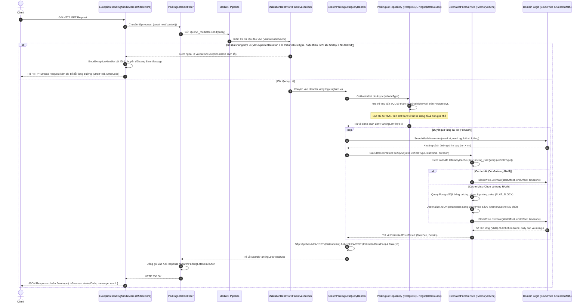

# TÀI LIỆU TỔNG HỢP KIẾN TRÚC & MÃ NGUỒN TÍNH NĂNG TÌM KIẾM BÃI ĐỖ XE (S2-03)
## Search Nearest / Cheapest Parking Lots with Clean Architecture, CQRS & PostgreSQL

---

## 1. Bức Tranh Tổng Quan & Vòng Đời Của Một Request (Request Lifecycle)

Khi ứng dụng Client (Mobile App / Web) gửi một HTTP request tìm kiếm bãi xe:
```http
GET /api/v1/parking-lots/search?latitude=10.776&longitude=106.700&vehicleType=CAR&sortBy=NEAREST&expectedDuration=180
```

### Sơ đồ tuần tự thực tế (Sequence Diagram):



---

## 2. Tổng Hợp Toàn Bộ Mã Nguồn & Chi Tiết Cú Pháp (Syntax)

---

### PHẦN I: TẦNG API & CHUẨN HÓA PHẢN HỒI (API & CONTRACTS)

#### 1. Chuẩn hóa phong bì phản hồi: `ApiResponse.cs`
- **Đường dẫn:** `src/Services/Parking/Parking.Parking.Api/Common/ApiResponse.cs`

```csharp
namespace Parking.Parking.Api.Common
{
    public class ApiResponse<T>
    {
        public T Result { get; set; }
        public bool IsSuccess { get; set; } = true;
        public int StatusCode { get; set; } = 200;
        public string Message { get; set; } = string.Empty;

        public ApiResponse(T result, string message = "Success")
        {
            Result = result;
            Message = message;
        }
    }
}
```

🔍 **Giải thích Cơ chế & Cú pháp:**
- **Generic `<T>`:** Cho phép class bọc bất kỳ kiểu dữ liệu nào (`SearchParkingLotsResultDto`, danh sách, object đơn lẻ...) mà vẫn bảo đảm tính an toàn kiểu (Type Safety).
- **Default Parameter `string message = "Success"`:** Tham số mặc định giúp gọi constructor ngắn gọn `new ApiResponse<T>(data)` mà không bắt buộc phải truyền message nếu thành công.
- **Phong bì chuẩn (Envelope Pattern):** Đảm bảo Client luôn nhận cấu trúc JSON nhất quán:
  ```json
  {
    "result": { ... },
    "isSuccess": true,
    "statusCode": 200,
    "message": "Search completed successfully."
  }
  ```

---

#### 2. Bộ điều khiển API: `ParkingLotsController.cs`
- **Đường dẫn:** `src/Services/Parking/Parking.Parking.Api/Controllers/ParkingLotsController.cs`

```csharp
using MediatR;
using Microsoft.AspNetCore.Mvc;
using Parking.Parking.Api.Common;
using Parking.Parking.Application.DTOs;
using Parking.Parking.Application.Features.ParkingLots.Queries;

namespace Parking.Parking.Api.Controllers
{
    [ApiController]
    [Route("api/v1/parking-lots")] // Đúng chuẩn URL: /api/v1/parking-lots
    public class ParkingLotsController : ControllerBase
    {
        private readonly IMediator _mediator;

        // "Tiêm" MediatR vào Controller qua Constructor Injection
        public ParkingLotsController(IMediator mediator)
        {
            _mediator = mediator;
        }

        // Định nghĩa Endpoint GET: /api/v1/parking-lots/search
        [HttpGet("search")]
        public async Task<IActionResult> Search(
            [FromQuery] SearchParkingLotsQuery query,
            CancellationToken cancellationToken)
        {
            // 1. Nhờ MediatR bắn Query này vào đường ống Pipeline.
            // Pipeline sẽ TỰ ĐỘNG kích hoạt file Validator kiểm tra tính hợp lệ.
            // Nếu hợp lệ, Pipeline chuyển tiếp vào SearchParkingLotsQueryHandler.
            var resultDto = await _mediator.Send(query, cancellationToken);

            // 2. Bọc kết quả DTO vào lớp vỏ chuẩn ApiResponse
            var response = new ApiResponse<SearchParkingLotsResultDto>(resultDto, "Search completed successfully.");

            // 3. Trả về HTTP 200 OK
            return Ok(response);
        }
    }
}
```

🔍 **Giải thích Cơ chế & Cú pháp:**
- **`[ApiController]`:** Báo cho ASP.NET Core kích hoạt các tính năng Web API nâng cao như tự động Model Binding từ query string.
- **`[Route("api/v1/parking-lots")]` & `[HttpGet("search")]`:** Tạo thành endpoint `GET /api/v1/parking-lots/search`.
- **`[FromQuery] SearchParkingLotsQuery query`:** Tự động đọc và parse các param từ query string trên URL (`?latitude=...&longitude=...&vehicleType=...`) vào các thuộc tính của đối tượng `query`.
- **`CancellationToken cancellationToken`:** ASP.NET Core tự động inject token này. Nếu client ngắt kết nối (tắt app, timeout), token này sẽ báo hiệu để hủy bỏ việc thực thi tác vụ bên dưới, tiết kiệm tài nguyên Server.
- **Thin Controller:** Controller không chứa logic nghiệp vụ hay truy vấn SQL mà hoàn toàn ủy nhiệm cho MediatR (`_mediator.Send(query)`).

---

#### 3. Bắt lỗi tập trung toàn hệ thống: `ExceptionHandlingMiddleware.cs`
- **Đường dẫn:** `src/Services/Parking/Parking.Parking.Api/Middleware/ExceptionHandlingMiddleware.cs`

```csharp
using FluentValidation;
using Parking.Parking.Application.Exceptions;
using System.Text.Json;

namespace Parking.Parking.Api.Middleware
{
    // 1. Cấu trúc trả về lỗi chuẩn hóa
    public class ErrorMessage
    {
        public string Message { get; set; } = "Đã xảy ra lỗi hệ thống.";
        public List<ErrorDetail> ErrorDetails { get; set; } = new();
    }

    public class ErrorDetail
    {
        public string ErrorMessage { get; set; } = string.Empty;
        public string ErrorCode { get; set; } = string.Empty;
        public string ErrorField { get; set; } = string.Empty;
    }

    // 2. Lớp xử lý phân loại lỗi
    public class ErrorExceptionHandler
    {
        private readonly Dictionary<Type, Func<Exception, ErrorMessage>> ExceptionHandling;

        public ErrorExceptionHandler()
        {
            this.ExceptionHandling = new Dictionary<Type, Func<Exception, ErrorMessage>>
            {
                { typeof(ValidationException), HandleValidationException },
                { typeof(NotFoundException), HandleNotFoundException },
                { typeof(ForbiddenAccessException), HandleForbiddenAccessException },
                { typeof(NotImplementedException), HandleNotImplementedException },
                { typeof(Exception), HandleGenericException }
            };
        }

        public (int, ErrorMessage) HandleException(Exception exception)
        {
            var statusCode = GetStatusCode(exception);
            var errorMessage = new ErrorMessage();

            if (this.ExceptionHandling.TryGetValue(exception.GetType(), out var handler))
            {
                errorMessage = handler(exception);
            }
            else
            {
                errorMessage = HandleGenericException(exception);
            }

            return (statusCode, errorMessage);
        }

        private static int GetStatusCode(Exception exception)
        {
            return exception switch
            {
                ValidationException => StatusCodes.Status400BadRequest,
                NotFoundException => StatusCodes.Status404NotFound,
                ForbiddenAccessException => StatusCodes.Status403Forbidden,
                NotImplementedException => StatusCodes.Status501NotImplemented,
                _ => StatusCodes.Status500InternalServerError
            };
        }

        private ErrorMessage HandleValidationException(Exception exception)
        {
            var validationException = exception as ValidationException;
            ArgumentNullException.ThrowIfNull(validationException);

            var listError = validationException.Errors.Select(error => new ErrorDetail
            {
                ErrorMessage = error.ErrorMessage,
                ErrorCode = error.ErrorCode,
                ErrorField = error.PropertyName
            }).ToList();

            return new ErrorMessage
            {
                Message = "Dữ liệu không hợp lệ.",
                ErrorDetails = listError
            };
        }

        private ErrorMessage HandleGenericException(Exception exception)
        {
            return new ErrorMessage
            {
                Message = "Đã xảy ra lỗi hệ thống.",
                ErrorDetails = new List<ErrorDetail>
                {
                    new()
                    {
                        ErrorMessage = exception.Message,
                        ErrorCode = "InternalServerError",
                        ErrorField = exception.Source ?? string.Empty
                    }
                }
            };
        }
        
        // (HandleNotFoundException, HandleForbiddenAccessException, HandleNotImplementedException...)
    }

    // 3. Lớp Middleware đứng chặn ở cổng HTTP Pipeline
    public class ExceptionHandlingMiddleware : IMiddleware
    {
        public async Task InvokeAsync(HttpContext context, RequestDelegate next)
        {
            try
            {
                await next(context);
            }
            catch (Exception ex)
            {
                var exceptionHandle = new ErrorExceptionHandler();
                var (status, errorMessage) = exceptionHandle.HandleException(ex);

                context.Response.ContentType = "application/json";
                context.Response.StatusCode = status;

                await context.Response.WriteAsync(JsonSerializer.Serialize(errorMessage));
            }
        }
    }
}
```

🔍 **Giải thích Cơ chế & Cú pháp:**
- **`IMiddleware`:** Kế thừa interface của ASP.NET Core cho phép quản lý vòng đời middleware thông qua Dependency Injection Container (`AddTransient<ExceptionHandlingMiddleware>()`).
- **`try { await next(context); } catch (Exception ex)`:** Toàn bộ unhandled exception phát sinh từ tầng dưới đều được bắt trọn vẹn, ngăn chặn hoàn toàn việc server bị crash hoặc trả về trang lỗi HTML mặc định không an toàn.
- **Pattern Matching `switch` expression:** `GetStatusCode` ánh xạ chính xác loại ngoại lệ sang HTTP Status Code tương ứng:
  - `ValidationException` -> `400 Bad Request`
  - `NotFoundException` -> `404 Not Found`
  - `ForbiddenAccessException` -> `403 Forbidden`
  - Khác -> `500 Internal Server Error`

---

### PHẦN II: TẦNG APPLICATION (CQRS, DTOs & BUSINESS LOGIC)

#### 4. Các đối tượng truyền dữ liệu (DTOs)
- **Đường dẫn:** `src/Services/Parking/Parking.Parking.Application/DTOs/`

##### `SearchParkingLotsResultDto.cs`
```csharp
namespace Parking.Parking.Application.DTOs
{
    public class SearchParkingLotsResultDto
    {
        public int TotalCount { get; set; }
        public List<ParkingLotItemDto> Items { get; set; } = new();
    }
}
```

##### `ParkingLotItemDto.cs`
```csharp
namespace Parking.Parking.Application.DTOs
{
    public class ParkingLotItemDto
    {
        public Guid ParkingLotId { get; set; }
        public string Code { get; set; } = string.Empty;
        public string Name { get; set; } = string.Empty;
        public string Address { get; set; } = string.Empty;

        public double Latitude { get; set; }
        public double Longitude { get; set; }

        // Khoảng cách từ khách đến bãi xe (Đơn vị: Km)
        public double DistanceKm { get; set; }

        // Số chỗ trống hiện tại thực tế
        public int AvailableSlots { get; set; }
        public string OperatingStatus { get; set; } = string.Empty;

        // Khối báo giá dự kiến cho toàn bộ thời lượng
        public EstimatedPricingDto EstimatedPricing { get; set; } = new();

        // Các tiện ích phụ (VD: Sạc điện EV, Có mái che...)
        public List<string> SupportedFeatures { get; set; } = new();
    }
}
```

##### `EstimatedPricingDto.cs`
```csharp
namespace Parking.Parking.Application.DTOs
{
    public class EstimatedPricingDto
    {
        public int ExpectedDurationMinutes { get; set; }
        public decimal EstimatedTotalFee { get; set; }
        public string Currency { get; set; } = "VND";
        public string BillingDetails { get; set; } = string.Empty;
    }
}
```

🔍 **Giải thích Cơ chế & Cú pháp:**
- **DTO Separation:** Tách biệt hoàn toàn mô hình dữ liệu trả về cho client với Entity trong Database để bảo mật (không lộ các trường nhạy cảm như ID người tạo, tenant ID nội bộ...).
- **`decimal EstimatedTotalFee`:** Luôn dùng kiểu `decimal` cho tiền tệ trong .NET để loại bỏ hoàn toàn sai số dấu phẩy động (Floating-Point Precision Error) của `double`/`float`.

---

#### 5. Truy vấn MediatR: `SearchParkingLotsQuery.cs`
- **Đường dẫn:** `src/Services/Parking/Parking.Parking.Application/Features/ParkingLots/Queries/SearchParkingLotsQuery.cs`

```csharp
using MediatR;
using Parking.Parking.Application.DTOs;

namespace Parking.Parking.Application.Features.ParkingLots.Queries
{
    // Kế thừa IRequest<SearchParkingLotsResultDto> để định nghĩa hợp đồng trả về
    public class SearchParkingLotsQuery : IRequest<SearchParkingLotsResultDto>
    {
        // GPS của khách hàng (Có thể rỗng nếu khách chỉ muốn tìm theo CHEAPEST mà không bật định vị)
        public double? Latitude { get; set; }
        public double? Longitude { get; set; }

        // Bán kính tìm kiếm (Mặc định 5km)
        public double RadiusKm { get; set; } = 5.0;

        // Loại xe (Bắt buộc, VD: "CAR" hoặc "MOTORBIKE")
        public string VehicleType { get; set; } = string.Empty;

        // Thời điểm bắt đầu đỗ dự kiến (Mặc định: UtcNow)
        public DateTime? StartTime { get; set; }

        // Thời lượng dự kiến đỗ xe (Tính bằng phút, VD: 180 phút = 3 tiếng)
        public int ExpectedDuration { get; set; }

        // Tiêu chí sắp xếp: "NEAREST" (Gần nhất) hoặc "CHEAPEST" (Rẻ nhất)
        public string SortBy { get; set; } = "NEAREST";
    }
}
```

🔍 **Giải thích Cơ chế & Cú pháp:**
- **`IRequest<SearchParkingLotsResultDto>`:** MediatR interface chỉ rõ rằng request này khi gửi đi sẽ được một `IRequestHandler<SearchParkingLotsQuery, SearchParkingLotsResultDto>` đón nhận và trả về đúng kiểu dữ liệu mong đợi.
- **`double? Latitude`, `double? Longitude`:** Khai báo kiểu Nullable `double?` cho phép người dùng không truyền GPS nếu họ chỉ muốn lọc bãi rẻ nhất (`CHEAPEST`).

---

#### 6. Kiểm tra hợp lệ dữ liệu: `SearchParkingLotsQueryValidator.cs`
- **Đường dẫn:** `src/Services/Parking/Parking.Parking.Application/Features/ParkingLots/Queries/SearchParkingLotsQueryValidator.cs`

```csharp
using FluentValidation;

namespace Parking.Parking.Application.Features.ParkingLots.Queries
{
    public class SearchParkingLotsQueryValidator : AbstractValidator<SearchParkingLotsQuery>
    {
        public SearchParkingLotsQueryValidator()
        {
            // 1. Thời gian đỗ xe bắt buộc phải > 0
            RuleFor(x => x.ExpectedDuration)
                .GreaterThan(0)
                .WithMessage("ExpectedDuration (Thời lượng đỗ xe) phải lớn hơn 0 phút.");

            // 2. Bắt buộc phải chọn loại xe
            RuleFor(x => x.VehicleType)
                .NotEmpty()
                .WithMessage("Bắt buộc phải truyền VehicleType (Ví dụ: CAR hoặc MOTORBIKE).");

            // 3. Nếu khách chọn tìm Bãi đỗ GẦN NHẤT (NEAREST) -> Ép buộc phải có GPS
            When(x => x.SortBy.Equals("NEAREST", StringComparison.OrdinalIgnoreCase), () =>
            {
                RuleFor(x => x.Latitude)
                    .NotNull()
                    .WithMessage("Latitude (Vĩ độ) là bắt buộc khi sắp xếp theo NEAREST.");

                RuleFor(x => x.Longitude)
                    .NotNull()
                    .WithMessage("Longitude (Kinh độ) là bắt buộc khi sắp xếp theo NEAREST.");
            });

            // 4. Giới hạn bán kính tìm kiếm (tối đa 50km để DB không bị quá tải)
            RuleFor(x => x.RadiusKm)
                .GreaterThan(0)
                .LessThanOrEqualTo(50)
                .WithMessage("Bán kính tìm kiếm (RadiusKm) phải lớn hơn 0 và tối đa là 50km.");
        }
    }
}
```

🔍 **Giải thích Cơ chế & Cú pháp:**
- **`AbstractValidator<T>`:** Kế thừa class cơ sở của FluentValidation giúp định nghĩa các quy tắc kiểm tra dữ liệu bằng cú pháp Fluent API mạch lạc, dễ đọc.
- **`When(condition, action)`:** Kiểm tra có điều kiện: Khi người dùng chọn `SortBy = NEAREST`, hệ thống mới bắt buộc phải có `Latitude` và `Longitude`. Nếu khách chọn `CHEAPEST` mà không có GPS, query vẫn hợp lệ.
- **Tự động bắt lỗi:** Mọi vi phạm được đóng gói thành danh sách lỗi và ném ra dưới dạng `ValidationException`, sau đó `ExceptionHandlingMiddleware` sẽ đón và trả về HTTP 400.

---

#### 7. MediatR Pipeline Behavior: `ValidationBehavior.cs`
- **Đường dẫn:** `src/Services/Parking/Parking.Parking.Application/Behaviors/ValidationBehavior.cs`

```csharp
using FluentValidation;
using MediatR;

namespace Parking.Parking.Application.Behaviors
{
    public class ValidationBehavior<TRequest, TResponse> : IPipelineBehavior<TRequest, TResponse>
        where TRequest : IRequest<TResponse>
    {
        private readonly IEnumerable<IValidator<TRequest>> _validators;

        // Tự động gom tất cả các file Validator phù hợp với TRequest qua DI
        public ValidationBehavior(IEnumerable<IValidator<TRequest>> validators)
        {
            _validators = validators;
        }

        // Hàm này tự động kích hoạt trước khi MediatR chuyển request vào Handler
        public async Task<TResponse> Handle(
            TRequest request, 
            RequestHandlerDelegate<TResponse> next, 
            CancellationToken cancellationToken)
        {
            if (_validators.Any())
            {
                var context = new ValidationContext<TRequest>(request);

                // Chạy bất đồng bộ tất cả các luật kiểm tra
                var validationResults = await Task.WhenAll(
                    _validators.Select(v => v.ValidateAsync(context, cancellationToken)));

                // Gom tất cả các lỗi vi phạm
                var failures = validationResults
                    .SelectMany(r => r.Errors)
                    .Where(f => f != null)
                    .ToList();

                // Nếu có lỗi -> Ném ngoại lệ ValidationException ngay lập tức
                if (failures.Count != 0)
                {
                    throw new ValidationException(failures);
                }
            }

            // Nếu dữ liệu hợp lệ -> Chuyển tiếp vào Handler chính
            return await next();
        }
    }
}
```

🔍 **Giải thích Cơ chế & Cú pháp:**
- **Pipeline Interceptor:** Đóng vai trò như một Middleware bên trong MediatR. Mọi Query hay Command trước khi vào đến Handler đều phải đi qua `ValidationBehavior`.
- **`Task.WhenAll(...)`:** Kích hoạt tất cả các validator cùng một lúc song song, tối ưu tốc độ xử lý I/O.

---

#### 8. Xử lý logic nghiệp vụ cốt lõi: `SearchParkingLotsQueryHandler.cs`
- **Đường dẫn:** `src/Services/Parking/Parking.Parking.Application/Features/ParkingLots/Queries/SearchParkingLotsQueryHandler.cs`

```csharp
using MediatR;
using Parking.Parking.Application.DTOs;
using Parking.Parking.Application.Interfaces;
using Parking.Parking.Domain;

namespace Parking.Parking.Application.Features.ParkingLots.Queries
{
    public class SearchParkingLotsQueryHandler : IRequestHandler<SearchParkingLotsQuery, SearchParkingLotsResultDto>
    {
        private readonly IParkingLotRepository _repository;
        private readonly IEstimatedPriceService _priceService;

        // Sử dụng Dependency Injection để tiêm Database Repository và Service tính giá
        public SearchParkingLotsQueryHandler(
            IParkingLotRepository repository, 
            IEstimatedPriceService priceService)
        {
            _repository = repository;
            _priceService = priceService;
        }

        public async Task<SearchParkingLotsResultDto> Handle(
            SearchParkingLotsQuery request, 
            CancellationToken cancellationToken)
        {
            // 1. Kéo danh sách bãi xe HỢP LỆ từ Database lên (ACTIVE, đúng loại xe, có slot khả dụng)
            var lots = await _repository.GetAvailableLotsAsync(request.VehicleType, cancellationToken);
            var resultItems = new List<ParkingLotItemDto>();

            // 2. Chạy vòng lặp tính Khoảng cách và Tính giá cho TỪNG bãi xe
            foreach (var lot in lots)
            {
                // Tính khoảng cách Haversine chuẩn Domain (Chỉ tính nếu khách có bật GPS)
                double distance = 0;
                if (request.Latitude.HasValue && request.Longitude.HasValue)
                {
                    var distanceInMeters = SearchMath.Haversine(
                        request.Latitude.Value,
                        request.Longitude.Value,
                        lot.Latitude,
                        lot.Longitude);

                    distance = distanceInMeters / 1000.0; // Đổi từ mét sang kilomet
                }

                // Gọi Service tính giá sản xuất cho TOÀN BỘ thời lượng đỗ
                var pricing = await _priceService.CalculateEstimatedFeeAsync(
                    lot.Id,
                    request.VehicleType,
                    request.StartTime ?? DateTime.UtcNow,
                    request.ExpectedDuration);

                // Gom dữ liệu vào DTO
                resultItems.Add(new ParkingLotItemDto
                {
                    ParkingLotId = lot.Id,
                    Name = lot.Name,
                    Latitude = lot.Latitude,
                    Longitude = lot.Longitude,
                    DistanceKm = Math.Round(distance, 2), // Làm tròn 2 chữ số thập phân
                    AvailableSlots = lot.AvailableSlots,
                    OperatingStatus = lot.Status,
                    EstimatedPricing = new EstimatedPricingDto
                    {
                        ExpectedDurationMinutes = request.ExpectedDuration,
                        EstimatedTotalFee = pricing.TotalFee,
                        Currency = pricing.Currency,
                        BillingDetails = pricing.Details
                    }
                });
            }

            // 3. Sắp xếp (Sort) theo yêu cầu của khách hàng và lấy top 10
            if (request.SortBy.Equals("NEAREST", StringComparison.OrdinalIgnoreCase))
            {
                // Sắp xếp TĂNG DẦN theo khoảng cách (Gần nhất đứng đầu)
                resultItems = resultItems.OrderBy(x => x.DistanceKm).Take(10).ToList();
            }
            else if (request.SortBy.Equals("CHEAPEST", StringComparison.OrdinalIgnoreCase))
            {
                // Sắp xếp TĂNG DẦN theo Giá tiền (Rẻ nhất đứng đầu)
                resultItems = resultItems.OrderBy(x => x.EstimatedPricing.EstimatedTotalFee).Take(10).ToList();
            }

            // 4. Đóng gói trả về cho Controller
            return new SearchParkingLotsResultDto
            {
                TotalCount = resultItems.Count,
                Items = resultItems
            };
        }
    }
}
```

🔍 **Giải thích Cơ chế & Cú pháp:**
- **Tách bạch hoàn toàn:** Handler phối hợp giữa `_repository` (lấy bãi đỗ thực tế từ PostgreSQL) và `_priceService` (tính giá sản xuất có Memory Cache), cùng Domain math `SearchMath.Haversine`.
- **`SearchMath.Haversine(...) / 1000.0`:** Tái sử dụng hàm toán học từ Domain, trả về khoảng cách tính bằng mét, sau đó chia 1000 để ra km.
- **`OrderBy(...).Take(10)`:** Đảm bảo hiệu năng tải trang trên thiết bị di động, chỉ trả về tối đa 10 bãi phù hợp nhất.

---

### PHẦN III: TẦNG DOMAIN & TOÁN HỌC (DOMAIN CORE)

#### 9. Lõi nghiệp vụ tính giá & Thuật toán khoảng cách: `Pricing.cs`
- **Đường dẫn:** `src/Services/Parking/Parking.Parking.Domain/Pricing.cs`

```csharp
namespace Parking.Parking.Domain;

public sealed record BlockPrice(int BlockMinutes, long RateVnd, long DailyCapVnd, decimal Multiplier)
{
    public void Validate()
    {
        if (BlockMinutes <= 0 || RateVnd < 0 || DailyCapVnd < 0 || Multiplier < 1)
            throw new ArgumentException("Invalid block price");
    }

    public long Estimate(DateTimeOffset start, DateTimeOffset end, TimeZoneInfo timezone)
    {
        Validate(); 
        if (end <= start) throw new ArgumentException("Invalid parking interval");

        decimal total = 0; 
        var cursor = start;

        // Vòng lặp cắt thời gian qua mốc nửa đêm (00:00) theo múi giờ địa phương của bãi xe
        while (cursor < end)
        {
            var local = TimeZoneInfo.ConvertTime(cursor, timezone);
            var nextDate = DateTime.SpecifyKind(local.Date.AddDays(1), DateTimeKind.Unspecified);

            if (timezone.IsInvalidTime(nextDate) || timezone.IsAmbiguousTime(nextDate))
                throw new ArgumentException("Unsupported local midnight; pricing timezone requires review");

            var midnight = new DateTimeOffset(TimeZoneInfo.ConvertTimeToUtc(nextDate, timezone));
            var stop = end < midnight ? end : midnight;

            // Làm tròn lên số lượng block trong ngày
            var blocks = decimal.Ceiling((decimal)(stop - cursor).Ticks / TimeSpan.FromMinutes(BlockMinutes).Ticks);

            // Giới hạn giá trị tối đa mỗi ngày không vượt quá DailyCapVnd
            total += Math.Min(blocks * RateVnd * Multiplier, DailyCapVnd);
            cursor = stop;
        }

        return checked((long)decimal.Ceiling(total));
    }
}

public static class SearchMath
{
    // Công thức Haversine tính khoảng cách cung tròn trên mặt cầu Trái Đất (kết quả trả về mét)
    public static double Haversine(double lat1, double lon1, double lat2, double lon2)
    {
        if (lat1 is < -90 or > 90 || lat2 is < -90 or > 90 || lon1 is < -180 or > 180 || lon2 is < -180 or > 180)
            throw new ArgumentException("Invalid GPS");

        const double radius = 6371000; // Bán kính trung bình của Trái Đất (mét)
        const double r = Math.PI / 180;
        var a = Math.Pow(Math.Sin((lat2 - lat1) * r / 2), 2) + 
                Math.Cos(lat1 * r) * Math.Cos(lat2 * r) * Math.Pow(Math.Sin((lon2 - lon1) * r / 2), 2);

        return 2 * radius * Math.Asin(Math.Sqrt(Math.Clamp(a, 0, 1)));
    }
}
```

🔍 **Giải thích Cơ chế & Cú pháp:**
- **Domain-Driven Design (DDD):** Quy tắc tính tiền gửi xe thuộc về tầng Domain, không phụ thuộc vào Database hay Web framework nào.
- **Xử lý trần ngày (`DailyCapVnd`) & Cắt nửa đêm (Midnight Boundary Split):** Khách gửi xe xuyên đêm từ 22:00 hôm trước đến 06:00 hôm sau sẽ được cắt làm 2 chu kỳ tính giá riêng theo ngày lịch địa phương (`TimeZoneInfo`), mỗi ngày đều được áp dụng trần giá tối đa độc lập.
- **`SearchMath.Haversine`:** Sử dụng bán kính mặt cầu 6.371.000m, áp dụng hàm lượng giác `Math.Asin` và `Math.Clamp` để tránh sai số dấu phẩy động làm `a > 1` gây lỗi `NaN`.

---

### PHẦN IV: TẦNG INFRASTRUCTURE (POSTGRESQL & CACHING)

#### 10. Repository truy vấn Database PostgreSQL: `ParkingLotRepository.cs`
- **Đường dẫn:** `src/Services/Parking/Parking.Parking.Infrastructure/Repositories/ParkingLotRepository.cs`

```csharp
using Npgsql;
using Parking.Parking.Application.Interfaces;
using Parking.Parking.Domain;

namespace Parking.Parking.Infrastructure.Repositories;

public class ParkingLotRepository : IParkingLotRepository
{
    private readonly NpgsqlDataSource _db;

    public ParkingLotRepository(NpgsqlDataSource db)
    {
        _db = db;
    }

    public async Task<List<ParkingLot>> GetAvailableLotsAsync(string vehicleType, CancellationToken cancellationToken = default)
    {
        var normalizedType = vehicleType.Trim().ToUpperInvariant();

        // Truy vấn danh sách bãi ACTIVE có chính sách cho loại xe này và đếm slot khả dụng thực tế
        const string sql = """
            SELECT 
                l.id,
                l.name,
                (l.latitude)::float8,
                (l.longitude)::float8,
                l.status,
                COALESCE(slots_stat.available_count, 0) AS available_slots
            FROM parking_lots l
            JOIN lot_vehicle_policies p ON p.lot_id = l.id AND p.vehicle_type = @vehicleType
            LEFT JOIN (
                SELECT 
                    s.lot_id,
                    COUNT(s.id) AS available_count
                FROM parking_slots s
                JOIN slot_vehicle_types svt ON svt.slot_id = s.id AND svt.vehicle_type = @vehicleType
                WHERE s.operational_status = 'ACTIVE'
                  -- 1. Loại bỏ slot đang có xe đỗ vật lý (chưa rời bãi)
                  AND NOT EXISTS (
                      SELECT 1 FROM session_slot_assignments sa 
                      WHERE sa.slot_id = s.id AND sa.vacated_at IS NULL
                  )
                  -- 2. Loại bỏ slot đang có đơn giữ chỗ còn hiệu lực (HELD/CONFIRMED)
                  AND NOT EXISTS (
                      SELECT 1 FROM slot_reservations sr
                      JOIN bookings b ON b.id = sr.booking_id
                      WHERE sr.slot_id = s.id 
                        AND sr.status IN ('HELD', 'CONFIRMED')
                        AND b.status IN ('PENDING_PAYMENT', 'CONFIRMED')
                        AND sr.ends_at > now() AND sr.starts_at <= now()
                  )
                GROUP BY s.lot_id
            ) slots_stat ON slots_stat.lot_id = l.id
            WHERE l.status = 'ACTIVE';
            """;

        await using var cmd = _db.CreateCommand(sql);
        cmd.Parameters.AddWithValue("vehicleType", normalizedType);

        await using var reader = await cmd.ExecuteReaderAsync(cancellationToken);
        var result = new List<ParkingLot>();

        while (await reader.ReadAsync(cancellationToken))
        {
            result.Add(new ParkingLot
            {
                Id = reader.GetGuid(0),
                Name = reader.GetString(1),
                Latitude = reader.GetDouble(2),
                Longitude = reader.GetDouble(3),
                Status = reader.GetString(4),
                AvailableSlots = reader.GetInt32(5)
            });
        }

        return result;
    }
}
```

🔍 **Giải thích Cơ chế & Cú pháp:**
- **`NpgsqlDataSource`:** Driver PostgreSQL hiện đại và nhanh nhất trong .NET, quản lý connection pool hiệu suất cao, không cần overhead của ORM nặng nề cho các tác vụ tìm kiếm tốc độ cao.
- **Chống SQL Injection Tuyệt Đối:** Sử dụng Parameterized Query (`cmd.Parameters.AddWithValue("vehicleType", normalizedType)`). Giá trị do người dùng gửi lên luôn được truyền như dữ liệu thuần, không bị ghép chuỗi, ngăn ngừa 100% tấn công SQL Injection.
- **Tính toán Slot khả dụng thực tế:**
  - Lọc slot đang hoạt động (`operational_status = 'ACTIVE'`).
  - `NOT EXISTS` trong `session_slot_assignments` (slot đang có xe đỗ thực tế `vacated_at IS NULL`).
  - `NOT EXISTS` trong `slot_reservations` (slot đang bị giữ chỗ trong khoảng `starts_at <= now() < ends_at`).
  - Dùng `COALESCE(..., 0)` để nếu bãi chưa có slot nào thì trả về 0 chỗ trống thay vì NULL.

---

#### 11. Service tính giá sản xuất có Bộ nhớ đệm Memory Cache: `EstimatedPriceService.cs`
- **Đường dẫn:** `src/Services/Parking/Parking.Parking.Infrastructure/Services/EstimatedPriceService.cs`

```csharp
using Microsoft.Extensions.Caching.Memory;
using Npgsql;
using Parking.Parking.Application.Interfaces;
using Parking.Parking.Domain;
using System.Text.Json;

namespace Parking.Parking.Infrastructure.Services
{
    public class EstimatedPriceService : IEstimatedPriceService
    {
        private readonly NpgsqlDataSource _db;
        private readonly IMemoryCache _cache;

        // Biểu giá bãi đỗ rất ít khi thay đổi, lưu đệm trong RAM 30 phút để triệt tiêu vấn đề N+1 query
        private static readonly TimeSpan CacheDuration = TimeSpan.FromMinutes(30);

        public EstimatedPriceService(NpgsqlDataSource db, IMemoryCache cache)
        {
            _db = db;
            _cache = cache;
        }

        public async Task<EstimatedPriceResult> CalculateEstimatedFeeAsync(
            Guid lotId,
            string vehicleType,
            DateTime startTime,
            int expectedDurationMinutes)
        {
            var normalizedType = vehicleType.Trim().ToUpperInvariant();
            var cacheKey = $"pricing_rule:{lotId}:{normalizedType}";

            // 1. Kiểm tra RAM Cache trước, nếu có thì KHÔNG cần truy vấn PostgreSQL
            if (!_cache.TryGetValue(cacheKey, out (BlockPrice Price, string Timezone) cachedConfig))
            {
                // 2. Nếu Cache Miss: Truy vấn PostgreSQL kiểm tra thời gian hiệu lực
                const string sql = """
                SELECT l.timezone, pr.parameters::text
                FROM parking_lots l
                JOIN pricing_plans pp ON pp.lot_id = l.id
                JOIN pricing_rules pr ON pr.plan_id = pp.id AND pr.rule_type = 'FLAT_BLOCK'
                WHERE l.id = @lotId 
                  AND pp.vehicle_type = @vehicleType 
                  AND pp.status = 'PUBLISHED'
                  AND pp.currency = 'VND'
                  AND pp.effective_from <= @startTime
                  AND (pp.effective_until IS NULL OR pp.effective_until >= @startTime)
                ORDER BY pp.version_no DESC 
                LIMIT 1;
                """;

                await using var cmd = _db.CreateCommand(sql);
                cmd.Parameters.AddWithValue("lotId", lotId);
                cmd.Parameters.AddWithValue("vehicleType", normalizedType);
                cmd.Parameters.AddWithValue("startTime", startTime.ToUniversalTime());

                await using var reader = await cmd.ExecuteReaderAsync();

                if (!await reader.ReadAsync())
                {
                    return new EstimatedPriceResult
                    {
                        TotalFee = 0,
                        Currency = "VND",
                        Details = "Chưa có biểu giá hiệu lực cho loại xe này"
                    };
                }

                var timezoneName = reader.GetString(0);
                var parametersJson = reader.GetString(1);
                await reader.CloseAsync();

                // 3. Chuyển đổi JSONB parameters sang Record BlockPrice của Domain
                var blockPrice = JsonSerializer.Deserialize<BlockPrice>(
                    parametersJson,
                    new JsonSerializerOptions { PropertyNameCaseInsensitive = true })
                    ?? throw new InvalidOperationException("Cấu hình biểu giá không hợp lệ");

                cachedConfig = (blockPrice, timezoneName);

                // 4. Lưu cấu hình vào Memory Cache
                _cache.Set(cacheKey, cachedConfig, CacheDuration);
            }

            // 5. Xác định múi giờ địa phương của bãi xe
            TimeZoneInfo tz;
            try
            {
                tz = TimeZoneInfo.FindSystemTimeZoneById(cachedConfig.Timezone);
            }
            catch
            {
                tz = TimeZoneInfo.FindSystemTimeZoneById("Asia/Ho_Chi_Minh");
            }

            // 6. Tính toán chi phí thực tế bằng Domain logic lõi (BlockPrice.Estimate)
            var startOffset = new DateTimeOffset(startTime.ToUniversalTime(), TimeSpan.Zero);
            var endOffset = startOffset.AddMinutes(expectedDurationMinutes);
            var totalAmount = cachedConfig.Price.Estimate(startOffset, endOffset, tz);

            return new EstimatedPriceResult
            {
                TotalFee = totalAmount,
                Currency = "VND",
                Details = $"Block {cachedConfig.Price.BlockMinutes}p, Đơn giá {cachedConfig.Price.RateVnd:N0} đ, Trần ngày {cachedConfig.Price.DailyCapVnd:N0} đ"
            };
        }
    }
}
```

🔍 **Giải thích Cơ chế & Cú pháp:**
- **Giải quyết bài toán N+1 Query:** Khi người dùng tìm kiếm, nếu có 10 bãi xe thì thông thường sẽ phải query Database 10 lần để lấy biểu giá. Bằng cách áp dụng `IMemoryCache` với TTL 30 phút, lượt tìm kiếm đầu tiên tải biểu giá vào RAM, các lượt tìm kiếm tiếp theo chạy với tốc độ gần như tức thời (~0ms).
- **`pr.parameters::text` & `JsonSerializer.Deserialize<BlockPrice>`:** Cột `parameters` trong PostgreSQL có kiểu `jsonb` lưu cấu hình linh hoạt:
  ```json
  {"rateVnd": 10000, "multiplier": 1.0, "dailyCapVnd": 150000, "blockMinutes": 15}
  ```
  Code tự động chuyển đổi JSON sang `record BlockPrice` của Domain để tính toán.
- **`new DateTimeOffset(startTime.ToUniversalTime(), TimeSpan.Zero)`:** Chuẩn hóa thời gian sang UTC offset `+00:00` trước khi cộng trừ phút, tránh hoàn toàn lỗi lệch múi giờ khi so sánh mốc nửa đêm.

---

### PHẦN V: ĐĂNG KÝ DEPENDENCY INJECTION (DI) & PROGRAM.CS

#### 12. Đăng ký Application Services: `DependencyInjection.cs`
- **Đường dẫn:** `src/Services/Parking/Parking.Parking.Application/DependencyInjection.cs`

```csharp
using FluentValidation;
using Microsoft.Extensions.DependencyInjection;
using Parking.Parking.Application.Behaviors;
using System.Reflection;

namespace Parking.Parking.Application
{
    public static class DependencyInjection
    {
        public static IServiceCollection AddApplicationServices(this IServiceCollection services)
        {
            var assembly = Assembly.GetExecutingAssembly();

            // 1. Tự động tìm và đăng ký các class Validator (AbstractValidator)
            services.AddValidatorsFromAssembly(assembly);

            // 2. Đăng ký MediatR và gắn Pipeline Behavior kiểm tra tính hợp lệ
            services.AddMediatR(cfg => {
                cfg.RegisterServicesFromAssembly(assembly);
                cfg.AddBehavior(typeof(MediatR.IPipelineBehavior<,>), typeof(ValidationBehavior<,>));
            });

            return services;
        }
    }
}
```

---

#### 13. Cấu hình dịch vụ và Middleware: `Program.cs`
- **Đường dẫn:** `src/Services/Parking/Parking.Parking.Api/Program.cs`

```csharp
// 1. Thêm bộ nhớ đệm Memory Cache (hỗ trợ cho EstimatedPriceService)
builder.Services.AddMemoryCache();

// 2. Đăng ký Repository và Service tính giá THẬT (kết nối PostgreSQL Npgsql)
builder.Services.AddScoped<IParkingLotRepository, ParkingLotRepository>();
builder.Services.AddScoped<IEstimatedPriceService, EstimatedPriceService>();

// 3. Đăng ký MediatR & FluentValidation Pipeline
builder.Services.AddApplicationServices();

// 4. Đăng ký ExceptionHandlingMiddleware bắt lỗi toàn cục
builder.Services.AddTransient<ExceptionHandlingMiddleware>();
builder.Services.AddControllers();

var app = builder.Build();

app.UseParkingDefaults("parking");

// 5. Đặt ExceptionHandlingMiddleware ở vị trí đầu tiên của HTTP Pipeline
app.UseMiddleware<ExceptionHandlingMiddleware>();

app.MapControllers();
await app.RunAsync();
```

---

## 3. Hướng Dẫn Chạy & Kiểm Thử Trên Postman (Thực Tế Với PostgreSQL)

Sau khi khởi chạy ứng dụng trên cổng `8080` (HTTP) và kết nối CSDL `Parking_3D` tại cổng `5432`, thực hiện kiểm thử các trường hợp sau:

### Test Case 1: Tìm kiếm theo khoảng cách GẦN NHẤT (NEAREST) cho Ô TÔ
- **Method:** `GET`
- **URL:** 
  ```http
  http://localhost:8080/api/v1/parking-lots/search?latitude=10.776&longitude=106.700&vehicleType=CAR&sortBy=NEAREST&expectedDuration=180
  ```
- **Kỳ vọng Response (HTTP 200 OK):**
  ```json
  {
    "result": {
      "totalCount": 2,
      "items": [
        {
          "parkingLotId": "11111111-1111-4111-8111-111111111111",
          "name": "Bãi demo A",
          "latitude": 10.776,
          "longitude": 106.7,
          "distanceKm": 0.0,
          "availableSlots": 4,
          "operatingStatus": "ACTIVE",
          "estimatedPricing": {
            "expectedDurationMinutes": 180,
            "estimatedTotalFee": 120000.0,
            "currency": "VND",
            "billingDetails": "Block 15p, Đơn giá 10,000 đ, Trần ngày 150,000 đ"
          }
        },
        {
          "parkingLotId": "22222222-2222-4222-8222-222222222222",
          "name": "Bãi demo B",
          "latitude": 10.79,
          "longitude": 106.71,
          "distanceKm": 1.9,
          "availableSlots": 4,
          "operatingStatus": "ACTIVE",
          "estimatedPricing": {
            "expectedDurationMinutes": 180,
            "estimatedTotalFee": 144000.0,
            "currency": "VND",
            "billingDetails": "Block 15p, Đơn giá 12,000 đ, Trần ngày 180,000 đ"
          }
        }
      ]
    },
    "isSuccess": true,
    "statusCode": 200,
    "message": "Search completed successfully."
  }
  ```

---

### Test Case 2: Tìm kiếm theo giá RẺ NHẤT (CHEAPEST) cho XE MÁY
- **Method:** `GET`
- **URL:** 
  ```http
  http://localhost:8080/api/v1/parking-lots/search?latitude=10.776&longitude=106.700&vehicleType=MOTORBIKE&sortBy=CHEAPEST&expectedDuration=120
  ```
- **Kỳ vọng Response (HTTP 200 OK):**
  - Bãi xe có giá dự kiến rẻ hơn sẽ tự động đứng đầu danh sách.
  - Áp dụng đúng block biểu giá của xe máy (VD: 3.000 VNĐ / block 15p thay vì giá ô tô).

---

### Test Case 3: Bắt lỗi Validation khi thiếu thông tin bắt buộc
- **Method:** `GET`
- **URL (Lỗi: ExpectedDuration = 0):** 
  ```http
  http://localhost:8080/api/v1/parking-lots/search?vehicleType=CAR&sortBy=CHEAPEST&expectedDuration=0
  ```
- **Kỳ vọng Response (HTTP 400 Bad Request):**
  ```json
  {
    "message": "Dữ liệu không hợp lệ.",
    "errorDetails": [
      {
        "errorMessage": "ExpectedDuration (Thời lượng đỗ xe) phải lớn hơn 0 phút.",
        "errorCode": "GreaterThanValidator",
        "errorField": "ExpectedDuration"
      }
    ]
  }
  ```

---

## 4. Bảng Thuật Ngữ Cú Pháp & Nguyên Lý Lập Trình

| Cú pháp / Từ khóa | Ý nghĩa kỹ thuật | Vai trò thực tế trong dự án |
| :--- | :--- | :--- |
| **`NpgsqlDataSource`** | Đối tượng quản lý kết nối và connection pool hiệu năng cao của Npgsql. | Đảm bảo truy vấn PostgreSQL nhanh gấp 2-3 lần so với ORM, không rò rỉ kết nối. |
| **`IMemoryCache`** | Bộ nhớ đệm RAM trong tiến trình ASP.NET Core (`Microsoft.Extensions.Caching.Memory`). | Lưu biểu giá 30 phút, giải quyết triệt để vấn đề N+1 query khi tìm kiếm danh sách bãi. |
| **`JSONB` & `parameters::text`** | Kiểu dữ liệu lưu trữ JSON nhị phân của PostgreSQL. | Lưu tham số biểu giá linh hoạt (BlockMinutes, RateVnd, DailyCap) mà không cần tạo nhiều cột bảng. |
| **`NOT EXISTS` Subquery** | Mệnh đề kiểm tra sự không tồn tại của bản ghi trong bảng con. | Loại trừ các slot đang có xe đỗ vật lý (`vacated_at IS NULL`) hoặc đang bị giữ chỗ (`HELD/CONFIRMED`). |
| **Parameterized Query (`AddWithValue`)** | Truyền tham số riêng biệt với câu lệnh SQL. | Chống 100% tấn công SQL Injection từ người dùng. |
| **`record BlockPrice`** | Cấu trúc dữ liệu bất biến (Immutable Record) đại diện cho biểu giá. | Chứa phương thức Domain `Estimate` tự động tính giá theo block, daily cap và múi giờ. |
| **`TimeZoneInfo`** | Đối tượng xử lý múi giờ địa phương của hệ điều hành. | Giúp cắt mốc nửa đêm (00:00) theo đúng giờ thực tế của từng bãi xe (Asia/Ho_Chi_Minh). |
| **`SearchMath.Haversine`** | Thuật toán tính khoảng cách trên mặt cong Trái Đất (đường chim bay). | Tính khoảng cách chính xác từ GPS người dùng đến bãi xe theo kilomet. |
| **`IRequest<T>` & `IRequestHandler`** | Mô hình CQRS của thư viện MediatR. | Tách rời Controller khỏi logic nghiệp vụ, giúp mã nguồn dễ mở rộng và kiểm thử độc lập. |
| **`ValidationBehavior`** | Pipeline Behavior của MediatR. | Tự động chặn và kiểm tra tính hợp lệ của query trước khi vào Handler, trả về lỗi 400 Bad Request. |
| **`IMiddleware`** | Giao diện chuẩn của ASP.NET Core cho custom middleware. | Được quản lý bởi DI container, bắt mọi unhandled exception và format chuẩn JSON `ErrorMessage`. |
