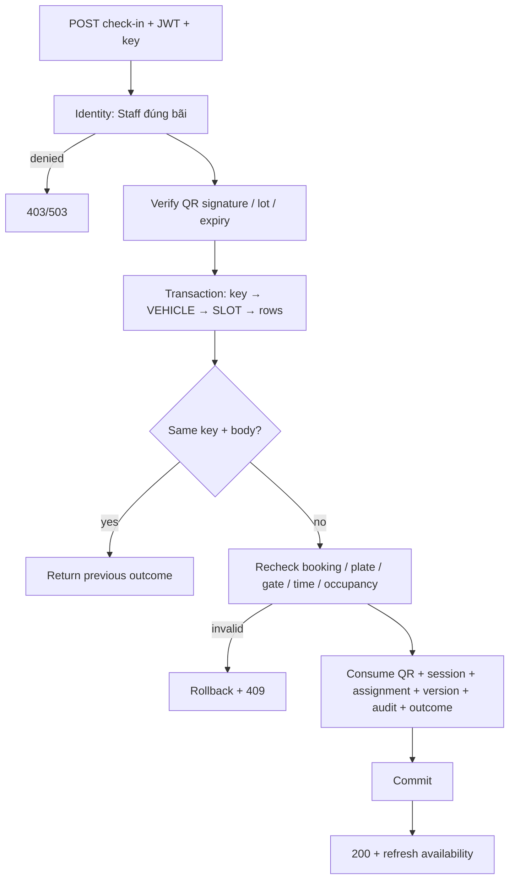

# SCRUM-49 / S2-05 — QR một lần và Staff check-in

Owner: Hàn. Runtime: .NET 9 / C# 13, microservices, Npgsql, Parking Persistence.

## Cơ sở yêu cầu

Đối chiếu Baseline V4, `02-BUSINESS-RULES.md`, `04-DATABASE.md`, `06-CODING-STANDARDS.md`,
`microservices/ARCHITECTURE.md`, thiết kế SCRUM-48 và bản phân tích mentor đã lưu trong workspace.
Các bài mentor đã khảo sát:

- https://classroom.google.com/c/ODY5NjYxNTExODM5/p/ODg3NjM3Nzc0ODY2/details — quy trình, mẫu API, UAT.
- https://classroom.google.com/c/ODY5NjYxNTExODM5/p/ODg3MjY3NjUzNjQw/details — SRS và bối cảnh hệ thống.
- https://classroom.google.com/c/ODY5NjYxNTExODM5/p/ODg2NTA3OTM0NjEx/details — tham khảo 3D.
- https://tn27062005.atlassian.net/browse/SCRUM-49 — phạm vi công việc.

Chốt với Hàn: hold **5 phút** trong dữ liệu policy; runtime tiếp tục đọc `hold_minutes`,
không thêm hằng số vào nghiệp vụ. QR chỉ phát khi booking **CONFIRMED** sau payment event
đã được server xác thực. Không dùng Spring Boot. Không lấy bản nháp trong stash đè lên runtime.

## API cấp QR

`POST /api/v1/bookings/{bookingId:guid}/qr`, JWT bắt buộc, body rỗng.
Chủ booking hoặc Staff/Manager được Identity cấp `LOOKUP` tại đúng bãi.
Booking phải CONFIRMED, còn arrival deadline, xe/bãi/slot hoạt động, có reservation CONFIRMED,
slot chưa có physical assignment. Cấp lại QR thu hồi các QR chưa dùng trước đó trong cùng transaction.

```json
{
  "result": {
    "bookingId": "7da3c6a1-41cc-412d-98e6-f53a280dadb8",
    "bookingCode": "BEXAMPLE",
    "qrPayload": "PARK1.<base64-claims>.<hmac-sha256>",
    "expiresAt": "2026-10-20T03:30:00Z"
  },
  "isSuccess": true,
  "statusCode": 200,
  "message": "Cấp mã QR thành công."
}
```

QR ký HMAC bằng `Qr:SigningKey` (ít nhất 32 byte), chứa booking/lot/vehicle, nonce ngẫu nhiên
256 bit và hạn đến bãi. DB chỉ giữ hash nonce, hạn dùng, consumed/revoked timestamps.
Không log QR/access token. Không có secret dự phòng trong source.

## API Staff check-in

`POST /api/v1/check-in`, JWT + header `Idempotency-Key` (1–128 ký tự).
Actor lấy từ JWT, không nhận actor/override từ client. Identity kiểm tra account active,
không bị lock, assignment PARKING_STAFF đúng bãi và còn hiệu lực bằng capability `CHECK_IN`.
Customer không được check-in, kể cả đang giữ QR của chính mình.

```json
{
  "lotId": "11111111-1111-4111-8111-111111111111",
  "gateId": "12345678-1234-4234-8234-123456789003",
  "qrPayload": "PARK1.<base64-claims>.<hmac-sha256>",
  "detectedPlate": "51A-123.45"
}
```

```json
{
  "result": {
    "sessionId": "12345678-1234-4234-8234-123456789004",
    "bookingId": "7da3c6a1-41cc-412d-98e6-f53a280dadb8",
    "lotId": "11111111-1111-4111-8111-111111111111",
    "slotId": "77777777-7777-4777-8777-777777777777",
    "status": "ACTIVE",
    "entryAt": "2026-10-20T03:00:00Z"
  },
  "isSuccess": true,
  "statusCode": 200,
  "message": "Check-in successful."
}
```

Biển số quan sát do Staff nhập/xác minh: bỏ dấu cách, `-`, `.`, chuyển uppercase; chỉ chấp nhận
A–Z/0–9, tối đa 20 ký tự sau chuẩn hóa. Phải khớp cả plate snapshot của booking và xe hiện tại.
Không coi chuỗi QR tự nó là bằng chứng xe thực tế; camera/ANPR tự động thuộc phạm vi khác.

Giao dịch kiểm tra lại state CONFIRMED, reservation, lot/slot/vehicle active, gate ENTRY/BOTH
thuộc đúng bãi, giờ hoạt động/closure, `starts_at - early_arrival_minutes <= DB now <= arrival_deadline`
và `DB now < ends_at`. Không nhận check-in override trong phạm vi này.

| HTTP | Ý nghĩa |
|---|---|
| 400 | IDs/input/plate/key không hợp lệ |
| 401 | JWT thiếu hoặc không hợp lệ |
| 403 | Sai owner/scope/assignment, Customer gọi check-in |
| 404 | Booking không tồn tại |
| 409 | Chưa trả tiền, QR sai/hết hạn/thu hồi/đã dùng, sai xe/cổng/giờ, state hoặc tài nguyên xung đột, key đổi body |
| 503 | Identity/DB unavailable hoặc service credentials không hợp lệ; không tự cho qua quyền |

Mọi REST response dùng envelope `result/isSuccess/statusCode/message`; không lộ SQL hoặc nội dung exception.

## Đồng thời, replay và physical occupancy

Thứ tự khóa: key-scoped advisory lock → VEHICLE → SLOT → booking/reservation → QR row.
Không gọi Identity hoặc provider trong lúc giữ transaction. Mọi request đều xác minh quyền trước.

Một transaction consume QR có điều kiện, tạo session ACTIVE, tạo một assignment mở,
booking CHECKED_IN và tăng version, release reservation với lý do CHECKED_IN, ghi audit và outcome.
Release reservation chỉ chuyển trách nhiệm sang physical assignment; **không làm slot AVAILABLE**.
Deferred occupancy triggers và unique/GiST guards tiếp tục có hiệu lực. Lỗi bất kỳ, kể cả commit,
rollback toàn bộ, bao gồm consume và outcome.

Cùng actor + key + body trả cùng kết quả (trong thời hạn xác minh QR), không tạo tác động lần hai.
Key mới dùng lại QR hoặc đổi body trên key cũ trả 409. Sau khi QR hết hạn, retry cũng bị từ chối
ở bước verify; tra booking/session để xác nhận kết quả cũ. Đây không phải lệnh mở barrier lần hai.
FE phải refetch availability/booking sau success; không dùng response để tự mở barrier nhiều lần.
Tích hợp phần cứng barrier và SignalR toàn hệ thống không nằm trong triển khai này.



```mermaid
sequenceDiagram
    participant UI as Staff UI
    participant API as Parking API
    participant ID as Identity gRPC
    participant DB as Parking PostgreSQL
    UI->>API: POST check-in (JWT, Idempotency-Key, QR, observed plate)
    API->>ID: CHECK_IN(actor, lot), x-service-key
    ID-->>API: Active account + valid assignment
    API->>API: Verify signed QR
    API->>DB: Begin; lock request key, VEHICLE, SLOT
    API->>DB: Recheck booking, gate, plate, time, nonce, occupancy
    API->>DB: Consume; insert session + assignment; booking/version; audit/outcome
    API->>DB: Commit (deferred guards)
    DB-->>API: Committed outcome
    API-->>UI: 200 DTO envelope
    UI->>API: GET availability / booking detail
```

## Cấu hình local

### Dependency do Identity owner triển khai

PR này chỉ chứa Parking và tài liệu/tests đi kèm. Không chứa sửa đổi source Identity hoặc shared
ServiceDefaults. Parking vẫn gọi Identity qua hợp đồng gRPC, không tự bỏ qua authorization.
Identity trên base `cd5a60b` chưa nhận capability `LOOKUP` và `CHECK_IN`; owner Identity cần bổ sung:

- `USER`: kiểm tra account ACTIVE và không bị khóa (đã có trên base).
- `LOOKUP`: Staff/Manager có assignment đúng lot, chưa revoke và còn thời hạn.
- `CHECK_IN`: PARKING_STAFF có assignment đúng lot, chưa revoke và còn thời hạn.

Trước khi owner cung cấp bản tương thích, luồng tích hợp có thể trả 403 dù JWT hợp lệ.
52 tests của lần thử trước dùng Identity chỉnh riêng tại máy Hàn; không phải bằng chứng bản PR
Parking chạy tích hợp đầy đủ với Identity nguyên trạng trên `dev`.

Parking HTTP 8080/gRPC 8081; Identity HTTP 5041/gRPC 5042 khi chạy local.
`Services:IdentityGrpc=http://127.0.0.1:5042` trong Parking User Secrets.
Hai service dùng cùng `Jwt:Key`, issuer; audience của Identity là `parking-api`.
`Grpc:ServiceKey` của hai bên phải giống nhau (ít nhất 32 ký tự).
Identity dùng `ConnectionStrings:DefaultConnectionString` tới `parking_identity`;
Parking dùng `ConnectionStrings:Service` tới database Parking.
Các giá trị nhạy cảm của Parking trong `appsettings.json` được để trống; mỗi máy cần cấu hình
`ConnectionStrings:Service`, `Jwt:Key`, `Grpc:ServiceKey`, `Qr:SigningKey` bằng User Secrets/environment.
Giữ khóa/mật khẩu trong User Secrets/environment, không chép vào tài liệu/Postman export.
Việc tắt bootstrap seed qua `SeedAccounts:Enabled=false` chỉ có trong bản Identity chỉnh local,
không thuộc PR này và không được giả định là có trên base. Dùng host Identity tương thích do owner
cấu hình; luôn cần account/assignment Staff hợp lệ để test.

## Kiểm thử và bàn giao

Chạy `scripts/Test-ParkingScrum48-49.ps1` từ Developer PowerShell. Mặc định build Parking/tests
và chọn 50 tests không cần hành vi Identity mới; hai tests có trait `IdentityIntegration` được loại
khỏi lượt chạy và script thông báo rõ. Chúng vẫn có trong source để kiểm tra khi dependency sẵn sàng.
Thêm `-IncludeIdentityIntegration` để build hai host và chạy đủ 52 tests khi có Identity tương thích.
Test PostgreSQL tạo database `scrum49_it_<random>` riêng trên localhost; HTTP test dùng port trống
và dọn đúng process/database do test tạo.
Cần PostgreSQL local và login có CREATEDB. Không xóa bảng hoặc sửa database Development.
Chạy `-Offline` khi dùng package đã cache; chỉ lần restore đó bỏ network vulnerability audit,
không thay đổi NuGet audit policy trong repo. Run online bình thường vẫn giữ audit mặc định.

Unit kiểm tra HMAC/tamper/key/expiry/parser/plate. Integration kiểm tra payment inbox replay,
5 phút hold, QR reissue/reuse, 10 concurrent scans, rollback sau consume, gate/time/maintenance,
scope hiện hành, availability/booking detail/hold expiry và invariant physical occupancy.
HTTP test dùng JWT thật từ Identity login, gRPC thật (bao gồm payment delivery), kiểm tra
401/400/403/409/200 và occupancy. Payment event trong test là event tổng hợp trong database
test, không chứng minh giao dịch VNPay/CASH thực tế hoặc barrier vật lý đã mở.
