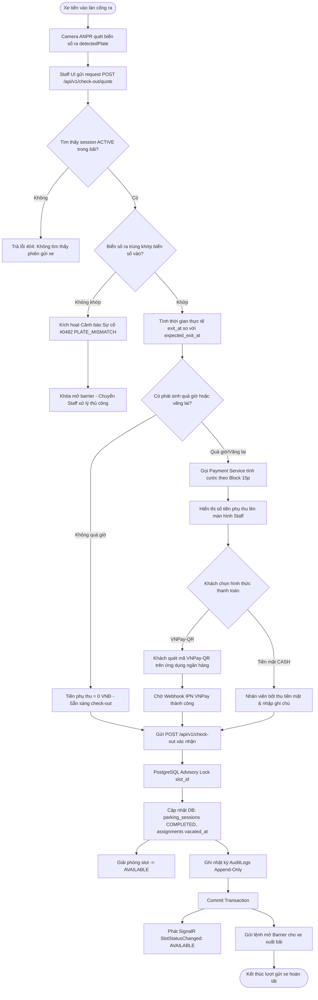
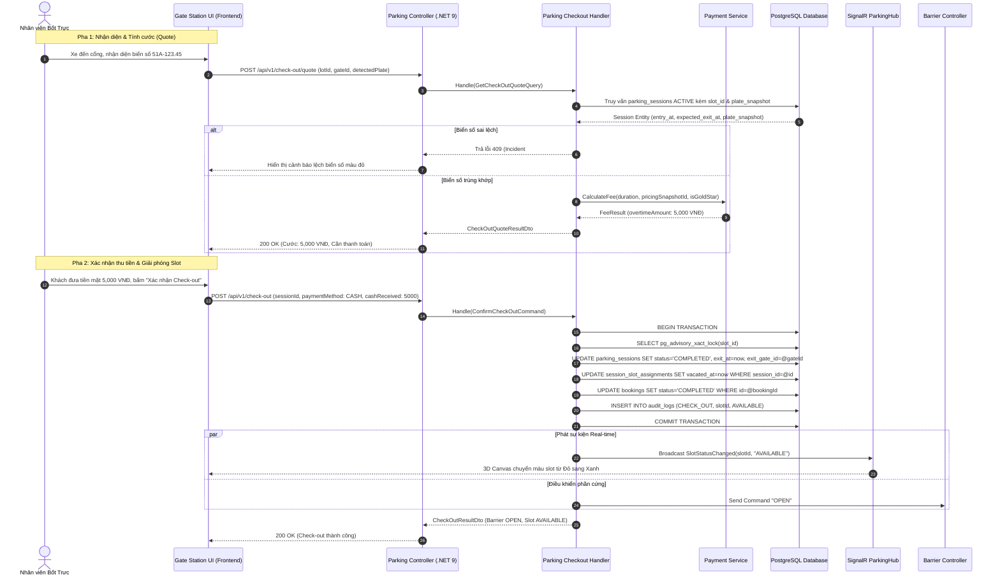

# SCRUM-70 / S3-04 — ĐẶC TẢ THIẾT KẾ API CHECK-OUT, ĐỐI SOÁT BIỂN SỐ & GIẢI PHÓNG SLOT

> **Tài liệu:** Thiết kế Kỹ thuật & Đặc tả API (API Design Specification)  
> **User Story:** SCRUM-70 / Task S3-04: `Parking: Luồng Check-out đối soát biển số, chốt cước & giải phóng slot Available`  
> **Người phụ trách (Owner):** Hàn (TV6 Hàn - Core Parking & Database)  
> **Phối hợp:** TV7 Sơn (Payment & Pricing), TV1 Phát (AI ANPR), TV4 Tiến (Staff Gate UI), TV3 A.Đức (3D Digital Twin)  
> **Thời gian:** 29/10/2026  
> **Tiêu chuẩn tuân thủ:** Clean Architecture, .NET 9 / C# 13, Standard Envelope `ApiResponse<T>`, PostgreSQL Advisory Lock.

---

## 1. TỔNG QUAN (OVERVIEW)

### 1.1. Bối cảnh & Mục đích
Sau khi xe đã thực hiện Check-in thành công (SCRUM-49) và chiếm giữ ô đỗ vật lý (`OCCUPIED`), hệ thống cần một luồng **Check-out khép kín** khi xe rời bãi đỗ:
1. **Đối soát nhận diện phương tiện:** Nhận diện biển số xe tại cổng ra (`detectedPlate`) từ camera trạm cổng (phối hợp AI OCR) hoặc mã vé QR, đối chiếu với biển số lúc vào (`plate_snapshot`).
2. **Kích hoạt cảnh báo sai lệch biển số (Incident #0482):** Ngăn chặn gian lận, tráo xe hoặc nhầm lẫn vé bằng cách khóa luồng check-out tự động khi phát hiện biển số không khớp và chuyển sang chế độ can thiệp thủ công của Staff.
3. **Chốt thời gian đỗ & Quyết toán cước phí:**
   - **Khách đặt trước (Booking):** Nếu ra đúng giờ (`currentTime <= expectedExitAt`), cước phụ thu là `0 VNĐ`. Nếu quá hạn (`currentTime > expectedExitAt`), tính phí phụ thu ngoài giờ (Overtime Fee) theo block 15 phút thông qua Payment Service.
   - **Khách vãng lai (Walk-in):** Tính cước phí toàn bộ thời gian gửi thực tế từ lúc vào đến lúc ra.
4. **Giải phóng ô đỗ & Đồng bộ thời gian thực:**
   - Đóng `parking_sessions` (`status = 'COMPLETED'`), cập nhật `session_slot_assignments` (`vacated_at = now`).
   - Giải phóng ô đỗ về **`AVAILABLE`** dưới sự bảo vệ của **PostgreSQL Advisory Lock** (`pg_advisory_xact_lock`).
   - Phát sự kiện SignalR `SlotStatusChanged` tới Web Client và 3D Digital Twin, đồng thời phát lệnh mở barrier cổng ra.

---

## 2. QUY TRÌNH NGHIỆP VỤ 2 GIAI ĐOẠN (TWO-PHASE CHECK-OUT)

Để đảm bảo hiệu năng (< 1.2s), trải nghiệm bốt trực thực tế và an toàn giao dịch, luồng Check-out được chia làm **2 API**:
1. **API 1 — Tính cước & Đối soát (Quote / Preview):** `POST /api/v1/check-out/quote`  
   Xe dừng trước vạch cổng ra -> Camera đọc biển số -> Hệ thống tra cứu phiên đỗ, đối soát biển số, tính tiền thừa/thiếu và hiển thị lên màn hình bốt trực.
2. **API 2 — Xác nhận Check-out & Mở cổng (Confirm & Release):** `POST /api/v1/check-out`  
   Sau khi khách thanh toán xong (tiền mặt cho Staff hoặc quét VNPay-QR thành công) -> Staff xác nhận hoặc hệ thống tự động hoàn tất check-out, giải phóng slot và mở barrier.

---

## 3. ĐẶC TẢ CHI TIẾT API 1: TÍNH CƯỚC & ĐỐI SOÁT (CHECK-OUT QUOTE)

### 3.1. Đặc tả kỹ thuật
- **Method:** `POST`
- **Endpoint:** `/api/v1/check-out/quote`
- **Authentication:** Yêu cầu JWT Token (Bearer).
- **Phân quyền (RBAC):** `PARKING_STAFF`, `PARKING_MANAGER` (có phân công hiệu lực tại bãi đỗ `lotId`).

### 3.2. Request Payload Mẫu
```json
{
  "lotId": "11111111-1111-4111-8111-111111111111",
  "gateId": "22222222-2222-4222-8222-222222222222",
  "detectedPlate": "51A-123.45",
  "qrPayload": null
}
```

**Bảng mô tả tham số đầu vào:**
| Trường (Field) | Kiểu dữ liệu | Bắt buộc | Mô tả & Ràng buộc |
| :--- | :---: | :---: | :--- |
| `lotId` | `UUID` | Có | Định danh bãi đỗ xe xảy ra check-out. |
| `gateId` | `UUID` | Có | Định danh cổng ra (phải là cổng OUT của đúng bãi đỗ). |
| `detectedPlate` | `string` | Có* | Biển số xe ghi nhận tại camera cổng ra (chuẩn hóa không dấu, VD: `51A-123.45`). |
| `qrPayload` | `string` | Không* | Chuỗi mã QR vé xuất trình (nếu dùng phương thức quét vé). |

*\* Bắt buộc có ít nhất một trong hai: `detectedPlate` hoặc `qrPayload`.*

### 3.3. Response Payload Mẫu (Thành công — 200 OK)
```json
{
  "result": {
    "sessionId": "a1b2c3d4-e5f6-4a1b-8c2d-3e4f5a6b7c8d",
    "bookingId": "7da3c6a1-41cc-412d-98e6-f53a280dadb8",
    "slotId": "77777777-7777-4777-8777-777777777777",
    "slotCode": "A01",
    "entryPlate": "51A-123.45",
    "exitPlate": "51A-123.45",
    "isPlateMatched": true,
    "entryAt": "2026-10-30T09:05:00+07:00",
    "expectedExitAt": "2026-10-30T10:05:00+07:00",
    "quoteAt": "2026-10-30T10:20:00+07:00",
    "totalDurationMinutes": 75,
    "overdueMinutes": 15,
    "prepaidAmount": 20000,
    "overtimeAmount": 5000,
    "totalAmountDue": 5000,
    "paymentRequired": true,
    "incidentCode": null
  },
  "isSuccess": true,
  "statusCode": 200,
  "message": "Tra cứu thông tin cước phí check-out thành công."
}
```

---

## 4. ĐẶC TẢ CHI TIẾT API 2: XÁC NHẬN CHECK-OUT & GIẢI PHÓNG SLOT (CONFIRM CHECK-OUT)

### 4.1. Đặc tả kỹ thuật
- **Method:** `POST`
- **Endpoint:** `/api/v1/check-out`
- **Headers bắt buộc:**
  - `Authorization: Bearer <Token>`
  - `Idempotency-Key: <UUID hoặc chuỗi duy nhất>` (Bảo đảm chống trừ tiền / mở barrier lặp lại)
- **Phân quyền (RBAC):** `PARKING_STAFF`, `PARKING_MANAGER` (có phân công tại đúng bãi).

### 4.2. Request Payload Mẫu
```json
{
  "sessionId": "a1b2c3d4-e5f6-4a1b-8c2d-3e4f5a6b7c8d",
  "gateId": "22222222-2222-4222-8222-222222222222",
  "paymentMethod": "CASH",
  "cashReceived": 5000,
  "paymentReference": null,
  "staffNotes": "Thu tiền mặt đủ tại bốt ra, barrier mở cho xe qua."
}
```

**Bảng mô tả tham số đầu vào:**
| Trường (Field) | Kiểu dữ liệu | Bắt buộc | Mô tả & Ràng buộc |
| :--- | :---: | :---: | :--- |
| `sessionId` | `UUID` | Có | Định danh phiên gửi xe đang ở trạng thái `ACTIVE`. |
| `gateId` | `UUID` | Có | Định danh cổng ra mà xe đang thực sự xuất bến. |
| `paymentMethod` | `string` | Có | Hình thức thanh toán: `NONE` (nếu tiền = 0), `CASH` (tiền mặt tại bốt), `VNPAY_QR`. |
| `cashReceived` | `decimal` | Có* | Số tiền mặt thực tế nhân viên thu từ khách (*bắt buộc nếu `paymentMethod = CASH`). |
| `paymentReference`| `string` | Không | Mã giao dịch tham chiếu từ cổng thanh toán (nếu thanh toán qua VNPay). |
| `staffNotes` | `string` | Không | Ghi chú của nhân viên bốt trực khi cho xe ra. |

### 4.3. Response Payload Mẫu (Thành công — 200 OK)
```json
{
  "result": {
    "sessionId": "a1b2c3d4-e5f6-4a1b-8c2d-3e4f5a6b7c8d",
    "bookingId": "7da3c6a1-41cc-412d-98e6-f53a280dadb8",
    "lotId": "11111111-1111-4111-8111-111111111111",
    "slotId": "77777777-7777-4777-8777-777777777777",
    "slotCode": "A01",
    "exitedAt": "2026-10-30T10:20:15+07:00",
    "finalAmountPaid": 5000,
    "paymentMethod": "CASH",
    "barrierStatus": "OPEN",
    "slotStatus": "AVAILABLE"
  },
  "isSuccess": true,
  "statusCode": 200,
  "message": "Xác nhận check-out thành công. Ô đỗ đã được giải phóng và mở barrier."
}
```

---

## 5. BẢNG MÃ LỖI VÀ XỬ LÝ NGOẠI LỆ (VALIDATION & ERROR CODES)

Tất cả phản hồi lỗi đều tuân thủ `ApiResponse<T>` với `isSuccess: false` và `result: null`:

| HTTP Status | Error / Business Code | Nguyên nhân vi phạm | Phản hồi mẫu (JSON) |
| :---: | :--- | :--- | :--- |
| **400** | `INVALID_ARGUMENT` | Thiếu biển số, sai định dạng UUID hoặc dữ liệu tiền âm. | `{"result": null, "isSuccess": false, "statusCode": 400, "message": "Biển số xe quan sát không được để trống."}` |
| **401** | `UNAUTHORIZED` | Token JWT không hợp lệ hoặc đã hết hạn. | `{"result": null, "isSuccess": false, "statusCode": 401, "message": "Yêu cầu xác thực tài khoản."}` |
| **403** | `FORBIDDEN_FACILITY` | Nhân viên không được phân công quản lý bãi xe này. | `{"result": null, "isSuccess": false, "statusCode": 403, "message": "Nhân viên không có quyền thao tác tại bãi đỗ xe này."}` |
| **404** | `SESSION_NOT_FOUND` | Không có phiên đỗ nào đang `ACTIVE` với biển số tương ứng tại bãi. | `{"result": null, "isSuccess": false, "statusCode": 404, "message": "Không tìm thấy phiên gửi xe hợp lệ đang hoạt động cho biển số này."}` |
| **409** | `INCIDENT_PLATE_MISMATCH` | Biển số xe lúc ra không khớp biển số lúc vào (Kích hoạt Incident #0482). | `{"result": null, "isSuccess": false, "statusCode": 409, "message": "Cảnh báo #0482: Biển số lúc ra không khớp với dữ liệu lúc vào bãi. Yêu cầu kiểm tra trực tiếp."}` |
| **409** | `PAYMENT_UNPAID` | Chưa hoàn tất thanh toán số tiền phụ thu mà đã bấm xác nhận check-out. | `{"result": null, "isSuccess": false, "statusCode": 409, "message": "Đơn gửi xe còn khoản phí chưa thanh toán (5,000 VNĐ). Không thể mở cổng."}` |
| **409** | `SESSION_ALREADY_COMPLETED` | Phiên gửi xe này đã được check-out trước đó. | `{"result": null, "isSuccess": false, "statusCode": 409, "message": "Phiên gửi xe này đã kết thúc."}` |

---

## 6. SƠ ĐỒ HOẠT ĐỘNG VÀ TRÌNH TỰ (DIAGRAMS)

### 6.1. Activity Diagram (Sơ đồ luồng nghiệp vụ Check-out)



---

### 6.2. Sequence Diagram (Sơ đồ trình tự tương tác các thành phần)



---

## 7. RÀNG BUỘC CSDL & DỮ LIỆU BẤT BIẾN (DATABASE INVARIANTS)

1. **Trigger `tr_session_identity` & `ct_session_occupancy`:**  
   Khi `parking_sessions` được cập nhật sang trạng thái `COMPLETED` kèm `exit_at`, bảng `session_slot_assignments` bắt buộc phải cập nhật `vacated_at = exit_at` trong cùng một transaction. Nếu không, PostgreSQL Trigger sẽ rollback toàn bộ giao dịch với lỗi mã `23514`.
2. **Khóa chống tranh chấp ô đỗ:**  
   Thao tác check-out phải giữ `pg_advisory_xact_lock(slot_id)` để đảm bảo ô đỗ không bị cấp cho booking mới hoặc worker khác can thiệp trong tích tắc đang đổi trạng thái.
3. **Phân quyền cơ sở (Facility-Scoped Isolation):**  
   Nhân viên bãi nào chỉ được phép thực hiện check-out cho xe tại bãi đó. Không thể dùng quyền ở Bãi A để xác nhận check-out cho xe ở Bãi B.
4. **Idempotency Key:**  
   Header `Idempotency-Key` bảo đảm nếu mạng chập chờn gửi lại 2 lần liên tiếp, hệ thống không thu tiền 2 lần và không ghi nhận 2 lần mở barrier.

---

## 8. DANH SÁCH FILE VÀ CẤU TRÚC CLEAN ARCHITECTURE DỰ KIẾN TRIỂN KHAI

Khi chuyển sang pha Implementation, mã nguồn sẽ được bố trí chuẩn chỉ theo Clean Architecture:

```
src/Services/Parking/
├── Parking.Parking.Api/
│   └── Controllers/
│       └── CheckOutController.cs                 // 2 Endpoints: Quote & Confirm
├── Parking.Parking.Application/
│   ├── DTOs/
│   │   ├── CheckOutQuoteRequestDto.cs
│   │   ├── CheckOutQuoteResultDto.cs
│   │   ├── ConfirmCheckOutRequestDto.cs
│   │   └── ConfirmCheckOutResultDto.cs
│   ├── Features/CheckOut/
│   │   ├── Queries/
│   │   │   ├── GetCheckOutQuoteQuery.cs
│   │   │   └── GetCheckOutQuoteQueryHandler.cs
│   │   └── Commands/
│   │       ├── ConfirmCheckOutCommand.cs
│   │       ├── ConfirmCheckOutCommandValidator.cs
│   │       └── ConfirmCheckOutCommandHandler.cs
│   └── Interfaces/
│       └── IParkingRepository.cs                 // Khai báo hàm GetActiveSession & CompleteCheckOutAsync
└── Parking.Parking.Persistence/
    └── Repositories/
        └── ParkingRepository.CheckOut.cs         // Thực thi SQL Transaction, Advisory Lock & Assignments
```
