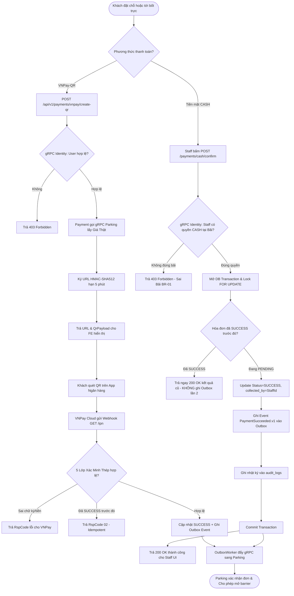
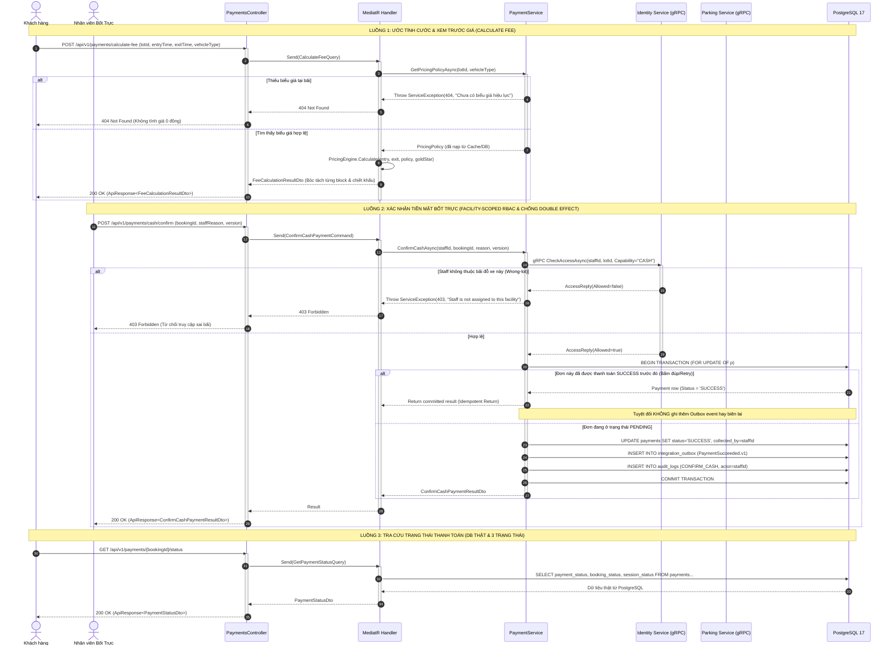

# THIẾT KẾ API: VNPAY-QR, XÁC NHẬN TIỀN MẶT BỐT TRỰC, TRA CỨU PAYMENT & TÍNH GIÁ CƯỚC (SCRUM-72 & SCRUM-95 [S3-06])

- **Mã User Story:** `SCRUM-72` & `SCRUM-95` | Phân hệ: `[S3-06][TV7 Sơn][P0]`
- **Sprint:** SCRUM Sprint 3
- **Owner:** TV7 Sơn (Payment & Pricing Engine)
- **Phối hợp liên kết:** TV4 Tiến (Staff UI - Bốt trực & Customer Frontend), TV6 Hàn (Core Parking - Barrier & Check-out), Quang (Mentor / QA)
- **Trạng thái:** Design Phase (Chuẩn hóa toàn diện theo APIDesignTemplate.md)

---

## 1. Overview & Mô hình Kinh doanh Bất biến (Core Invariants)

### 1.1. Mô hình Mua vé đỗ xe trả trước (Full Upfront Ticket) - KHÔNG ĐẶT CỌC:
- **Bản chất nghiệp vụ:** Hệ thống đỗ xe hoạt động theo mô hình **Mua vé đỗ xe trả trước trọn gói** tương tự như **Mua vé xem phim (chọn đúng rạp, đúng suất chiếu, đúng vị trí ghế)**.
- **Tính giá cuối cùng (Final Amount) ngay lúc đặt:**
  - Dù khách đặt ở nhà qua App hay đến bốt trả tiền mặt, hệ thống áp dụng đầy đủ: Biểu giá thật của bãi theo loại xe, phụ phí giờ cao điểm 1.2x (trưa `11:30 - 13:00` và chiều `17:30 - 19:00`), trần ngày `DailyCap` và **chiết khấu hội viên Gold Star (10%)** để ra **GIÁ CUỐI CÙNG**.
  - Khách thanh toán 100% số tiền này ngay lúc đặt. Khi thanh toán thành công, vị trí đỗ (`Slot`) thuộc quyền sử dụng độc quyền của khách trong toàn bộ khung giờ `[StartsAt, EndsAt)`.
- **Ra bãi đúng giờ:** Xe đến bãi quét QR vào, khi ra quét QR tự động mở barrier và rời bãi $\rightarrow$ **Không phải trả thêm bất kỳ đồng nào**.
- **Chỉ phát sinh chi phí khi vi phạm:** Chỉ khi khách về muộn hơn giờ kết thúc đã mua (**`OVERSTAY`**) hoặc đỗ sai vị trí, hệ thống tại barrier cổng ra mới tính tiền cước cho thời gian phát sinh vượt quá + tiền phạt vi phạm trước khi mở barrier.

### 1.2. Danh mục các API Endpoints trong tài liệu:
1. **API 1 - Sinh mã VNPay-QR động (`Create VNPay-QR`):** `POST /api/v1/payments/vnpay/create-qr` — Sinh mã QR thanh toán động theo đơn đặt xe, hạn 5 phút khớp với thời gian giữ chỗ (`Hold Policy - BR-08`), xác thực tài khoản qua gRPC Identity.
2. **API 2 - Webhook IPN Server-to-Server (`VNPay IPN Callback`):** `GET /api/v1/payments/vnpay/ipn` — Tiếp nhận callback tự động từ máy chủ VNPay, áp dụng **5 Lớp Xác minh Thép**.
3. **API 3 - Điều hướng Trình duyệt (`VNPay Return URL`):** `GET /api/v1/payments/vnpay/return` — Đón trình duyệt của khách hàng quay về sau khi thanh toán trên cổng VNPay (Chỉ đọc, không ghi DB).
4. **API 4 - Nhân viên Bốt Xác Nhận Thu Tiền Mặt (`Confirm Cash Payment`):** `POST /api/v1/payments/cash/confirm` — Nhân viên xác nhận thu tiền mặt, **bắt buộc kiểm tra quyền qua gRPC Identity (`Facility-Scoped RBAC - BR-01`)**, hỗ trợ cơ chế **Idempotent Return** chống double effect khi bấm đúp.
5. **API 5 - Tra Cứu Trạng Thái Thanh Toán (`Get Payment Status`):** `GET /api/v1/payments/{bookingId}/status` — Đọc dữ liệu CSDL thật, **phân định rõ ràng 3 trạng thái độc lập (`PaymentStatus` vs `BookingStatus` vs `SessionStatus`)** để Frontend không bị nhầm lẫn.
6. **API 6 - Xuất Hóa Đơn Điện Tử (`Get E-Receipt`):** `GET /api/v1/payments/{paymentId}/receipt` — Xuất biên lai điện tử (E-Receipt) kèm mã xác thực băm bảo mật SHA-256 đối soát.
7. **API 7 - Ước Tính Cước & Xem Trước Chi Phí (`Calculate Fee`):** `POST /api/v1/payments/calculate-fee` — Tính toán cước phí bóc tách chi tiết từng block theo biểu giá thật của bãi và loại xe. **Quy định cứng: Thiếu biểu giá trả lỗi 404 Not Found, tuyệt đối không trả về 0 đồng.**

---

## 2. Đặc Tả Kỹ Thuật Chi Tiết Các API Endpoints

### 2.1. API 1: Sinh mã VNPay-QR động cho đơn gửi xe
- **HTTP Method:** `POST`
- **URL Endpoint:** `/api/v1/payments/vnpay/create-qr`
- **Permission:** Customer / Guest
- **Xác thực qua gRPC Identity:** Gọi `identity.CheckAccessAsync(UserId, Capability = "USER")` (Graceful Fallback nếu gRPC timeout).
- **Header:** `Idempotency-Key` (bắt buộc, chuỗi ngẫu nhiên tối đa 128 ký tự để chống bấm đúp 2 lần).

#### Request Body Sample:
```json
{
  "bookingId": "c9a01234-5678-90ab-cdef-1234567890ab"
}
```

#### Response Body Sample (`200 OK` - Bọc trong `ApiResponse<PaymentQrResultDto>`):
```json
{
  "result": {
    "paymentId": "f1e2d3c4-b5a6-7890-1234-567890abcdef",
    "bookingId": "c9a01234-5678-90ab-cdef-1234567890ab",
    "amount": 45000,
    "currency": "VND",
    "merchantTxnRef": "a1b2c3d4e5f678901234567890abcdef",
    "paymentUrl": "https://sandbox.vnpayment.vn/paymentv2/vpcpay.html?vnp_Amount=4500000&vnp_Command=pay&vnp_CreateDate=20261028110000&vnp_CurrCode=VND&vnp_ExpireDate=20261028110500&vnp_IpAddr=127.0.0.1&vnp_Locale=vn&vnp_OrderInfo=Thanh+toan+ve+do+xe&vnp_OrderType=other&vnp_ReturnUrl=https%3A%2F%2Fdomain%2Freturn&vnp_TmnCode=LDWHY5M9&vnp_TxnRef=a1b2c3d4e5f678901234567890abcdef&vnp_Version=2.1.0&vnp_SecureHash=7a8b9c...",
    "qrPayload": "https://sandbox.vnpayment.vn/paymentv2/vpcpay.html?vnp_Amount=4500000...",
    "expiresAt": "2026-10-28T11:05:00Z"
  },
  "isSuccess": true,
  "statusCode": 200,
  "message": "Dynamic VNPay-QR generated successfully. Valid for 5 minutes."
}
```

---

### 2.2. API 2: Tiếp nhận Webhook IPN từ VNPay (Server-to-Server)
- **HTTP Method:** `GET`
- **URL Endpoint:** `/api/v1/payments/vnpay/ipn`
- **Permission:** Anonymous / Public (Máy chủ ngân hàng VNPay gọi trực tiếp)
- **Cơ chế xác thực:** Băm mật mã học `HMAC-SHA512` kiểm tra `vnp_SecureHash`.

#### Response Định Dạng Chuẩn VNPay:
```json
{
  "RspCode": "00",
  "Message": "Confirm Success"
}
```
*(Các mã lỗi trả về cho VNPay: `01` - Order not found; `02` - Order already confirmed; `04` - Invalid amount; `97` - Invalid signature).*

---

### 2.3. API 3: Trang điều hướng người dùng (Return URL)
- **HTTP Method:** `GET`
- **URL Endpoint:** `/api/v1/payments/vnpay/return`
- **Permission:** Public
- **Cơ chế:** Kiểm tra chữ ký số HMAC-SHA512, giải mã kết quả giao dịch để Frontend hiển thị màn hình thông báo (Read-only, không ghi DB).

#### Response Body Sample (`200 OK`):
```json
{
  "result": {
    "isSuccess": true,
    "txnRef": "a1b2c3d4e5f678901234567890abcdef",
    "amount": 45000,
    "bankCode": "NCB",
    "transactionNo": "14567890",
    "responseCode": "00"
  },
  "isSuccess": true,
  "statusCode": 200,
  "message": "Payment completed successfully. Parking spot confirmed."
}
```

---

### 2.4. API 4: Nhân viên Bốt Trực Xác Nhận Thu Tiền Mặt (CASH)
- **HTTP Method:** `POST`
- **URL Endpoint:** `/api/v1/payments/cash/confirm`
- **Permission:** `PARKING_STAFF` hoặc `PARKING_MANAGER`
- **Kiểm tra quyền qua gRPC Identity (Bắt buộc):** Gọi `identity.CheckAccessAsync(StaffId, LotId, Capability = "CASH")`. Nếu nhân viên không được gán quyền tại bãi này $\rightarrow$ Quăng lỗi **`403 Forbidden`** (Quy tắc `Facility-Scoped RBAC - BR-01`).
- **Cơ chế Chống Double Effect (Idempotency Guard):**
  - Khóa dòng bản ghi bằng PostgreSQL Row Lock (`FOR UPDATE OF p`).
  - Nếu hóa đơn đã ở trạng thái `SUCCESS` từ trước (do mạng lag nhân viên bấm 2 lần hoặc Frontend retry): Hàm lập tức trả về `200 OK` kèm thông tin thanh toán đã commit trước đó. **Tuyệt đối KHÔNG ghi thêm Outbox event lần 2, không tạo thêm biên lai trùng**.

#### Request Body Sample:
```json
{
  "bookingId": "c9a01234-5678-90ab-cdef-1234567890ab",
  "staffReason": "Khách thanh toán tiền mặt vé đỗ xe tại bốt trực",
  "version": 1
}
```

#### Response Body Sample (`200 OK` - Bọc trong `ApiResponse<ConfirmCashPaymentResultDto>`):
```json
{
  "result": {
    "paymentId": "f1e2d3c4-b5a6-7890-1234-567890abcdef",
    "status": "Success",
    "confirmedBy": "11223344-5566-7788-99aa-bbccddeeff00",
    "confirmedAt": "2026-10-28T11:02:15Z"
  },
  "isSuccess": true,
  "statusCode": 200,
  "message": "CASH payment confirmed. Receipt is being generated."
}
```

---

### 2.5. API 5: Tra cứu Trạng thái Thanh toán (Payment Status Lookup)
- **HTTP Method:** `GET`
- **URL Endpoint:** `/api/v1/payments/{bookingId}/status`
- **Permission:** Customer (chủ xe) hoặc `PARKING_STAFF` / `PARKING_MANAGER`
- **Mục tiêu:** Trả về dữ liệu từ CSDL thật. Phân biệt rõ 3 thực thể độc lập để Frontend hiển thị đúng ngữ cảnh:
  - `paymentStatus`: Tiền đã vào tài khoản chưa (`PENDING`, `SUCCESS`, `FAILED`).
  - `bookingStatus`: Vị trí giữ chỗ đã được xác nhận chưa (`PENDING_PAYMENT`, `CONFIRMED`, `EXPIRED`, `CANCELLED`).
  - `sessionStatus`: Xe vật lý đang ở đâu (`NOT_CHECKED_IN`, `ACTIVE` trong bãi, `COMPLETED` đã rời bãi).

#### Response Body Sample (`200 OK` - Bọc trong `ApiResponse<PaymentStatusDto>`):
```json
{
  "result": {
    "bookingId": "c9a01234-5678-90ab-cdef-1234567890ab",
    "paymentId": "f1e2d3c4-b5a6-7890-1234-567890abcdef",
    "paymentMethod": "CASH",
    "paymentStatus": "SUCCESS",
    "bookingStatus": "CONFIRMED",
    "sessionStatus": "NOT_CHECKED_IN",
    "totalAmount": 45000,
    "currency": "VND",
    "lastUpdatedAt": "2026-10-28T11:02:15Z"
  },
  "isSuccess": true,
  "statusCode": 200,
  "message": "Retrieved payment status successfully."
}
```

---

### 2.6. API 6: Xuất Hóa đơn Điện tử (E-Receipt)
- **HTTP Method:** `GET`
- **URL Endpoint:** `/api/v1/payments/{paymentId}/receipt`
- **Permission:** Customer (chủ xe) hoặc `PARKING_STAFF` / `PARKING_MANAGER`
- **Cơ chế:** Xuất biên lai điện tử có số hóa đơn chuẩn `REC-YYYYMMDD-XXXXXX` kèm mã băm bảo mật SHA-256 (`verificationHash`) ghép từ các trường dữ liệu bất biến để đối soát chống sửa đổi số tiền.

#### Response Body Sample (`200 OK` - Bọc trong `ApiResponse<EReceiptDto>`):
```json
{
  "result": {
    "receiptNumber": "REC-20261028-8F9ABC",
    "paymentId": "f1e2d3c4-b5a6-7890-1234-567890abcdef",
    "bookingId": "c9a01234-5678-90ab-cdef-1234567890ab",
    "lotName": "Bãi đỗ xe Trung tâm Quận 1",
    "plateNumber": "51A-888.88",
    "paymentMethod": "CASH",
    "totalAmount": 45000,
    "currency": "VND",
    "paidAt": "2026-10-28T11:02:15Z",
    "collectedByStaff": "11223344-5566-7788-99aa-bbccddeeff00",
    "bankTransactionNo": null,
    "verificationHash": "9f83c605d4c82b3e925b99a28794ff24a48c48a734b4f6057a73d324b1a45700"
  },
  "isSuccess": true,
  "statusCode": 200,
  "message": "Electronic receipt retrieved successfully."
}
```

---

### 2.7. API 7: Ước tính Cước & Xem trước Chi phí (Calculate Fee)
- **HTTP Method:** `POST`
- **URL Endpoint:** `/api/v1/payments/calculate-fee`
- **Permission:** Public / Customer / Staff
- **Mục tiêu:** Kích hoạt Động cơ tính cước thông minh `PricingEngine.Calculate`:
  - Phân tách Block khởi đầu (ví dụ 60 phút đầu) và các block bước nhảy (mỗi 15 phút).
  - Tự động phát hiện 2 khung giờ cao điểm `11:30 - 13:00` và `17:30 - 19:00` để nhân hệ số `1.2x`.
  - Phân tách theo nửa đêm và áp mức trần ngày `DailyCap`.
  - Áp dụng chiết khấu hội viên thân thiết `Gold Star` giảm 10%.
- **QUY ĐỊNH BẮT LỖI CỨNG (Hợp đồng Mentor Quang):** 
  - Biểu giá phải lấy đúng theo bãi (`ParkingLotId`), loại xe (`VehicleType`: `CAR` hoặc `MOTORBIKE`) và thời điểm có hiệu lực.
  - Nếu bãi chưa cấu hình biểu giá cho loại xe này $\rightarrow$ **Quăng ngay lỗi `404 Not Found`**, tuyệt đối KHÔNG trả về giá 0 đồng!

#### Request Body Sample:
```json
{
  "parkingLotId": "b1a2c3d4-e5f6-7890-1234-567890abcdef",
  "entryTime": "2026-10-28T11:00:00+07:00",
  "exitTime": "2026-10-28T14:00:00+07:00",
  "vehicleType": "CAR",
  "isGoldStarMember": true
}
```

#### Response Body Sample (`200 OK` - Bọc trong `ApiResponse<FeeCalculationResultDto>`):
```json
{
  "result": {
    "parkingLotId": "b1a2c3d4-e5f6-7890-1234-567890abcdef",
    "entryTime": "2026-10-28T11:00:00+07:00",
    "exitTime": "2026-10-28T14:00:00+07:00",
    "totalMinutes": 180,
    "totalBillableBlocks": 9,
    "totalGrossAmountVnd": 62000,
    "totalDailyCapDiscountVnd": 0,
    "subtotalAfterDailyCapVnd": 62000,
    "isGoldStarMember": true,
    "goldStarDiscountAmountVnd": 6200,
    "finalNetAmountVnd": 55800,
    "currency": "VND",
    "dailyBreakdowns": [
      {
        "date": "2026-10-28",
        "startTime": "2026-10-28T11:00:00+07:00",
        "endTime": "2026-10-28T14:00:00+07:00",
        "totalBlocks": 9,
        "peakBlocks": 6,
        "grossAmountVnd": 62000,
        "dailyCapDiscountVnd": 0,
        "netAmountVnd": 62000
      }
    ]
  },
  "isSuccess": true,
  "statusCode": 200,
  "message": "Calculated parking fee successfully."
}
```

---

## 3. Danh Mục Mã Lỗi Chuẩn Hóa (Validation & Error Codes)

Mọi phản hồi lỗi đều được chuẩn hóa theo chuẩn `ProblemDetails` bọc trong `ApiResponse<T>`:

| HTTP Status | Nguyên nhân lỗi | Thông điệp trả về (`ApiResponse.Message`) |
| :---: | :--- | :--- |
| **`400`** | Thiếu BookingId, sai khoảng thời gian (ExitTime <= EntryTime), lý do thu tiền để trống | `"Invalid request parameters. Please verify input data."` |
| **`403`** | Nhân viên thu tiền nhầm bãi (Wrong-lot RBAC qua gRPC Identity) hoặc tài khoản bị khóa | `"Forbidden. Staff is not assigned to this parking facility or user account suspended."` |
| **`404`** | Không tìm thấy đơn thanh toán, hoặc **bãi xe chưa cấu hình biểu giá hiệu lực** | `"Payment record, booking or valid pricing plan not found."` |
| **`409`** | Xung đột phương thức (đơn VNPay mà lại ra bốt xác nhận tiền mặt) | `"Payment method conflict. Only CASH payments can be confirmed at counter."` |
| **`422`** | Xung đột phiên bản dữ liệu Concurrency (Version mismatch) | `"Concurrency version mismatch. Please reload transaction state."` |
| **`503`** | Dịch vụ Identity/Parking gRPC không phản hồi hoặc mất kết nối Database | `"Service temporarily unavailable. Please retry shortly."` |

---

## 4. Sơ Đồ Thiết Kế Trực Quan (Diagrams)

### 4.1. Activity Diagram: Toàn bộ Quy trình Thanh toán, Phân quyền & Chống Double Effect


---

### 4.2. Sequence Diagram: Tương tác Tuần tự Chi tiết (Identity gRPC, Parking gRPC & PostgreSQL)

