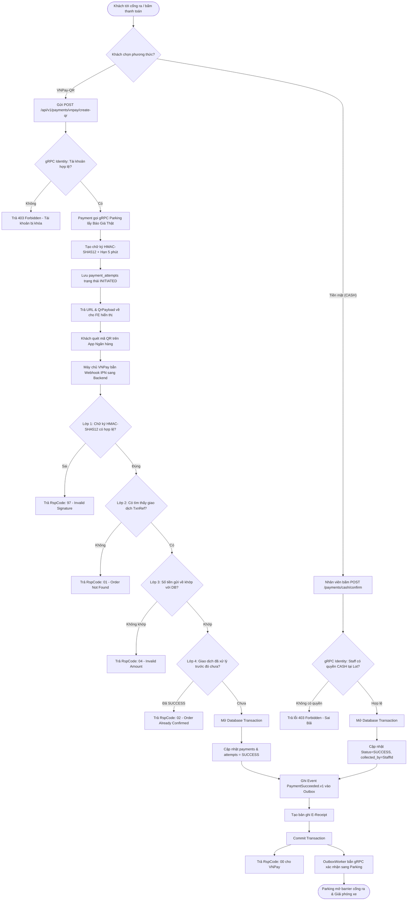
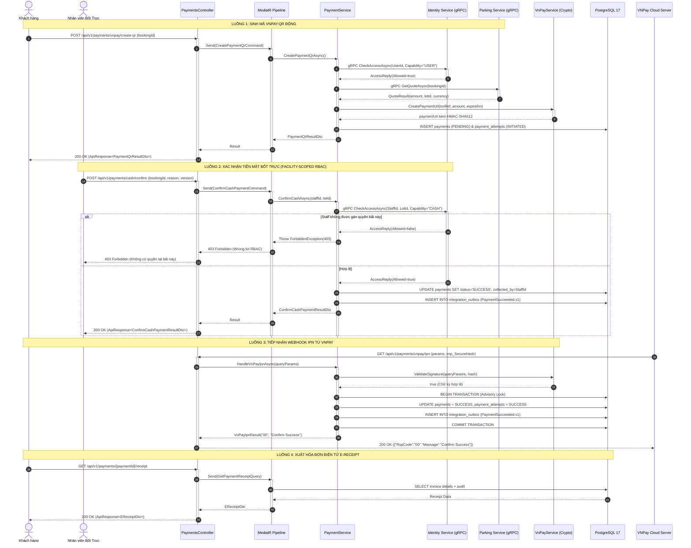

# THIẾT KẾ API: VNPAY-QR ĐỘNG & THANH TOÁN TIỀN MẶT BỐT TRỰC KÈM E-RECEIPT (SCRUM-72 [S3-06])

- **Mã User Story:** `SCRUM-72` | Phân hệ: `[S3-06][TV7 Sơn][P0]`
- **Sprint:** SCRUM Sprint 3
- **Owner:** TV7 Sơn (Payment & Pricing)
- **Phối hợp liên kết:** TV4 Tiến (Staff UI - Bốt trực), TV6 Hàn (Check-out & Mở barrier cổng ra)
- **Trạng thái:** Design Phase (Chuẩn theo APIDesignTemplate.md)

---

## 1. Overview (Tổng quan Nghiệp vụ)

Tài liệu này đặc tả toàn diện các API thuộc phân hệ thanh toán tại cổng và bốt trực:
1. **API 1 - Sinh mã VNPay-QR động (`Create VNPay-QR`):** Sinh mã QR thanh toán động theo đơn đặt xe, chứa số tiền đã tính từ Pricing Engine (S3-05), mã giao dịch tham chiếu duy nhất, thời hạn quét đúng **5 phút** khớp với thời gian giữ chỗ (`Hold Policy - BR-08`). **Được xác thực quyền tài khoản qua gRPC Identity Service**.
2. **API 2 - Webhook IPN Server-to-Server (`VNPay IPN Callback`):** Tiếp nhận callback tự động từ máy chủ VNPay, áp dụng **5 Lớp Xác minh Thép** (chữ ký số HMAC-SHA512, đối soát số tiền x100, kiểm tra trạng thái Idempotency, ghi sự kiện Outbox nguyên tử).
3. **API 3 - Điều hướng Trình duyệt (`VNPay Return URL`):** Đón trình duyệt của khách hàng quay về sau khi thanh toán trên cổng VNPay, chỉ đọc kết quả để hiển thị giao diện, không ghi Database.
4. **API 4 - Xác nhận Tiền mặt tại Bốt (`Confirm Cash Payment`):** Nhân viên bốt trực xác nhận thu tiền mặt, **bắt buộc kiểm tra quyền bốt trực qua gRPC Identity Service (`Facility-Scoped RBAC - BR-01`)**, ghi nhận `UserId` nhân viên thu (`collected_by`).
5. **API 5 - Xuất Hóa đơn Điện tử (`Get E-Receipt`):** Cung cấp mã giao dịch và xuất biên lai điện tử (E-Receipt) sau khi thanh toán thành công (dù là VNPay hay Tiền mặt), kèm mã xác thực số để nhân viên bốt hoặc hệ thống barrier đối soát cho xe xuất bãi.

---

## 2. Đặc Tả Kỹ Thuật Chi Tiết Các API Endpoints

### 2.1. API 1: Sinh mã VNPay-QR động cho đơn gửi xe
- **HTTP Method:** `POST`
- **URL Endpoint:** `/api/v1/payments/vnpay/create-qr`
- **Permission:** Customer / Guest
- **Xác thực qua gRPC Identity:** Gọi `identity.CheckAccessAsync(UserId, Capability = "USER")`. *(Cơ chế Graceful Fallback: nếu gRPC Identity offline cục bộ, đọc an toàn từ JWT Claims)*.
- **Header:** `Idempotency-Key` (bắt buộc, chuỗi ngẫu nhiên tối đa 128 ký tự để chống bấm đúp 2 lần)

#### Request Body Sample:
```json
{
  "bookingId": "c9a01234-5678-90ab-cdef-1234567890ab"
}
```

#### Response Body Sample (`200 OK` - Bọc trong `ApiResponse<PaymentQrResultDto>`):
```json
{
  "result": {
    "paymentId": "f1e2d3c4-b5a6-7890-1234-567890abcdef",
    "bookingId": "c9a01234-5678-90ab-cdef-1234567890ab",
    "amount": 45000,
    "currency": "VND",
    "merchantTxnRef": "a1b2c3d4e5f678901234567890abcdef",
    "paymentUrl": "https://sandbox.vnpayment.vn/paymentv2/vpcpay.html?vnp_Amount=4500000&vnp_Command=pay&vnp_CreateDate=20261027110000&vnp_CurrCode=VND&vnp_ExpireDate=20261027110500&vnp_IpAddr=127.0.0.1&vnp_Locale=vn&vnp_OrderInfo=Thanh+toan+giu+cho&vnp_OrderType=other&vnp_ReturnUrl=https%3A%2F%2Fdomain%2Freturn&vnp_TmnCode=LDWHY5M9&vnp_TxnRef=a1b2c3d4e5f678901234567890abcdef&vnp_Version=2.1.0&vnp_SecureHash=7a8b9c...",
    "qrPayload": "https://sandbox.vnpayment.vn/paymentv2/vpcpay.html?vnp_Amount=4500000...",
    "expiresAt": "2026-10-27T11:05:00Z"
  },
  "isSuccess": true,
  "statusCode": 200,
  "message": "Dynamic VNPay-QR generated successfully. Valid for 5 minutes."
}
```

---

### 2.2. API 2: Tiếp nhận Webhook IPN từ VNPay (Server-to-Server)
- **HTTP Method:** `GET`
- **URL Endpoint:** `/api/v1/payments/vnpay/ipn`
- **Permission:** Anonymous / Public (Máy chủ ngân hàng VNPay gọi trực tiếp, không mang JWT Token)
- **Cơ chế xác thực:** Băm mật mã học `HMAC-SHA512` kiểm tra `vnp_SecureHash`

#### Response Định Dạng Chuẩn VNPay (Bắt buộc theo chuẩn cổng thanh toán):
```json
{
  "RspCode": "00",
  "Message": "Confirm Success"
}
```
*(Các mã lỗi trả về cho VNPay: `01` - Order not found; `02` - Order already confirmed; `04` - Invalid amount; `97` - Invalid signature).*

---

### 2.3. API 3: Trang điều hướng người dùng (Return URL)
- **HTTP Method:** `GET`
- **URL Endpoint:** `/api/v1/payments/vnpay/return`
- **Permission:** Public
- **Cơ chế:** Kiểm tra chữ ký số HMAC-SHA512, giải mã kết quả giao dịch và trả về cho giao diện Frontend hiển thị:

```json
{
  "result": {
    "isSuccess": true,
    "txnRef": "a1b2c3d4e5f678901234567890abcdef",
    "amount": 45000,
    "bankCode": "NCB",
    "transactionNo": "14567890",
    "responseCode": "00"
  },
  "isSuccess": true,
  "statusCode": 200,
  "message": "Payment completed successfully. Parking spot confirmed."
}
```

---

### 2.4. API 4: Nhân viên Bốt Trực Xác Nhận Thu Tiền Mặt (CASH)
- **HTTP Method:** `POST`
- **URL Endpoint:** `/api/v1/payments/cash/confirm`
- **Permission:** `PARKING_STAFF` hoặc `PARKING_MANAGER`
- **Xác thực qua gRPC Identity (Bắt buộc):** Gọi `identity.CheckAccessAsync(StaffId, LotId, Capability = "CASH")`. Nếu nhân viên không thuộc bãi đỗ xe này -> Quăng lỗi **`403 Forbidden`** (Wrong-lot RBAC theo `BR-01`).

#### Request Body Sample:
```json
{
  "bookingId": "c9a01234-5678-90ab-cdef-1234567890ab",
  "staffReason": "Khách thanh toán tiền mặt tại bốt barrier cổng OUT",
  "version": 1
}
```

#### Response Body Sample (`200 OK` - Bọc trong `ApiResponse<ConfirmCashPaymentResultDto>`):
```json
{
  "result": {
    "paymentId": "f1e2d3c4-b5a6-7890-1234-567890abcdef",
    "status": "Success",
    "confirmedBy": "staff_01",
    "confirmedAt": "2026-10-27T11:02:15Z"
  },
  "isSuccess": true,
  "statusCode": 200,
  "message": "CASH payment confirmed. Receipt is being generated."
}
```

---

### 2.5. API 5: Tra cứu Hóa đơn Điện tử (E-Receipt)
- **HTTP Method:** `GET`
- **URL Endpoint:** `/api/v1/payments/{paymentId}/receipt`
- **Permission:** Customer (chủ xe) hoặc `PARKING_STAFF` / `PARKING_MANAGER`

#### Response Body Sample (`200 OK` - Bọc trong `ApiResponse<EReceiptDto>`):
```json
{
  "result": {
    "receiptNumber": "REC-20261027-8F9A",
    "paymentId": "f1e2d3c4-b5a6-7890-1234-567890abcdef",
    "bookingId": "c9a01234-5678-90ab-cdef-1234567890ab",
    "lotName": "Bãi đỗ xe Trung tâm Quận 1",
    "plateNumber": "30H-888.88",
    "paymentMethod": "VNPAY",
    "totalAmount": 45000,
    "currency": "VND",
    "paidAt": "2026-10-27T11:02:15Z",
    "collectedByStaff": null,
    "bankTransactionNo": "14567890",
    "verificationHash": "e3b0c44298fc1c149afbf4c8996fb92427ae41e4649b934ca495991b7852b855"
  },
  "isSuccess": true,
  "statusCode": 200,
  "message": "Electronic receipt retrieved successfully."
}
```

---

## 3. Danh Mục Mã Lỗi Chuẩn Hóa (Validation & Error Codes)

| HTTP Status | Nguyên nhân lỗi | Thông điệp trả về (`ApiResponse.Message`) |
| :---: | :--- | :--- |
| **400** | Thiếu Idempotency-Key hoặc BookingId rỗng | `Booking ID and Idempotency-Key header are required.` |
| **403** | Tài khoản không hợp lệ hoặc Nhân viên thu tiền nhầm bãi (Wrong-lot RBAC qua gRPC Identity) | `Forbidden. Staff is not assigned to this parking facility or user account unavailable.` |
| **404** | Không tìm thấy đơn thanh toán hoặc đơn đặt chỗ | `Payment record or booking not found.` |
| **409** | Xung đột Idempotency hoặc đơn đã thanh toán trước đó | `Payment already confirmed or idempotency key reused with different parameters.` |
| **422** | Xung đột phiên bản dữ liệu Concurrency | `Concurrency version mismatch. Please reload transaction state.` |
| **503** | Mất kết nối Database hoặc cổng VNPay không phản hồi | `Service temporarily unavailable. Please retry shortly.` |

---

## 4. Sơ Đồ Thiết Kế Trực Quan (Diagrams)

### 4.1. Activity Diagram: Luồng Tạo QR / Thu Tiền Mặt ➔ Xác Thực Identity ➔ IPN ➔ E-Receipt


---

### 4.2. Sequence Diagram: Tương tác Tuần tự Bao Gồm Cả Identity Service (gRPC)

