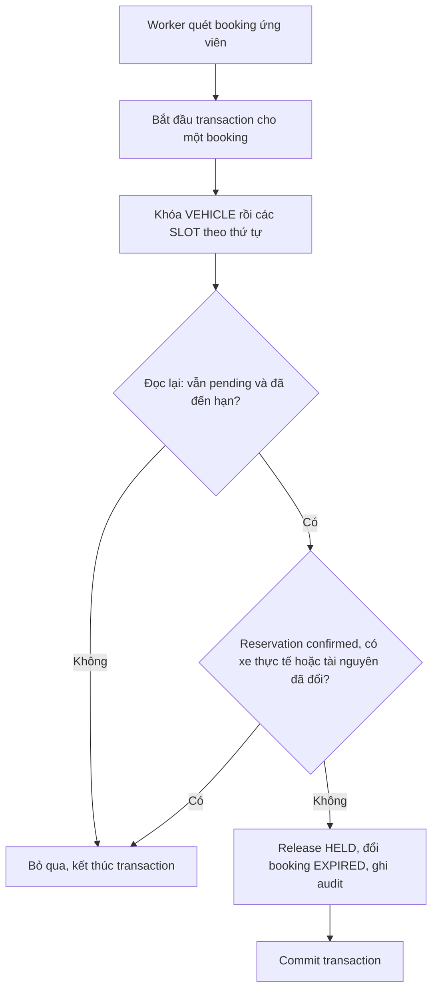
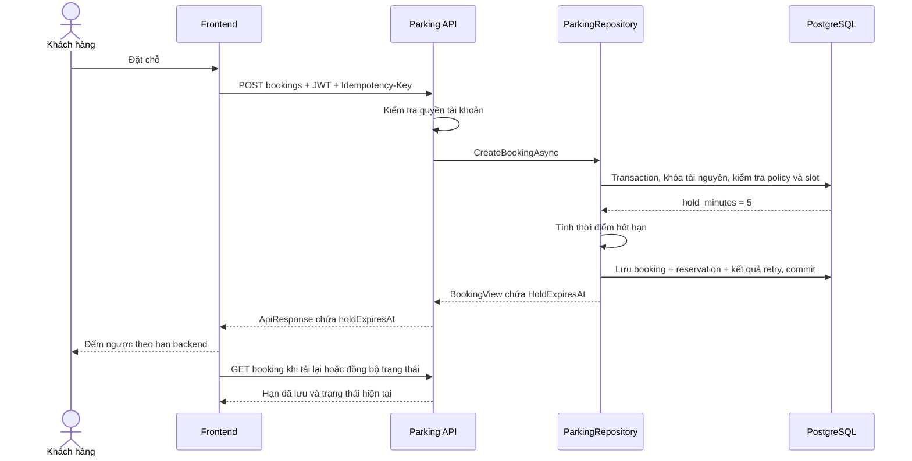

# SCRUM-100 — Đồng bộ giữ chỗ mặc định 5 phút

- Người thực hiện: Hàn.
- Jira: [SCRUM-100](https://tn27062005.atlassian.net/browse/SCRUM-100).
- Ngày ghi nhận: 29/10/2026.
- Trạng thái: thiết kế ban đầu; đã cập nhật hai policy Development, chưa hoàn tất kiểm thử nghiệm thu.

## 1. Mục tiêu và phạm vi

Khách đặt chỗ có mặc định **5 phút để thanh toán**. Backend tính thời điểm hết hạn, lưu vào database và trả cho frontend để hiển thị đếm ngược.

SCRUM-100 hoàn thiện luồng giữ chỗ đã có từ SCRUM-48. Phạm vi gồm cấu hình, dữ liệu mẫu, thời điểm hết hạn trong API, worker, thanh toán trễ, kiểm thử và tài liệu liên quan. Luồng check-in/check-out mới thuộc các nhiệm vụ khác.

Yêu cầu 5 phút trong SCRUM-100 là cập nhật mới từ mentor, thay cho mô tả hold 15 phút trong một số tài liệu cũ. Những giá trị 15 phút dùng cho block tính phí, OTP/token hoặc giờ đến sớm có ý nghĩa riêng; phải đọc ngữ cảnh trước khi sửa.

## 2. Những khái niệm cần hiểu

| Khái niệm | Ý nghĩa | Ví dụ |
|---|---|---|
| `hold_minutes` | Số phút giữ chỗ, cấu hình theo bãi và loại xe | `5` |
| `hold_expires_at` | Thời điểm hết hạn lưu trong database | `2026-10-29T02:05:00Z` |
| `HoldExpiresAt` | Tên thuộc tính C# của thời điểm hết hạn | `DateTimeOffset` |
| `holdExpiresAt` | Tên trường JSON frontend nhận | Cùng thời điểm do backend trả |
| `PENDING_PAYMENT` | Booking đang chờ thanh toán | Hold còn hiệu lực khi chưa đến hạn |
| `HELD` | Reservation đang giữ tài nguyên cho booking | Chưa đồng nghĩa có xe đang đỗ |
| Physical occupancy | Xe thực tế đang chiếm chỗ | Assignment có `vacated_at IS NULL` |

Ví dụ: backend tính hạn lúc **09:00**, policy là **5 phút**, thì hạn là **09:05**. Khách mở trang lúc 09:02 sẽ thấy còn khoảng 3 phút. Tải lại trang vẫn phải dùng hạn 09:05 đã lưu.

## 3. Hiện trạng đã xác minh

| Thành phần | Hiện trạng | Công việc tiếp theo |
|---|---|---|
| Tạo booking | Đọc `lot_vehicle_policies.hold_minutes` và tính hạn bằng `UtcNow.AddMinutes(hold)` | Giữ khả năng cấu hình theo bãi; bổ sung kiểm chứng |
| Dữ liệu mẫu `002_demo_fixture.sql` | Hai policy mẫu đã là 5 phút | Rà các fixture và nơi tạo policy khác |
| Database Development `Parking_3D` | Hai policy CAR/MOTORBIKE trước đó là 15; đã cập nhật thành 5 và đọc lại sau commit | Kiểm tra booking mới qua API |
| Schema | `hold_minutes` là `NOT NULL`, có ràng buộc dương; chưa khai báo SQL `DEFAULT 5` | Xác định và kiểm thử nơi cấp giá trị mặc định khi tạo policy |
| API tạo và xem booking | Đã có trường thời điểm hết hạn | Đối chiếu response với giá trị database |
| Worker | Chạy khoảng mỗi 10 giây, đọc hạn đã lưu và kiểm tra lại dưới khóa | Kiểm thử biên thời gian, chạy lặp và bảo vệ xe đang đỗ |
| Frontend | Trang booking đã đếm ngược theo `holdExpiresAt`, cập nhật đồng hồ mỗi giây | Kiểm tra thực tế cùng A.Đức, gồm tải lại trang và lệch đồng hồ máy khách |
| Tài liệu/chatbot | Vẫn có một số mô tả giữ chỗ 15 phút | Rà và đồng bộ đúng phạm vi; trao đổi chủ phần AI trước khi sửa |

Việc cập nhật hai dòng dữ liệu Development chưa làm SCRUM-100 hoàn thành. Chưa chạy build, bộ test hoặc kiểm thử API/UI cho lượt cập nhật này.

### 3.1. Thay đổi Development đã thực hiện

| Bãi | Loại xe | Trước | Sau |
|---|---|---:|---:|
| `11111111-1111-4111-8111-111111111111` | CAR | 15 | 5 |
| `22222222-2222-4222-8222-222222222222` | MOTORBIKE | 15 | 5 |

Chỉ thay đổi policy. Booking đã tạo vẫn giữ thời điểm `hold_expires_at` cũ. Thay đổi dữ liệu trực tiếp này chưa phải script migration được lưu trong repository cho các môi trường khác.

## 4. Quy tắc thiết kế

1. Mặc định hold là **5 phút**; tiếp tục hỗ trợ policy riêng cho bãi và loại xe.
2. Backend lấy thời lượng từ policy, tính hạn một lần cho booking mới và lưu trong transaction tạo booking.
3. Frontend sử dụng `holdExpiresAt` từ backend; tải lại trang không kéo dài hạn.
4. Khi thời gian backend **nhỏ hơn** hạn, hold chưa hết hạn. Khi **bằng hoặc lớn hơn** hạn, hold đã hết hạn.
5. Worker dùng hạn đã lưu, không tính lại bằng policy hiện tại. Đổi policy không tự kéo dài hoặc rút ngắn booking cũ.
6. Booking `CONFIRMED` không bị worker hết hold hủy. Chỗ có xe thực tế vẫn được bảo vệ.
7. Thao tác ghi phải giữ transaction, advisory lock, thứ tự khóa `VEHICLE → SLOT` và ràng buộc chống overlap. Nhiều slot phải được khóa theo thứ tự thống nhất.
8. Thanh toán đến trễ phải được kiểm tra lại dưới khóa; không xác nhận booking chỉ dựa vào trạng thái frontend hoặc thời gian client gửi lên. Đối soát/hoàn tiền cần theo hợp đồng Payment, không coi booking tự động được xác nhận.

**Lưu ý về worker:** chu kỳ 10 giây là chu kỳ dọn dữ liệu, không phải phần cộng thêm vào thời hạn thanh toán. Giao diện có thể về 0 trong lúc trạng thái lưu vẫn chờ worker cập nhật; backend phải từ chối xác nhận thanh toán đã quá hạn ngay cả khi worker chưa chạy.

## 5. API và hợp đồng với frontend

Sử dụng endpoint hiện có; chưa đề xuất endpoint mới cho SCRUM-100.

| API | Mục đích | Quyền |
|---|---|---|
| `POST /api/v1/bookings` | Tạo booking, trả thời điểm hết hạn | JWT hợp lệ, kiểm tra tài khoản và quyền dùng xe; cần `Idempotency-Key` |
| `GET /api/v1/bookings/{bookingId}` | Đọc lại hạn và trạng thái booking | Chủ booking hoặc quyền `LOOKUP` tại đúng bãi |

### 5.1. Request tạo booking minh họa

Thêm header `Authorization: Bearer <token>` và `Idempotency-Key: <unique-key>`.

```json
{
  "lotId": "11111111-1111-4111-8111-111111111111",
  "slotId": "77777777-7777-4777-8777-777777777777",
  "vehicleId": "99999999-9999-4999-8999-999999999999",
  "startsAt": "2026-10-30T02:30:00Z",
  "endsAt": "2026-10-30T03:30:00Z"
}
```

ID và ngày giờ chỉ minh họa; khi thử API phải dùng tài nguyên có thật, xe được xác minh thuộc quyền tài khoản, thời gian tương lai và slot còn khả dụng. Client không gửi thời hạn hold để tự quyết định.

### 5.2. Response tạo booking minh họa

Giả sử backend tính hạn lúc `2026-10-30T02:00:00Z`, policy 5 phút:

```json
{
  "result": {
    "id": "aaaaaaaa-aaaa-4aaa-8aaa-aaaaaaaaaaaa",
    "code": "BEXAMPLE",
    "status": "PENDING_PAYMENT",
    "estimatedAmount": 30000,
    "holdExpiresAt": "2026-10-30T02:05:00Z",
    "version": 1
  },
  "isSuccess": true,
  "statusCode": 200,
  "message": "Success"
}
```

Đây là ví dụ thiết kế, không phải kết quả API đã chạy. GET chi tiết có cấu trúc DTO riêng và cũng trả `holdExpiresAt`. Hai API phải thể hiện cùng thời điểm đã lưu, không tính lại hạn khi đọc.

### 5.3. Kiểm tra dữ liệu và lỗi

Giữ nguyên envelope `result/isSuccess/statusCode/message` và các kiểm tra quyền hiện có. Không đổi mã lỗi trong phạm vi đồng bộ thời gian nếu chưa xác định nhu cầu.

| HTTP | Trường hợp liên quan |
|---:|---|
| 400 | ID, thời gian đặt hoặc `Idempotency-Key` không hợp lệ |
| 401 | Thiếu JWT hoặc JWT không hợp lệ |
| 403 | Không có quyền dùng xe hoặc xem booking tại bãi |
| 404 | Không tìm thấy booking khi tra cứu |
| 409 | Slot/giá không còn khả dụng, trùng thời gian hoặc dùng lại key cho nội dung khác |
| 503 | Dịch vụ phụ thuộc không sẵn sàng theo cơ chế xử lý lỗi hiện hành |

## 6. Luồng hoạt động

### 6.1. Activity Diagram — xử lý hết hạn



### 6.2. Sequence Diagram — tạo hạn và đếm ngược



## 7. Bản đồ file cần đọc

Các đường dẫn dưới đây tính từ thư mục gốc repository.

| File | Vai trò trong SCRUM-100 |
|---|---|
| `database/services/parking/001_schema.sql` | Khai báo policy và ràng buộc database |
| `database/services/parking/002_demo_fixture.sql` | Dữ liệu mẫu policy 5 phút |
| `src/Services/Parking/Parking.Parking.Persistence/Repositories/ParkingRepository.cs` | Đọc policy, tính và lưu hạn khi tạo booking |
| `src/Services/Parking/Parking.Parking.Application/ParkingContracts.cs` | Request tạo booking và response `BookingView` |
| `src/Services/Parking/Parking.Parking.Application/DTOs/BookingDetailDto.cs` | DTO chi tiết có `HoldExpiresAt` |
| `src/Services/Parking/Parking.Parking.Persistence/Repositories/ParkingRepository.Lookup.cs` | Đọc lại hạn đã lưu |
| `src/Services/Parking/Parking.Parking.Persistence/Repositories/ParkingRepository.HoldExpiry.cs` | Kiểm tra và xử lý hold hết hạn trong transaction |
| `src/Services/Parking/Parking.Parking.Infrastructure/BackgroundServices/HoldExpiryWorker.cs` | Gọi xử lý định kỳ khoảng 10 giây |
| `src/Services/Parking/Parking.Parking.Infrastructure/PaymentGrpc.cs` | Kiểm tra booking còn thanh toán được và xử lý sự kiện thanh toán |
| `tests/Parking.Microservices.Tests/ParkingWorkflowTests.cs` | Kiểm thử tích hợp trên database tạm riêng |
| `frontend_parking_system/src/pages/BookingStatusPage.tsx` | Đếm ngược và tải lại trạng thái booking |

## 8. Kế hoạch kiểm thử và điều kiện hoàn thành

Các trường hợp dưới đây là kế hoạch cần thực thi, chưa được đánh dấu đạt trong tài liệu này.

| Trường hợp | Kết quả mong đợi |
|---|---|
| Policy 5 phút, tạo booking mới | Hạn bằng thời điểm backend tính hạn cộng 5 phút; API và database nhất quán |
| Policy khác 5 được cấu hình có chủ đích trong database test | Runtime vẫn đọc policy, không bị hard-code 5 |
| Retry tạo booking cùng key/body | Trả booking và hạn cũ; không tạo booking mới hoặc kéo dài hạn |
| Trước hạn | Worker chưa expire booking |
| Đúng hạn | Điều kiện `now >= deadline` nhận diện đã hết hạn |
| Sau hạn | Booking đủ điều kiện thành EXPIRED, reservation HELD được RELEASED |
| Worker chạy lại | Không tăng version hoặc thêm audit expiry lần nữa cho booking đã xử lý |
| Booking đã CONFIRMED | Worker hold không hủy booking hoặc release reservation confirmed |
| Slot đang có physical occupancy | Assignment vẫn mở, slot không bị coi là trống do hold expiry |
| Thanh toán đến sau hạn, kể cả worker chưa chạy | Không xác nhận booking đã quá hạn; kết quả đối soát được lưu đúng |
| Đọc lại booking hoặc tải lại UI | Giữ cùng hạn; đếm ngược không khởi động lại từ 5 phút |
| Đồng hồ máy khách lệch | Ghi nhận ảnh hưởng đến hiển thị; quyền quyết định hết hạn vẫn thuộc backend |

Kiểm thử biên đúng hạn cần kiểm soát nguồn thời gian; tránh dùng chờ thực tế 5 phút hoặc khoảng sleep may rủi. Hiện luồng tạo booking/thanh toán dùng thời gian ứng dụng, còn worker dùng thời gian database; cách kiểm soát thời gian trong test cần được thiết kế trước khi sửa code.

Test tích hợp hiện có yêu cầu `PARKING_TEST_ADMIN_CONNECTION` để chạy trên PostgreSQL localhost và tạo database tạm. Test bị skip do thiếu cấu hình không được báo là đã đạt. Không thử các tình huống lỗi bằng cách sửa booking thật trong database Development.

## 9. Lộ trình thực hiện của Hàn

1. Đọc và rà lại tài liệu thiết kế này.
2. Hoàn thiện phần Design theo quy trình nhóm; dùng nhánh Implementation riêng khi bắt đầu sửa code.
3. Chạy kiểm thử nền phù hợp, ghi nhận lỗi có sẵn trước khi thay đổi.
4. Bổ sung test cho thời hạn theo policy và các trường hợp còn thiếu; phần đã chạy đúng được giữ nguyên.
5. Từ kết quả test, xác định thay đổi tối thiểu cho mặc định policy, cấu hình và cách kiểm soát thời gian nếu cần. Mọi thay đổi C#/SQL trong repository sẽ được hướng dẫn để Hàn thực hiện.
6. Bổ sung cách áp dụng thay đổi policy có phạm vi rõ ràng cho môi trường khác; kiểm tra lại sau khi áp dụng, không tự sửa hạn booking cũ.
7. Phối hợp A.Đức kiểm tra countdown, Nhật kiểm tra cấu hình và Quang kiểm thử lại.
8. Đồng bộ tài liệu có mô tả hold cũ, chạy build/test liên quan và ghi bằng chứng nghiệm thu.

Hoàn thành khi các yêu cầu Jira được kiểm chứng, build đạt 0 lỗi/0 cảnh báo theo quy định nhóm, các test cần thiết chạy thật và kết quả được ghi rõ. Tài liệu này sẽ được cập nhật theo bằng chứng thực tế.
