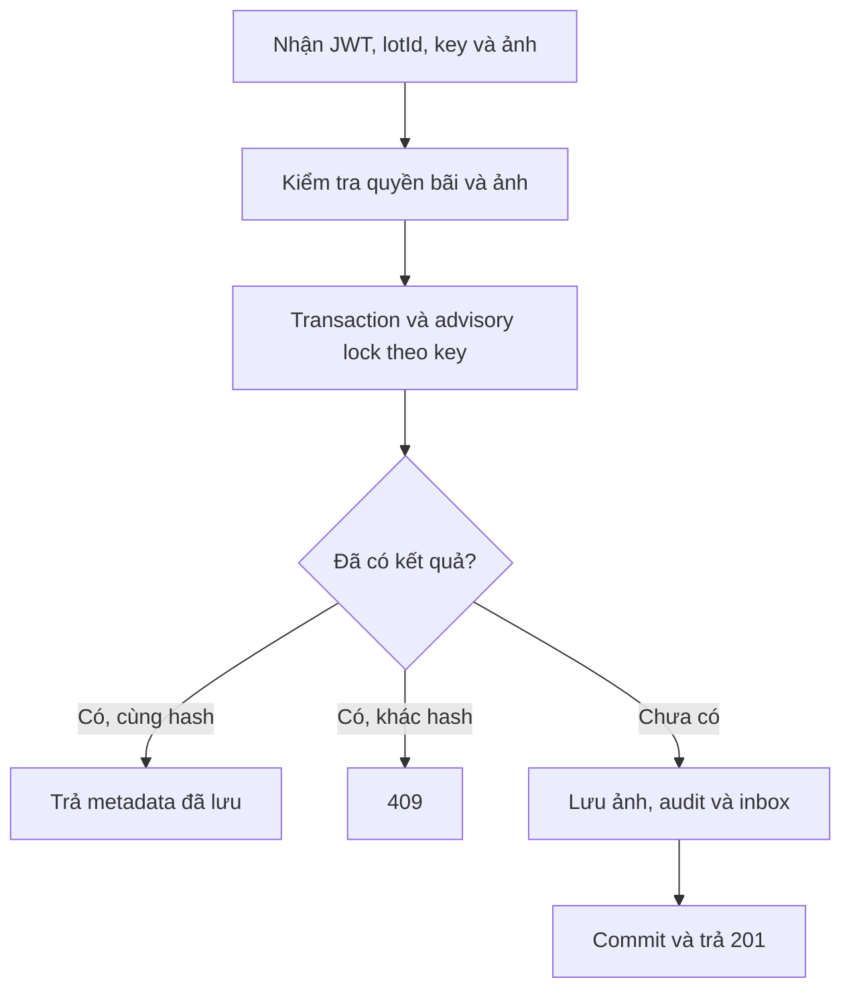
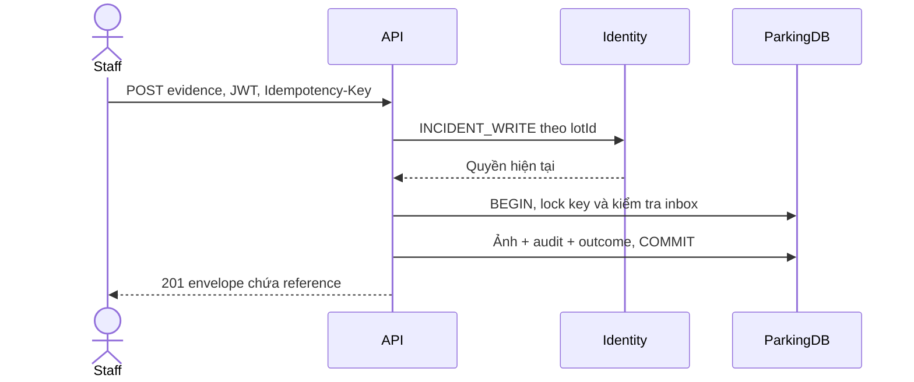
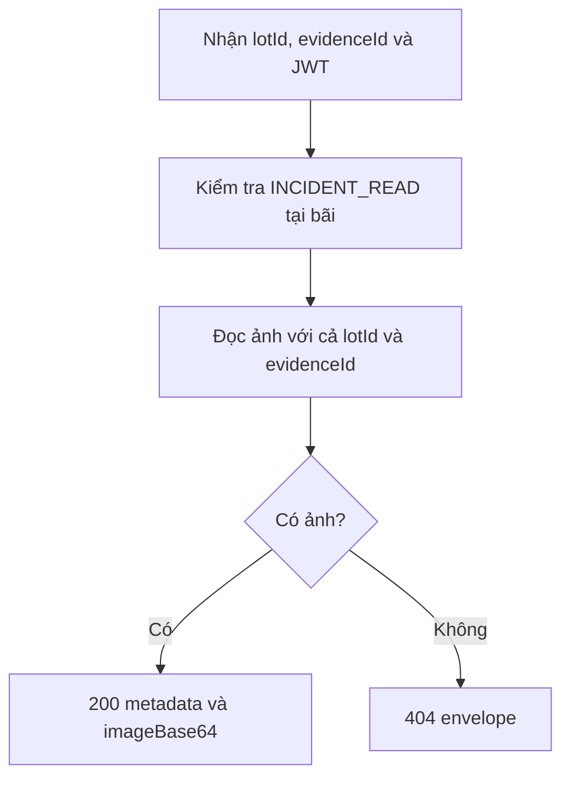
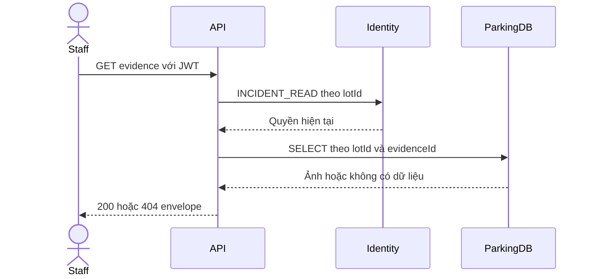

# Ảnh chứng cứ theo bãi và contract ghi dữ liệu

Parking lưu ảnh chứng cứ riêng trong PostgreSQL để giữ reference bền vững qua các lần khởi động. Actor lấy từ JWT. Quyền được kiểm tra với Identity theo bãi tại thời điểm gọi API. Ảnh PNG/JPEG tối đa 4 MiB, kiểm tra MIME và chữ ký nhị phân. Response dùng envelope chuẩn.

## POST /api/v1/parking-lots/{lotId}/evidence

Staff/Manager cần quyền INCIDENT_WRITE tại bãi. Header Idempotency-Key bắt buộc, một giá trị dài 1–128 ký tự. Cùng key/nội dung trả lại cùng metadata, khác nội dung trả 409.

```json
{"contentType":"image/png","imageBase64":"<base64 của file PNG>"}
```

Response 201.

```json
{
  "result": {
    "evidenceId":"aaaaaaaa-aaaa-4aaa-8aaa-aaaaaaaaaaaa",
    "lotId":"11111111-1111-4111-8111-111111111111",
    "contentType":"image/png",
    "reference":"parking-evidence:aaaaaaaa-aaaa-4aaa-8aaa-aaaaaaaaaaaa",
    "sha256":"<64 ký tự hex>",
    "sizeBytes":68,
    "createdAt":"2026-11-12T12:00:00Z"
  },
  "isSuccess":true,"statusCode":201,"message":"Evidence image saved."
}
```

Dùng result.reference trong evidence[].reference của check-in/incident/decision. Parking đối chiếu các reference parking-evidence với ảnh thuộc cùng bãi. Các reference ảnh bên ngoài đã được hỗ trợ vẫn dùng quy tắc kiểm tra reference hiện có.

400 cho thiếu/sai key, base64/MIME/chữ ký không hợp lệ hoặc ảnh quá lớn. 401 khi thiếu JWT, 403 khi không có quyền bãi, 404 khi bãi không tồn tại, 409 khi tái sử dụng key cho nội dung khác, 503 khi database/Identity không sẵn sàng.





## GET /api/v1/parking-lots/{lotId}/evidence/{evidenceId}

Staff/Manager cần quyền INCIDENT_READ tại bãi. Không có request body. Response 200 chứa metadata như trên và imageBase64 để FE dựng preview.

```json
{
  "result":{"metadata":{"evidenceId":"aaaaaaaa-aaaa-4aaa-8aaa-aaaaaaaaaaaa","lotId":"11111111-1111-4111-8111-111111111111","contentType":"image/png","reference":"parking-evidence:aaaaaaaa-aaaa-4aaa-8aaa-aaaaaaaaaaaa","sha256":"<64 ký tự hex>","sizeBytes":68,"createdAt":"2026-11-12T12:00:00Z"},"imageBase64":"<base64 ảnh>"},
  "isSuccess":true,"statusCode":200,"message":"Evidence image retrieved."
}
```

401/403 áp dụng như POST. 404 khi ảnh không có trong bãi được yêu cầu, 503 khi phụ thuộc chưa sẵn sàng.





## Mã lỗi và key ở API ghi dữ liệu

Envelope bổ sung errorCode khi có mã lỗi. Các trường result/isSuccess/statusCode/message tiếp tục giữ contract hiện có.

```json
{"result":null,"isSuccess":false,"statusCode":409,"message":"Observed plate does not match the booked vehicle. Staff override required.","errorCode":"PLATE_MISMATCH"}
```

POST/PATCH của incidents và shift-handovers bắt buộc Idempotency-Key. Thiếu key trả 400 với errorCode IDEMPOTENCY_KEY_REQUIRED. Key rỗng, quá 128 ký tự hoặc nhiều giá trị trả 400. API đọc tiếp tục dùng quyền hiện tại theo bãi. Các overload repository nội bộ hiện có tiếp tục hỗ trợ caller cũ.
